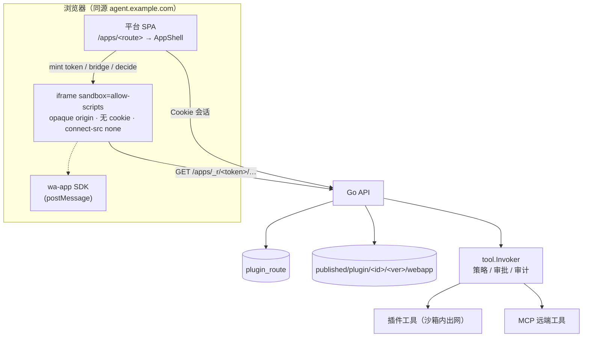

# Web 应用：空间内开发、预览与上线

> 状态：**设计稿（未实施）**。评审通过后并入 `docs/技术方案.md` §16、更新 `AGENTS.md` 与 `docs/插件体系设计.md`。
> 关联：`docs/插件体系设计.md`（清单 / 生命周期 / 权限 / 审计）、`docs/Agent 开发的应用类插件思考.md`（纯前端应用走平台代理）、`docs/插件安全基线.md`（发布扫描）、`docs/前端设计规范.md`（预览与发布界面的 token 与四态）。

---

## 0. 结论

**新增第 7 类插件 `kind=webapp`：产物是一组静态文件（HTML/CSS/ESM），在空间的草稿目录里开发，在平台的同源页面里预览，发布后在平台域名下绑定一条 `/apps/<route>` 路径上线。**

五个关键决策：

| # | 决策 | 理由（一句话） |
|---|---|---|
| D1 | **不用 `component` 承载 web 应用**，新增 `webapp` | 组件是声明式 DSL、前端原生渲染、主动排除了任意 HTML/JS；web 应用就是要写代码，两者隔离模型相反，混在一起会把组件的 XSS 承诺一起打破 |
| D2 | **`/apps/<route>` 不是应用文档本身，而是平台外壳（shell）+ 沙箱 iframe** | 应用文档必须是不透明源（opaque origin）才拿不到平台 cookie/localStorage；顶层直接加载就没有父窗口可回传数据 |
| D3 | **应用零出网**：`connect-src 'none'`，所有数据经 `postMessage` → shell → 平台 bridge → `Invoker` | 「只能调工具/MCP」不能只写在 skill 里，必须由浏览器策略与后端校验两条硬门禁保证 |
| D4 | **数据源仍然是 `data_sources`**，指向同空间已安装的工具/MCP 插件，服务端按**部署版本的清单快照**校验 | 与组件同一套语义、同一条 `Invoker` 链路（策略/审批/审计）；按快照校验，避免改草稿就能给线上应用加权限 |
| D5 | **开发闭环不需要发布**：草稿预览只要空间 `write`；上线（绑路径）要空间 `manage` | 发布权与「进市场」解耦：webapp 首版不进市场、不可被其他空间安装，就不是供应链问题；路径是部署资源，归空间管理员 |

与现有约定不冲突的说明见 §2.9（尤其「发布只认系统管理员」的适用边界）。

---

## 1. 产品方案

### 1.1 用户旅程

```text
A. 提需求            B. Agent 生成              C. 预览自测            D. 发布上线            E. 使用
「做一个本周工单看板」 → 写 plugin.json +        → 空间页「预览」        → 指定 /apps/ticket-      → 同事打开
                        webapp/index.html 等      （自动刷新 / 手机宽）    board 上线            /apps/ticket-board
```

| 阶段 | 入口 | 门槛 | 产物 |
|---|---|---|---|
| 生成 | 会话里对 Agent 说需求（自动挂 `builtin_webapp` 技能） | 空间 `write` | `spaces/{id}/files/plugins/{slug}/` 下的 `plugin.json` + `webapp/` |
| 预览 | 空间页 →「应用」区块 → 卡片「预览」；或会话里的应用卡片 | 空间 `write` | 临时 token，15 分钟有效，不产生版本 |
| 发布版本 | 卡片「发布」→ 生成不可变快照 | 空间 `manage` | `plugin` + `plugin_version` |
| 上线 | 发布弹窗内填写路径 `/apps/<route>` | 空间 `manage` | `plugin_route` 一条 live 记录 |
| 访问 | 直接打开 `/apps/<route>` | 空间 `read`（未登录先登录） | 外壳 + 应用 |
| 迭代 | 改文件 → 预览 →「更新上线」（新版本 + 切路径指向） | 同上 | 旧版本保留，可回滚 |
| 下线 | 卡片「下线」 | 空间 `manage` | 路径立即失效，释放占用 |

### 1.2 概念

| 名词 | 含义 |
|---|---|
| Web 应用 | `kind=webapp` 的插件，一个空间内的一条记录；产物是静态文件 |
| 草稿 | `files/plugins/<slug>/webapp/`，Agent 可改，随时预览，不对外 |
| 版本 | 发布产生不可变快照 `published/plugin/<plugin_id>/<version>/`，含清单与 `webapp/` |
| 路径（route） | 全局唯一的 `apps/<slug>`，一个应用同时只占一条；**路径 → (空间, 应用, 版本)** |
| 预览会话 | 一次预览用的短期 token，绑定草稿目录 |
| 运行时会话 | 一次线上访问用的短期 token，绑定 route 与具体版本 |
| 数据源 | `plugin.json` 的 `data_sources`，应用唯一能拿数据的方式 |

### 1.3 预览

**位置**：空间页右侧面板新增「应用」区块（与本地/已安装插件、智能体同级）。卡片显示：名称、路径（未上线显示「未上线」）、版本、最近变更时间、状态徽标（草稿有改动 / 已发布未上线 / 在线 / 已下线）。

**预览弹窗**：

- 内容区用沙箱 iframe 铺满，宽度可切 `375 / 768 / 100%`（按设计规范用 `--wa-space-*` 与 `--wa-radius-10` 的容器）。
- 顶栏：应用名 · 路径 ·「草稿未发布」徽标 · 刷新按钮 · 自动刷新开关（默认开）·「发布」主按钮。
- 自动刷新：前端每 3 秒取一次草稿签名（文件名 + 大小 + 修改时间），变化后整帧重载并保留滚动位置提示；顶栏显示「已更新，正在重新加载」。
- 空态：没有 `webapp/index.html` 时，不显示空白 iframe，而是给出一段可直接发送的示例提示词（「做一个……，数据用 xxx 工具」）与技能说明。
- 失败态：子资源缺失、禁止 API 命中、数据源未安装，都在顶栏下方以折叠面板列出（不塞进 iframe —— 应用自身报错应用自己展示）。
- 若同时有会话在改这个应用，预览顶部提示「Agent 正在修改，内容可能不完整」。

**不产生版本、不触发发布扫描**：预览就是本地开发服务器，权限只有空间 `write`。同一空间内其他成员即使有 `read` 也看不到别人的草稿预览（草稿本来就是空间内容，`read` 能读文件，但预览 token 只发给 `write`）。

### 1.4 发布与上线

一次「发布」= 生成版本 + 绑定路径，弹窗一屏完成，但也允许**只发版、不上线**（例如先给管理员看）。

**表单字段**：

| 字段 | 说明 |
|---|---|
| 版本号 | 自动 `patch+1`，只读（与插件发布同一规则） |
| 路径 | 前缀 `/apps/` 固定；输入段名，`^[a-z][a-z0-9-]{1,30}$`；失焦即校验占用，冲突时给出 `-2` 建议 |
| 访问范围 | 首版唯一选项「本空间成员（含 view 及以上）」，置灰并说明「对外公开需组织管理员开通」 |
| 依赖清单 | 只读，来自 `data_sources`：工具名 · 读/写徽标 · 风险徽标（只读 / 查询 / 写入 / 高危） |
| 自检结果 | 文件数 / 体积 / 禁止 API / 外部引用 / 缺失资源，错误项阻塞发布，警告项可确认继续 |
| 主按钮 | 「发布并上线」（未填路径则为「仅发布版本」） |

**校验与冲突**：

- 路径已被其他应用占用 → 内联错误「/apps/ticket-board 已被「工单看板」占用」。
- 路径在黑名单（`_r` / `_p` / `_sdk` / `login` / `admin` / `market`）→ 内联错误。
- 依赖的数据源缺插件/未安装 → 阻断，附「去安装」链接。
- 内容与上一版完全一致 → 提示「内容无变化，可直接重试上线」并禁用发布按钮。

**上线后的能力**：复制链接、在新窗口打开、查看历史版本（列表 + 回滚）、下线（二次确认，写明「路径将立即失效并被释放」）。

**权限**：

| 动作 | 门槛 |
|---|---|
| 生成 / 改文件 / 预览 / 自检 | 空间 `write` |
| 发布版本 / 上线 / 回滚 / 下线 | 空间 `manage` |
| 强制下线、回收路径、改路径归属 | 系统管理员（后台操作，写审计） |
| 删除应用 | 空间 `manage`；有 live 路由时要求先下线 |

> 与「发布只认系统管理员」的关系：那条约束的对象是**进入插件市场、可被其他空间安装**的产物（跨空间供应链）。webapp 首版不进市场、不进 `plugin_search`、不能跨空间安装，只影响本空间的一条路径，因此按部署处理。若将来支持分发，改为「系统管理员发布版本 + 空间安装 + 空间绑路径」，本节权限随之回退。

### 1.5 访问体验

`https://agent.example.com/apps/ticket-board`：

1. 未登录 → 跳 `/login?next=/apps/ticket-board`，登录后回到原路径。
2. 已登录但非空间成员 → 403 页面（说明属于哪个空间、找谁申请），**不泄露应用名以外的内容**。
3. 正常 → 外壳：顶部 48px 应用条（空间名 · 应用名 · 版本· 更新时间 · 全屏 · 打开原链接 · 反馈），下方 iframe 铺满剩余视口。
4. 路径不存在 / 已下线 → 404 页面「应用不存在或已下线」+ 返回工作台。

外壳是平台自己的 React 页面，因此可以正大光明地告诉浏览者「这是平台内某空间发布的应用」——这是共享域名下最重要的一条钓鱼缓解。

### 1.6 状态与文案

| 场景 | 表现 |
|---|---|
| 加载 | 骨架：应用条骨架 + 内容区居中 `Spin` + 「正在加载应用」 |
| 空 | 预览无入口文件 → 示例提示词卡片；应用列表为空 → 「还没有 Web 应用，告诉 Agent 你想做什么」+ 示例 |
| 失败 | token 过期 → 自动重新领取并重载一次，仍失败显示「应用加载失败，请刷新」+ 刷新按钮；版本已回滚 → 自动跟随新版本；应用已下线 → 404 |
| 数据源报错 | 应用内自行展示（SDK 返回结构化错误），外壳不接管 |

### 1.7 权限矩阵

| 主体 | 读应用列表 | 预览 | 发布/上线 | 访问线上 | 强制下线 |
|---|---|---|---|---|---|
| 空间 `view` | ✓ | ✗ | ✗ | ✓ | ✗ |
| 空间 `read` | ✓ | ✗ | ✗ | ✓ | ✗ |
| 空间 `write` | ✓ | ✓（草稿） | ✗ | ✓ | ✗ |
| 空间 `manage` | ✓ | ✓ | ✓ | ✓ | ✗ |
| 系统管理员 | ✓ | ✓ | ✓ | ✓ | ✓ |

---

## 2. 技术方案

### 2.1 总体架构



三条链路互不越界：

1. **静态链路**：iframe 取 HTML/JS/CSS，只认 token，无 cookie，无出网。
2. **数据链路**：iframe → postMessage → shell → `POST /apps/{route}/data`（带 cookie）→ `Invoker` → 工具/MCP。
3. **控制链路**：空间页 / 发布弹窗 / 应用条，全部走平台自己的接口与设计系统。

### 2.2 产物契约

```text
spaces/{space_id}/files/plugins/{slug}/
  plugin.json                 # 唯一清单（kind=webapp）
  webapp/
    index.html                # 入口，默认 webapp/index.html
    app.js / style.css / assets/*
```

```jsonc
{
  "protocol": "wa-plugin/1",
  "kind": "webapp",
  "slug": "ticket_board",
  "name": "工单看板",
  "description": "按状态与负责人查看本周工单，需要看工单进度时使用",
  "webapp": { "entry": "webapp/index.html" },
  "data_sources": [
    { "id": "tickets", "label": "本周工单", "plugin": "crm", "tool": "ticket_list", "mode": "read" },
    { "id": "assign", "label": "转派工单", "plugin": "crm", "tool": "ticket_assign",
      "mode": "action", "confirm": "确认把该工单转派给此人？" }
  ]
}
```

规则：

- `kind=webapp` **不允许** `capabilities` / `fs` / `runtime` / `secret`（应用自己不执行任何外部动作，能力全部落在数据源上；写了直接解析失败）。风险等级由 `data_sources` 推导：含 `mode=action` → L3「写入」，只有 read → L2「查询」，无数据源 → L1「只读」。
- 相对路径**强制**：`src` / `href` / `import` 只允许相对路径（`./`、`../`）或平台 SDK 的 `/wa-app/v1.js`。绝对路径 `/assets/x.js` 在 token 路径下会 404，发布自检直接报错。
- 只允许静态扩展名（§2.5.4），不允许 `wasm`、不允许 `node_modules`、不允许构建产物以外的中间文件。
- 体积上限对 webapp 放宽到 **500 文件 / 20MB**（单文件 2MB），其余 kind 维持 200 / 5MB。

### 2.3 隔离模型

**结论：应用文档运行在不透明源里，不能读平台 cookie、不能访问父窗口 DOM、不能发任何网络请求。**

| 层 | 手段 | 拦住的攻击 |
|---|---|---|
| L1 文档隔离 | `<iframe sandbox="allow-scripts">`（**不加** `allow-same-origin` / `allow-top-navigation` / `allow-popups` / `allow-forms`）+ 响应头 `CSP: sandbox allow-scripts` | 读平台 cookie / localStorage、拿父窗口 DOM、顶栏跳转钓鱼、表单外发 |
| L2 网络隔离 | `default-src 'none'`；`connect-src 'none'`；`form-action 'none'`；`worker-src 'none'`；`frame-src 'none'` | fetch/XHR/WebSocket/EventSource/sendBeacon/Worker/表单 POST —— 一条都不通 |
| L3 数据鉴权 | 所有数据只能经 shell 调 bridge；bridge 用**浏览者的身份**过 `Invoker`（空间成员校验 + 插件策略 + 审批 + 审计） | 越权读别人的数据、绕过审批做写操作 |
| L4 发布门禁 | 自检（禁止 API / 外部引用 / 绝对路径 / 硬编码凭证）+ 发布扫描 | 把 `fetch` 藏在压缩代码里、引 CDN 脚本、写死 token |

两个必须解释的问题：

**为什么不能顶层直接跑应用 HTML？** 顶层文档没有父窗口，`postMessage` 无处可去；若为了拿数据放开 `connect-src` 或改用 cookie，应用就和平台同源了——一份有 bug 或恶意的 JS 可以读 `localStorage`、发平台接口请求（带 cookie，`SameSite=Lax` 对同源请求完全放行），这等于把整个平台的鉴权面交给用户代码。共享域名下这条不能开口子。

**为什么这不推翻「组件不用 iframe」的结论？** 组件是**平台渲染的声明式 DSL**，没有可执行内容，所以不需要隔离；web 应用是**用户编写的可执行代码**，隔离是前提。两者是两类插件，走两条渲染路径，互不影响（`internal/plugin/dsl.go` 的前提不变）。

### 2.4 数据通道

#### 2.4.1 SDK（`/wa-app/v1.js`，随前端产物发布）

```html
<script src="/wa-app/v1.js"></script>
<script>
  wa.ready({ title: '工单看板' });
  const rows = await wa.call('tickets', { status: 'open', limit: 50 });
  btn.onclick = async () => {
    await wa.action('assign', { ticket_id: id, assignee: 'zhangsan' });
  };
</script>
```

| API | 说明 |
|---|---|
| `wa.ready(meta)` | 通知外壳进入可交互态（外壳用它撤加载态） |
| `wa.call(source, params)` | 只读数据源，返回 `any`（JSON） |
| `wa.action(source, params)` | 写数据源；必须发生在用户手势里（`navigator.userActivation.isActive`），外壳弹平台确认卡后才执行 |
| `wa.theme()` / `wa.on('theme')` | 跟随平台明暗主题 |
| `wa.open(url)` | 外链在新标签打开（外壳二次确认，只放行 http/https） |
| `wa.user()` | `{ name, avatar }`（最小化，不含工号/邮箱等可枚举字段） |
| `wa.storage.get/set` | 64KB 键值（不透明源没有 localStorage，由外壳代持） |

#### 2.4.2 消息协议

```jsonc
// iframe → shell
{ "v": 1, "type": "wa.ready",  "meta": { "title": "工单看板" } }
{ "v": 1, "type": "wa.call",   "id": "c1", "source": "tickets", "params": {...} }
{ "v": 1, "type": "wa.action", "id": "c2", "source": "assign",  "params": {...} }
{ "v": 1, "type": "wa.open",   "url": "https://…" }

// shell → iframe
{ "v": 1, "type": "wa.result", "id": "c1", "ok": true,  "data": {...} }
{ "v": 1, "type": "wa.result", "id": "c1", "ok": false, "error": { "code": "forbidden", "message": "…" } }
{ "v": 1, "type": "wa.event",  "name": "theme", "payload": "dark" }
```

外壳侧校验（缺一不可）：`event.source === frame.contentWindow`、`event.origin === 'null'`、`v === 1`、`type` 在白名单、`params` 序列化后 ≤ 64KB、未知 `source` 直接拒（不便宜行事地转发给后端）。iframe 侧校验 `event.source === window.parent`。

#### 2.4.3 bridge

- 线上：`POST /apps/{route}/data`（cookie 会话）。服务端按 `plugin_route` 查 (space, plugin, version)，**用该版本的清单快照**校验 `source`，再取依赖插件快照里的工具，走 `Invoker`。
- 预览：`POST /spaces/{id}/apps/{slug}/preview/data`（空间 `write`），用草稿清单校验。
- 参数合并、工具寻址、`mode=action` 必须 `gesture=true`、结果截断：与 `Manager.Data` 完全复用（抽出 `invokeSource`，两条路径共用，避免组件与应用语义漂移）。
- 读取权限 `read`/`view` 的浏览者一律置 `gesture=false`（同 `handler.data` 的现有防御）。

#### 2.4.4 审批

现有 `Manager.Data` 调 `Invoker` 时没装配 `Approvals`，所以一旦某工具命中审批（安装档位 `always`、MCP 声明了 `writes`、shell 命中名单），组件里的点击会被静默拒绝成「审批通道未配置」。web 应用把这个坑放大成主路径，所以首版一起补齐，且**组件复用同一套**：

```text
bridge → Invoker → 需要审批
      ← 202 { approval: { id, tool, risk, detail, expire_at } }
shell 弹平台确认卡（工具名 / 参数摘要 / 风险徽标 / 「本页内都同意」）
      → POST /ui-approvals/{id}/decide { allow: true }
shell 带 X-WA-Approval: <id> 重试同一请求
服务端校验 (actor, args_hash, expire, 状态=approved) 后执行，落 audit
```

新表 `ui_approval`（不进 `approval` 表：那张表 `session_id` / `run_id` 非空，绑定的是会话轮次，语义不同）。超时 5 分钟按拒绝；「本页内都同意」只对当前页面会话的 `action_key` 生效，刷新即失效。

### 2.5 路由与静态服务

#### 2.5.1 路径规划

| 路径 | 归谁 | 说明 |
|---|---|---|
| `GET /apps/{route}` | 前端 SPA | 外壳页，nginx 回退 `index.html` |
| `GET /apps/{route}/…` | 前端 SPA | 外壳内的客户端路由（预留） |
| `GET /apps/_p/{token}/{path…}` | 后端 | 预览静态资源 |
| `GET /apps/_r/{token}/{path…}` | 后端 | 线上静态资源 |
| `GET /apps/routes/{route}` | 后端 | 路径占用检查（发布弹窗） |
| `POST /apps/{route}/data` | 后端 | 线上 bridge |
| `GET /wa-app/v1.js` | 前端静态 | SDK（长缓存，版本化） |

`_p` / `_r` / `_sdk` 为保留段，用户不可用；路径统一存成不带前导斜杠的 `apps/<slug>`。

#### 2.5.2 token

`HMAC-SHA256`（密钥 `APP_RUNTIME_SECRET`，未配置时启动失败而不是退化成随机密钥——多实例下随机密钥会让 token 随机失效）：

```jsonc
{ "s": "<space_id>", "p": "<plugin_id>", "k": "draft" | "pub",
  "v": "<version>", "r": "apps/ticket-board", "u": "<user_id>", "e": 1730000000 }
```

- 预览 TTL 15 分钟，线上 30 分钟；外壳在 401/token 过期时自动重领并重载一次。
- token 出现在 URL 里 → 所有响应带 `Referrer-Policy: no-referrer`，且不可撤销地绑定版本：服务端每次请求都复核 `plugin_route` 仍 live 且 `version` 一致，否则 `410`（回滚/下线立即生效，不靠 TTL）。
- 线上 token 的发放要过空间 `read`；预览 token 要过空间 `write`。

#### 2.5.3 服务端响应约束

```http
Content-Type: text/html; charset=utf-8
X-Content-Type-Options: nosniff
Referrer-Policy: no-referrer
Cross-Origin-Resource-Policy: cross-origin      # 不透明源的子资源请求必须放行
Cache-Control: no-store                          # HTML 与预览资源
Cache-Control: private, max-age=300              # 线上静态资源（按 token URL 缓存）
Content-Security-Policy:
  sandbox allow-scripts;
  default-src 'none';
  script-src 'unsafe-inline' 'unsafe-eval' https://agent.example.com;
  style-src 'unsafe-inline' https://agent.example.com;
  img-src https://agent.example.com data: blob:;
  font-src https://agent.example.com data:;
  media-src https://agent.example.com data:;
  connect-src 'none'; frame-src 'none'; worker-src 'none';
  form-action 'none'; base-uri 'none'; object-src 'none';
  frame-ancestors 'self'
```

- `script-src` 用主机源而不是 nonce：nonce 会让 `'unsafe-inline'` 失效，应用里的内联脚本会被一并拦掉；主机源只放过平台域名（其余平台接口都要鉴权，脚本标签拿不到数据）。
- 不做 gzip 之外的任何重写，只在 `</head>` 前注入 `<script src="/wa-app/v1.js"></script>`（无 `</head>` 时插到开头）。注入是确定性的、可单测的，不让 Agent 记「记得引 SDK」这种易漏的事。

#### 2.5.4 路径与 MIME 校验

`path.Clean` 后：拒绝 `..`、绝对路径、反斜杠、`%2e`、NUL、长度 > 256；拼接后必须仍在应用根目录前缀内；拒绝任何以 `.` 开头的段（`.env` / `.git` 不可下载）。

MIME 白名单（其余一律 404，不靠系统探测）：`html htm css js mjs json svg png jpg jpeg webp gif ico woff2 woff ttf txt md map`。

SPA fallback：路径无扩展名且 `Accept` 含 `text/html` 时回退入口 HTML（应用长这样也能用），其余 404——避免把 HTML 当 JS 返回导致的诡异报错。

### 2.6 数据模型（`0032_webapp.sql`）

```sql
-- 路径 → 版本。一个应用同时只占一条路径；下线即释放（历史看 audit_log）。
create table if not exists plugin_route (
    route        text primary key
                 check (route ~ '^apps/[a-z][a-z0-9-]{1,30}$'),
    space_id     uuid not null references space(id) on delete cascade,
    plugin_id    text not null references plugin(id) on delete cascade,
    version      text not null,
    status       text not null default 'live' check (status in ('live','offline')),
    deployed_by  uuid not null,
    deployed_at  timestamptz not null default now(),
    updated_at   timestamptz not null default now(),
    unique (plugin_id)
);
create index if not exists plugin_route_space_idx on plugin_route (space_id);

-- 界面触发的确认（组件与应用共用；与会话轮次的 approval 表分开）
create table if not exists ui_approval (
    id          text primary key,
    space_id    uuid not null references space(id) on delete cascade,
    subject_kind text not null check (subject_kind in ('webapp','component')),
    subject_id  text not null,
    actor_id    uuid not null,
    tool        text not null,
    action_key  text not null,
    args_hash   text not null,
    detail      text not null default '',
    risk        int  not null default 0,
    status      text not null default 'pending'
                check (status in ('pending','approved','denied','expired','consumed')),
    expire_at   timestamptz not null,
    created_at  timestamptz not null default now(),
    decided_at  timestamptz
);
create index if not exists ui_approval_pending_idx
    on ui_approval (subject_kind, subject_id, created_at) where status = 'pending';
```

不新增应用表：应用就是 `plugin`（`kind='webapp'`）+ `plugin_version` 快照；路由是独立的一层，因为它是**部署资源**（全局唯一），而插件记录是**内容资源**。

### 2.7 接口契约

| 方法 | 路径 | 权限 | 说明 |
|---|---|---|---|
| GET | `/spaces/{id}/apps` | read | 列表：slug、名称、路径、状态、版本、草稿签名、最近变更 |
| GET | `/spaces/{id}/apps/{slug}` | read | 详情 + 最近一次自检结果 + 版本历史 |
| POST | `/spaces/{id}/apps/{slug}/check` | write | 跑门禁，返回 `{errors,warnings,stats}` |
| POST | `/spaces/{id}/apps/{slug}/preview/session` | write | 领预览 token `{url,expires_at}` |
| GET | `/spaces/{id}/apps/{slug}/preview/meta` | write | 草稿签名（3s 轮询）+ 校验摘要 |
| POST | `/spaces/{id}/apps/{slug}/preview/data` | write | 预览 bridge |
| POST | `/spaces/{id}/apps/{slug}/publish` | manage | 生成不可变版本（内容未变则 409） |
| POST | `/spaces/{id}/apps/{slug}/deploy` | manage | body `{route, version?}`；默认最新版 |
| POST | `/spaces/{id}/apps/{slug}/rollback` | manage | body `{version}`；等价 deploy 到旧版本 |
| POST | `/spaces/{id}/apps/{slug}/offline` | manage | 下线并释放路径 |
| DELETE | `/spaces/{id}/apps/{slug}` | manage | 删除草稿与版本；有 live 路由先下线 |
| GET | `/apps/routes/{route}` | 登录 | `{available, owner?}` |
| GET | `/apps/{route}` | 登录 + read | 外壳元数据 `{name, space:{id,name}, version, updated_at, entry_ok}` |
| POST | `/apps/{route}/session` | 登录 + read | 领运行 token `{url,expires_at,version}` |
| POST | `/apps/{route}/data` | 登录 + read | 线上 bridge；可回 `202 approval` |
| POST | `/ui-approvals/{id}/decide` | 本人 | body `{allow}` |
| GET | `/apps/_p/{token}/{path…}` `GET /apps/_r/{token}/{path…}` | token | 静态资源（HEAD 支持） |

错误码沿用 `platform.WriteError`：`bad_request` / `unauthorized` / `forbidden` / `not_found` / `conflict` / `gone`（版本已下线）/ `too_large`（请求超限）/ `rate_limited`。

bridge 成功响应统一 `{"data": <any>}`：工具返回的 `Content` 能解析成 JSON 就返回对象，否则返回 `{"text": "..."}`——不给调用方两种形状之外的选择，避免「有时对象有时字符串」。

### 2.8 门禁与校验

`check` 同时用于预览前提示、发布前阻断、`publish` 内部复核（不信客户端）。

| 检查 | 级别 | 判据 |
|---|---|---|
| 入口存在 | error | `webapp.entry` 指向打包内文件 |
| 扩展名白名单 | error | 出现其他扩展名 |
| 单文件 / 总量 / 文件数 | error | > 2MB / > 20MB / > 500 |
| 禁止的网络 API | error | `fetch(`、`XMLHttpRequest`、`WebSocket`、`EventSource`、`sendBeacon`、`importScripts`、`new Worker`、`navigator.serviceWorker` |
| 外部引用 | error | `src` / `href` / `import` / `url(` 命中 `http://` `https://` `//`（SDK 自身除外） |
| 绝对路径引用 | error | 以 `/` 开头且不是 `/wa-app/` |
| 硬编码凭证 | error | `Bearer ` / `api_key` / `secret` / 长随机串 + 「token」同行 |
| `eval` / `new Function` | warn | 允许但不推荐（已开 `unsafe-eval`，留给打包产物） |
| `localStorage` / `sessionStorage` | warn | 不透明源会抛异常，引导用 `wa.storage` |
| 缺 `viewport` / `lang` / `<title>` | warn | 可访问性与移动端 |

静态扫描是**提前失败**，不是安全边界；真正的边界是 §2.3 的浏览器策略。这句话要写进 skill，避免有人以为「扫过就是安全」。

### 2.9 生命周期与插件体系的关系

| 维度 | 处理 |
|---|---|
| 清单 | 共用 `plugin.json`、共用 `Derive`（webapp 只由 `data_sources` 推导：action → L3，read → L2，无 → L1） |
| 草稿 / 快照 | 共用 `plugins/<slug>/` 与 `published/plugin/<id>/<ver>/`，共用体积校验（webapp 单独放宽） |
| 市场 | **不进**（catalog 过滤 `kind=webapp`），不可被其他空间安装 |
| 检索 | **不进** `plugin_search`（它不是能力，是界面） |
| 停用 / 卸载 | webapp 没有 `plugin_install`；「下线」释放路径，「删除」清草稿与版本 |
| 审计 | `webapp.publish` / `deploy` / `rollback` / `offline` / `delete` / `data.action` / `ui_approval.decide` 全写 `audit_log` |
| 系统空间 | 系统空间的应用路径同样受全局唯一约束；内置示例应用可作为 `origin=system` 发到系统空间，但**不进其他空间的列表**（只作为模板） |
| 缓存 | 路径解析结果按 route 缓存 10s（下线/回滚要立刻生效，缓存只用于静态资源热路径，命中后再校验 version） |

### 2.10 部署改动

| 位置 | 改动 |
|---|---|
| `internal/app/app.go` | 注册 `appH`（新 handler） |
| `web/vite.config.ts` | 代理前缀加 `/apps/_p`、`/apps/_r`、`/apps/routes`、`/apps/*/data`、`/ui-approvals`（注意不能用 `/apps` 整段，`/apps/<route>` 必须留给 SPA） |
| Nginx | `location ^~ /apps/_p/`、`^~ /apps/_r/`、`^~ /apps/routes/`、`= /apps/*/session`、`= /apps/*/data` → 后端；其余 `/apps/` 回退 SPA；`X-Forwarded-Proto` 必须透传（CSP 里的 host 由它决定） |
| `docs/技术方案.md` §10.2.2 | 路径表补上述行 + 「新增后端前缀必须同步反代」的提醒 |
| 配置 | `APP_RUNTIME_SECRET`（必填）、`WEBAPP_MAX_PER_SPACE`（默认 5）、`WEBAPP_PREVIEW_TTL`（15m）、`WEBAPP_RUNTIME_TTL`（30m） |

### 2.11 观测

- 指标：`webapp_asset_requests_total{scope,status}`、`webapp_bridge_calls_total{source,mode,status}`、`webapp_bridge_duration_seconds`、`webapp_deploy_total{action}`。
- 日志：asset 只在 4xx/5xx 记（否则流量噪声），bridge 每次都记 `space/app/source/tool/status/risk/actor`。
- 审计：发布/上线/回滚/下线/删除必须带「谁、什么时候、从哪个版本到哪个版本、路径」。

---

## 3. 安全分析与威胁模型

| 威胁 | 后果 | 缓解 | 残留 |
|---|---|---|---|
| 应用 JS 读平台会话 | 账号被接管 | 不透明源：无 cookie 读权、无 localStorage、跨源无父窗口 DOM | 无（这是整个方案的立身之本） |
| 应用直接打平台接口 | 借用户 cookie 越权 | token 路径不带 cookie；bridge 只接受清单声明过的 source 且用浏览器身份过策略 | 平台接口自身鉴权 |
| 应用打外部接口外传数据 | 数据泄露 | `connect-src 'none'` + 无表单 + 无 Worker | 图片/字体只允许平台域与 `data:` |
| 应用越权读数据 | 横向越权 | bridge 以浏览者身份执行，空间 `read` 起步；写操作再要手势 + 平台确认 + 工具策略 | 浏览者本身有权限的数据可见（符合预期） |
| 改草稿偷加权限 | 线上静默扩权 | 线上 bridge 按**版本快照**清单校验；预览按草稿但只对 `write` 成员可见 | 无 |
| token 泄露（URL/Referer/日志） | 拿到静态资源（非数据） | `Referrer-Policy: no-referrer`、TTL 15/30min、绑定版本、URL 不入日志（只记 route + scope） | 同版本静态资源可被持有者读取 |
| 共享域名钓鱼 | 用户以为官方页面 | 外壳常驻空间名与应用名、无边框无全屏仿冒（iframe 必在外壳内）、下线与举报入口、发布审计 | 应用内容本身无法自动判定恶意 |
| 命名抢占 / 混淆 | 抢 `apps/pay` 之类路径 | 名字黑名单、空间配额、系统管理员可强制回收、占用者与发布者在卡片与审计中可见 | 同空间内无冲突（DB 唯一 + 事务） |
| 资源耗尽 | 平台带宽/存储 | 体积上限、单文件上限、每用户 bridge 限流（读 120/min、写 20/min）、并发 5 | 无 |
| 路径穿越 | 读平台文件 | `Clean` + 前缀校验 + 隐藏段拦截 + 不跟随软链 | 无 |
| 供应链（CDN 脚本） | 注入任意代码 | CSP 只放平台域；扫描拦外部引用 | 打包进 `webapp/` 的第三方代码仍需人工 review（与脚本插件同级别） |

---

## 4. Web 应用开发 Skill（`builtin_webapp`）

技能正文（`SKILL.md`）+ 三份参考（`runtime-api.md` / `patterns.md` / `troubleshooting.md`），随内置技能 seed 发布到系统空间，`base` 智能体在「做页面 / 看板 / 小工具」时 `plugin_search` + `plugin_read` 载入。

**SKILL.md 必须写死的规则**（每条都与 §2 的执行点对齐，避免「文档说一套、系统跑一套」）：

1. 产物只有一个目录 `webapp/`，纯静态：HTML + CSS + 原生 ESM。**不要**生成 `package.json`、不要 Vite/Webpack、不要 `npm install`、不要 TypeScript（首版没有构建步骤）。
2. **所有数据只能来自 `data_sources`**：前端只允许 `wa.call(id, params)` / `wa.action(id, params)`。禁止 `fetch` / XHR / WebSocket / 第三方 SDK / 直连数据库 / 直连内部接口 / 把接口地址写进代码。
3. 需要新数据 → 先改 `plugin.json` 的 `data_sources`（指向本空间已安装的工具或 MCP 的某个远端工具），再改前端。工具不存在就先让用户装插件。
4. 写操作一律 `mode=action` + `confirm` 文案，必须由用户点击触发；读操作不得造成副作用。
5. 只用相对路径引用资源；不要引 CDN（CSP 会拦，发布自检直接报错）。
6. 不写死任何凭证、域名、工号白名单；身份用 `wa.user()`，持久化用 `wa.storage`。
7. 交付前自检：`POST .../check` 通过（errors 为空）；首屏、空态、错误态、加载态各有实现；375 宽度可用；键盘可操作（表格可聚焦、按钮有文案）。
8. 不要试图绕过隔离（不要 `window.parent.document`、不要 `document.domain`、不要顶层跳转）；这些是平台边界，不是 bug。
9. 交付话术：告诉用户「已生成，点预览自测；确认后发布到 `/apps/<建议路径>`」，不承诺未实现的能力（自定义域名、后端接口、登录体系）。

同时更新：

- `base/AGENT.md` 的三档分流里补一条「要做网页/看板/工具页 → 走 webapp 流程，先 `plugin_read` 技能」。
- 会话消息支持 ` ```app {"slug":"ticket_board"} ` 块，渲染成应用卡片（名称 + 路径 + 预览/发布按钮），与 `ui-block` 并列，由 `Markdown.tsx` 分发。
- `docs/插件体系设计.md` 的六类表格加第 7 行与「webapp 不进市场/不进检索」的说明。

---

## 5. 实施计划与验收

| 阶段 | 内容 | 验收 |
|---|---|---|
| P0-1 契约 | `kind=webapp` 解析与校验（禁 `capabilities`/`fs`/`runtime`）、`Derive` 分支、体积上限分支、`0032` 迁移 | 单测：非法清单逐条报错；`Derive` 三档正确 |
| P0-2 静态运行时 | token 签发/校验、`/apps/_p|_r` 服务、CSP/header、MIME、路径校验、SPA fallback | 单测：穿越、隐藏文件、错扩展名、过期/版本不匹配全拒；HTML 带完整 CSP |
| P0-3 bridge | `invokeSource` 抽取、线上/预览两个端点、`ui_approval` + 202 重试、限流 | 单测：未声明 source 拒、action 无手势拒、read 用户伪造手势被置 false、审批超时拒 |
| P0-4 预览 | 空间页「应用」区块、预览弹窗、草稿签名轮询、自检面板、空/错态 | 手工：Agent 生成 → 3s 内自动刷新；无入口时显示示例；缺插件时报出具体插件名 |
| P0-5 发布上线 | 发布弹窗、路径占用校验、deploy/rollback/offline、外壳页与 404/403 | 手工：发版→上线→打开→回滚→下线全链路；路径冲突有建议；未登录跳转后回原路径 |
| P0-6 门禁与技能 | `check` 规则、发布扫描接入、`builtin_webapp` 技能与参考、`app` 消息块 | 反例集：`fetch`/CDN/绝对路径/凭证各 1 例全部拦下；新会话按技能能一次产出可跑页面 |
| P0-7 部署与文档 | vite/nginx 前缀、`APP_RUNTIME_SECRET`、技术方案 §16、AGENTS 更新 | 本地 `make run` + `make web` 全流程；反代前缀漏配时有明确报错而不是白屏 |

端到端验收（不通过不发版）：

1. 在新空间对 Agent 说「做一个工单看板，数据用工单列表工具」→ 产出清单与 `webapp/`，预览可用、数据来自工具。
2. 前端改写 `fetch('/spaces/...')` → 预览里请求失败（CSP 阻断），`check` 报 error，发布被拦。
3. 发布到 `/apps/ticket-board` → 换一个只有 `read` 的账号打开可用；非成员 403；未登录跳登录后回到原路径。
4. 应用内点「转派」→ 平台确认卡 → 允许 → 远端生效并落审计；点拒绝 → 应用收到 `denied`。
5. 改草稿不发布 → 线上不变；回滚到 v1 → 已打开的页面刷新后跟随 v1。

---

## 6. 取舍与待确认项

| # | 事项 | 本方案 | 需要谁定 |
|---|---|---|---|
| 1 | webapp 是否可以自助上线（不等系统管理员） | 可以（空间 `manage`），前提是不进市场；管理员保留强制下线 | 产品 + 安全 |
| 2 | `/apps/<route>` 是否允许「组织内公开 / 匿名分享」 | 首版不支持。若做，必须明确「数据以谁的身份执行」——以发布者身份会越权，以匿名身份则等于无鉴权 | 产品 |
| 3 | 是否需要构建步骤（TS/JSX/打包） | 首版不需要；触发条件：出现「单文件 > 2MB」或「必须用 TS/组件库」的真实需求，届时用沙箱内 vendor 的 esbuild 产出 `webapp/dist`，门禁与 CSP 不变 | 技术 |
| 4 | 每空间应用配额 | 5 个，可配 | 产品 |
| 5 | 应用使用统计（PV / 调用量） | 首版只做指标与审计，不做页面 | 产品 |
| 6 | 组件是否同步享受 §2.4.4 的界面审批 | 是（同一实现），否则组件的 action 在命中审批时永远失败 | 技术 |

明确不做（本方案的非目标）：自定义域名、后端容器 / SSR、应用内独立登录体系、应用之间互调、应用市场分发、Git 工作流、CDN 同步、多环境（预发/灰度）。
