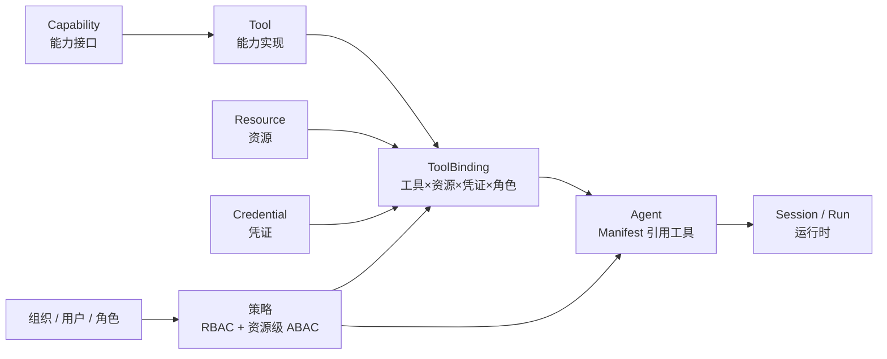
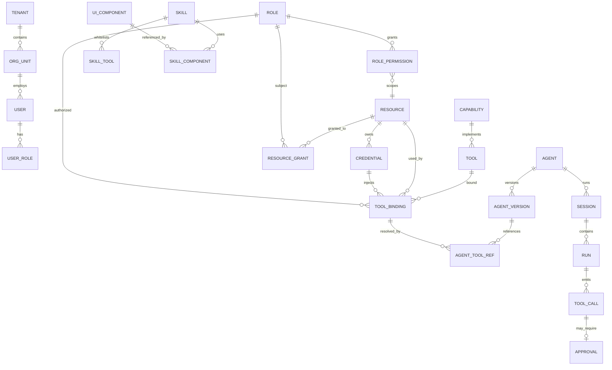
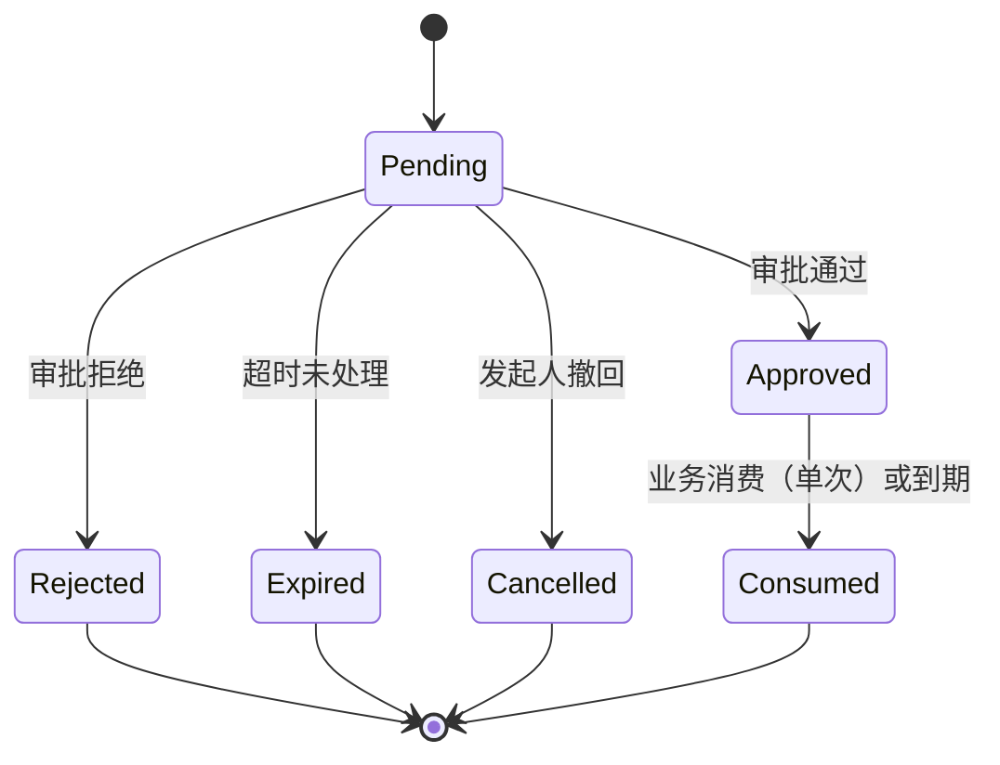
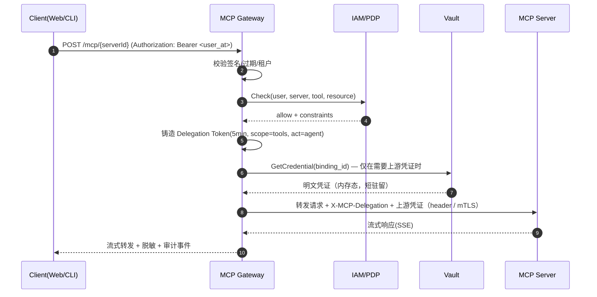
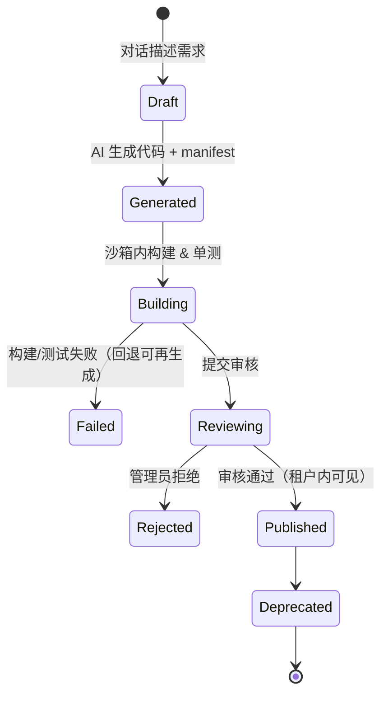
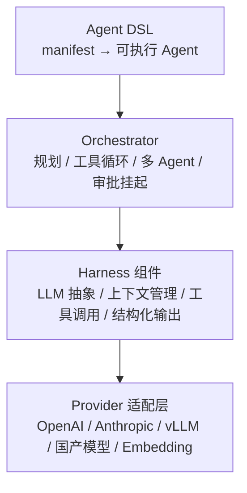
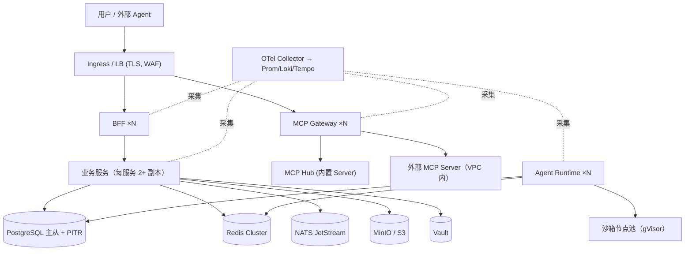
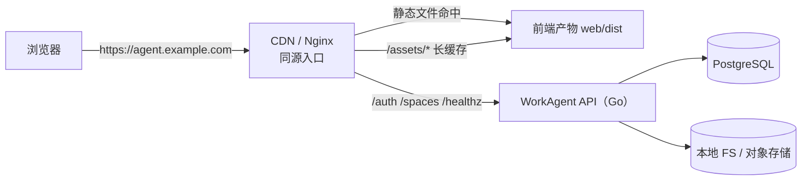

# WorkAgent 企业级 Agent 平台技术方案

> 版本：v0.1（评审稿）
> 状态：待评审
> 更新时间：2026-11-03

---

## 1. 文档说明

### 1.1 目的

本文档描述 WorkAgent 的整体技术方案，覆盖架构分层、关键模块设计、领域模型、接口约定、安全与部署方案、演进路线，用于技术评审与后续拆解排期。

### 1.2 范围

- 范围之内：平台后端服务、Agent Core SDK、MCP Gateway、资源与工具体系、权限与审批、UI 组件服务、客户端形态（Web / CLI / Electron / A2A）。
- 范围之外：具体业务 Agent 的 prompt 工程、模型训练与微调、企业 IM 平台内部实现（仅做集成）。

### 1.3 术语

| 术语 | 含义 |
| --- | --- |
| Capability（能力） | 对通用能力的抽象接口，如 MySQL、Redis、FS、Computer、LLM Wiki，只描述语义与 IO Schema，不含实现 |
| Tool（工具） | Capability 的一个具体实现，可被 Agent 调用；有运行时与风险等级 |
| ToolBinding | Tool + Resource + Credential + 授权角色的绑定关系，是"可执行的最小单元" |
| Resource（资源） | 被访问的目标实体：数据库、MCP 服务、目录、文件、HTTP 端点等 |
| Credential（凭证） | 访问资源所需的密钥/账号，加密存储，运行时按需下发 |
| Agent Manifest | Agent 的声明式定义：模型、Prompt、工具、Skills、UI 组件、策略 |
| Skill | 可复用的指令包 + 工具白名单 + 组件引用，可通过指令触发 |
| A2A | Agent-to-Agent 协议，用于跨 Agent 任务委派 |

---

## 2. 目标与约束

### 2.1 业务目标

1. **一站式**：Agent 的开发、调试、发布、运维、监控在同一平台内闭环。
2. **企业可控**：组织架构、RBAC、资源级授权、审批、审计缺一不可，任何工具调用可追溯到人。
3. **可扩展**：能力、工具、配置、UI 组件均支持二次开发与租户级自定义。
4. **对话即开发**：用户通过对话即可产出可用的工具与 UI 组件，经审核后进入共享市场。

### 2.2 设计原则

| 原则 | 落地方式 |
| --- | --- |
| 控制面与数据面分离 | 管理类 API（低频、强一致）与运行流量（高频、低延迟）独立部署、独立扩缩容 |
| 一切皆资源 | 资源是权限、凭证、审计的统一锚点，工具通过 Binding 间接访问资源 |
| 默认拒绝 | 工具无显式授权不可执行；凭证不落到模型上下文 |
| 能力与实现解耦 | Capability 定义协议，Tool 提供实现，二者独立演进 |
| 协议优先 | 对外只暴露 MCP / A2A / HTTP，内部模块不泄漏实现细节 |
| 可观测内建 | 每个 Agent 运行时都产出完整 trace，天然支持成本与质量分析 |

### 2.3 关键约束与假设

- 部署形态：私有化（K8s）+ SaaS 多租户，同一套代码。
- 必须支持国产化环境（可选依赖替换：达梦/人大金仓、麒麟 OS），因此 ORM 与存储访问需限定在标准 SQL 子集内。
- LLM 供应商可替换：至少支持 1 个公有云 + 1 个私有化推理（vLLM / SGLang）。
- 假定企业已有 IdP（AD / LDAP / 飞书 / 钉钉 / Keycloak），平台不重复造账号体系。

---

## 3. 总体架构

### 3.1 分层视图


### 3.2 控制面 / 数据面切分

| 维度 | 控制面 | 数据面 |
| --- | --- | --- |
| 组成 | Login、IAM、MCP Management、Resource、Tool、UI Component、Config、Agent Service | Agent Runtime、Tool Executor、MCP Hub、MCP Gateway |
| 特征 | 低频写、强一致、需审计 | 高并发长连接、流式、可容忍短暂降级 |
| 存储 | PostgreSQL（主）+ 对象存储 | Redis（会话/缓存）+ PostgreSQL（checkpoint） |
| 扩缩容 | 按 API QPS | 按并发会话数与 SSE 连接数 |
| 故障影响 | 无法管理配置 | 已有会话可继续，新建会话失败 |

### 3.3 技术选型

| 层 | 选型 | 理由 / 备选 |
| --- | --- | --- |
| 后端语言 | **Go**（核心服务、Gateway、Runtime 骨架） | 网关与流式代理性能好、部署单一二进制；备选 Java/Spring Boot（若团队栈为 Java，IAM 可平移） |
| Agent 框架 | **CloudWeGo Eino**（仅 Runtime 模块可依赖） | 强类型工具定义、图编排、中断恢复、ModelFailover，字节内部大规模生产验证；备选 Google ADK Go（2026-03 发布 1.0）；LangChainGo 已于 2026-01 停止维护，排除。详见 §5.7.7 |
| 工具运行时 | **Python 3.12** 容器 + TS/Node 容器 | 自定义工具多由 Python 生态产出（数据处理、爬虫、SDK） |
| 前端 | **React 18 + TypeScript + Vite + Tailwind + Radix** | 组件库可约束 AI 生成风格；Electron 复用同一套代码。产物由 CDN 托管、API 同源反代，见 §10.2 |
| API 风格 | REST（控制面）+ SSE/WebSocket（运行流）+ gRPC（内部高性能链路） | 控制面用 REST 易调试、易生成 SDK；内部用 gRPC |
| 主库 | **PostgreSQL 16** | JSONB 存 Manifest、RLS 做租户隔离、pgvector 起步免引入额外组件 |
| 缓存/会话 | **Redis 7**（Cluster） | 会话状态、限流、分布式锁、SSE 连接路由 |
| 对象存储 / 文件 | **S3 兼容（MinIO 私有化）/ HDFS**（部署期） | 工具制品、组件产物、附件、文件资源。**MVP 阶段不引入分布式存储**，一律走本地 FS，统一由 `Storage` 接口抽象（`Put/Get/Delete/List/Rename/Stat`），切 HDFS/S3 只换实现 |
| 向量 | **pgvector** → 后期可切 Milvus | 降低起步复杂度，量大再拆 |
| 密钥 | **Vault / 云 KMS**，本地用信封加密 | 凭证绝不落库明文 |
| 消息 | **NATS JetStream**（轻量）/ Kafka（已有则复用） | 审计、事件、异步构建任务 |
| 工作流 | 自研轻量状态机（审批） | 避免引入 Temporal 的运维成本；复杂后迁移 |
| 沙箱 | **K8s Pod + gVisor / Kata**（默认 gVisor） | 隔离自定义工具代码；高安全场景升 Firecracker |
| 可观测 | **OpenTelemetry + Prometheus + Loki + Tempo** | LLM Span 遵循 GenAI 语义约定 |
| 部署 | **Kubernetes + Helm + ArgoCD** | 私有化交付标准形态 |

### 3.4 代码仓库结构（Monorepo）

```
auto-agent/
├── AGENTS.md
├── docs/
├── proto/                      # 内部 gRPC 契约
├── services/
│   ├── login/                  # OIDC / SSO
│   ├── iam/                    # 组织 + RBAC + 审批
│   ├── mcp-management/
│   ├── mcp-gateway/
│   ├── resource/
│   ├── tool-management/
│   ├── ui-component/
│   ├── config/
│   ├── agent/
│   └── runtime/
├── sdk/
│   ├── ts/                     # 前端/CLI/Electron 共用
│   └── python/                 # 数据侧、自定义工具 SDK
├── apps/
│   ├── web/
│   ├── cli/
│   └── electron/
├── mcp-servers/                # 内置 MCP Server（mysql/fs/browser/computer）
├── deploy/                     # Helm、Kustomize、ArgoCD
└── tests/e2e/
```

---

## 4. 领域模型

### 4.1 五层模型总览



核心不变量：

1. Agent **不直接持有**凭证，只声明所需 Capability 与 Tool。
2. Runtime 执行工具时，凭证由 Tool Executor 在服务端注入，模型上下文永不可见。
3. 任一 ToolBinding 的可用性 = 用户授权 ∧ 资源授权 ∧ 凭证有效 ∧ 审批通过（如策略要求）。

### 4.2 实体关系



---

## 5. 详细设计

### 5.1 认证与组织权限（Login + IAM）

#### 5.1.1 认证

- 平台作为 **OIDC Relying Party**，对接企业 IdP（Keycloak / Azure AD / 飞书 / 钉钉 / 自建 LDAP+OIDC 桥）。
- 登录流程：Authorization Code + PKCE；CLI 用 Device Code；Electron 用系统浏览器 + 回环端口。
- Token 设计：
  - `access_token`：JWT，RS256，有效期 30min，含 `sub`、`tenant`、`org_path`、`roles`、`scope`。
  - `refresh_token`：不透明串，30 天，绑定设备指纹，可撤销。
  - 平台自签的内部 token 仅用于服务间调用（mTLS + `actor` claim）。
- 会话：Redis 存 refresh token 白名单与撤销表，支持"踢下线"。

**身份接入层（`IdentityProvider`）**

平台不直接耦合某个 IdP 的登录协议与通讯录接口，登录与资料获取统一收口到一个接口；切换 IdP 只改配置，不改业务代码：

| 能力 | 接口方法 | 说明 |
| --- | --- | --- |
| 授权地址 | `AuthorizeURL(state) (string, error)` | 钉钉走 `login.dingtalk.com/oauth2/auth`；企微/飞书走各自的网页授权 |
| 换取凭证 | `Exchange(ctx, code) (Credential, error)` | 授权码 → 访问令牌，协议差异封装在实现内部 |
| 拉取资料 | `Profile(ctx, Credential) (Profile, error)` | 统一输出 `Profile`，业务层不感知 IdP 差异 |
| 就绪状态 | `Ready() bool` / `Missing() []string` | 启动告警、登录页提示所需 |

首版实现钉钉（`dingtalk`），企业微信（`wecom`）与飞书（`feishu`）按同一接口接入，**未实现时登录接口返回 501 并可读提示，不影响服务启动**。

统一资料 `Profile` 与各 IdP 的来源映射（落库表见 §6 `user_identity`）：

| 字段 | 钉钉来源 | 企业微信（待实现） | 飞书（待实现） |
| --- | --- | --- | --- |
| `provider_uid` | unionId（缺省退化为 openId） | userid | union_id |
| `employee_id` | userid（通讯录） | userid | user_id |
| `name` / `avatar` / `mobile` | 个人资料；通讯录有值则覆盖 | 通讯录 | 通讯录 |
| `email` | 个人资料 `email`；通讯录 `email` 覆盖 | 通讯录 | 通讯录 |
| `job_number`（工号） | 通讯录 `job_number` | 通讯录工号/职位扩展 | 通讯录 `employee_no` |
| `title` / `dept_ids` | 通讯录 | 通讯录 | 通讯录 |
| `corp_name`（企业名称） | `GET /v1.0/contact/organizations/authInfos?targetCorpId=` 的 `orgName`，失败用 `DINGTALK_CORP_NAME` 兜底 | 企业信息 | 企业信息 |
| `contact_error`（同步失败原因） | 通讯录链路失败时写入，成功时清空 | 同左 | 同左 |

钉钉取数链路（OAuth 个人资料 + 通讯录补全）：

1. `POST /v1.0/oauth2/userAccessToken`：授权码换用户访问令牌（扫码登录）。
2. `GET /v1.0/contact/users/me`：取 unionId / openId / nick / avatarUrl / mobile / email。
3. `POST /v1.0/oauth2/accessToken`（appKey/appSecret）：换**企业内部应用 accessToken**，进程内缓存至过期前 60s。
4. `POST /topapi/user/getbyunionid`：unionId → userid。
5. `POST /topapi/v2/user/get`：取 `job_number`（工号）、`email`、`title`、`dept_id_list`，覆盖第 2 步的同名字段。
6. `GET /v1.0/contact/organizations/authInfos?targetCorpId={corpId}`：取 `orgName` 作为企业名称，进程内缓存 1 小时；接口失败（如未开通 `Contact.Org.Read`）时用 `DINGTALK_CORP_NAME` 配置兜底。

约束：

- 第 3–5 步要求应用是**企业内部应用**且具备通讯录读取权限（`qyapi_get_member`/`Contact.User.Read`）；第 6 步需要 `Contact.Org.Read`。权限缺失、CorpID 未配置或接口报错时**只告警降级**为个人资料，工号/邮箱/企业名为空，不阻断登录。
- `email` / `mobile` 属**敏感字段**：即使有成员信息读权限，未在「权限管理 → 通讯录管理」勾选「企业员工手机号信息」「邮箱等个人信息」时，`v2/user/get` 返回中**不含这两个字段**（不是空字符串）。此时工号正常、邮箱为空，属于权限问题而非数据问题。
- **降级必须对用户可见**：同步告警（权限缺失、邮箱未返回等）写入 `user_identity.contact_error`，`GET /auth/me` 以 `profile_warning` 返回，前端在用户信息处提示管理员去开放平台申请权限；否则用户只会看到工号/邮箱长期为空。
- 登录端点与 IdP 无关：`GET /auth/login/url`、`GET /auth/login`、`GET|POST /auth/callback`、`GET /auth/provider`（返回 provider / 展示名 / 是否就绪 / 缺失配置）；历史 `/auth/dingtalk/*` 保留为别名。
- 账号唯一键是 `(provider, provider_uid)`；同一自然人更换 IdP 重新登录会得到新账号，账号合并（按手机号/邮箱归并）不在 MVP 范围。
- 用户资料按每次登录刷新（`name / avatar / mobile / email / job_number`），通讯录字段只做「有值才覆盖」，避免权限临时缺失把已存工号清空。

#### 5.1.2 组织架构

- 树形 `org_unit`（公司 / 事业部 / 部门 / 团队），支持多根（集团多法人）。
- 用户可多归属；角色可授予到 `org_unit` 并递归继承（继承深度可配）。
- 与 IdP 同步：SCIM 2.0 定时/事件同步，冲突以 IdP 为准，平台侧仅允许扩展字段。

#### 5.1.3 权限模型

采用 **RBAC 为主、资源级 ABAC 为辅**：

- 主语：`user` / `group` / `role` / `service_account`。
- 权限三元组：`(permission, scope_type, scope_id)`，`permission` 形如 `tool:invoke`、`resource:read`、`agent:publish`。
- 资源授权：`resource_grant(subject, resource_id, actions[], constraints jsonb)`，`constraints` 支持时间窗、数据行数上限、SQL 只读、脱敏等级等。
- 决策点：**统一授权服务（PDP）** 部署为 IAM 内的库 + gRPC 服务；策略缓存于各服务本地（TTL 30s + 变更事件失效）。
- 关键策略示例：
  - `resource.sql.readonly = true` → Tool Executor 对 SQL 做 AST 级只读校验。
  - `constraints.max_rows = 1000` → 结果集截断。
  - `constraints.approval_required = true` → 触发 5.2 审批流。

> 不建议直接上 OPA/Rego（学习与运维成本高），但策略求值层做成接口 `PolicyEngine`，需要复杂策略时替换为 OPA。

### 5.2 审批流

#### 5.2.1 触发时机

| 场景 | 说明 |
| --- | --- |
| 敏感工具调用 | Tool 风险等级 ≥ L3，或资源 `sensitivity = high` |
| 越权临时申请 | 用户对某资源无长期授权，发起单次/限时授权申请 |
| 自定义工具发布 | 提交到租户市场需管理员审核 |
| UI 组件发布 | 同上 |

#### 5.2.2 流程设计



- 接口抽象：`ApprovalProvider` 接口，方法 `Submit(ctx, Request) (ID)`、`OnDecision(ctx, ID, Decision)`。
- 默认实现 `ImApprovalProvider`：
  1. 通过 IM 开放平台（飞书/钉钉/Slack）发交互式卡片，卡片携带一次性 `approval_token`（JWT，含 `approval_id` + `nonce`）。
  2. 用户点击或直接回复自然语言，回调到平台；自然语言回复走小模型抽取意图（通过/拒绝/追问）。
  3. 校验 `approval_token` 签名与 nonce（Redis 一次性消费）后落决策。
- 兜底：平台内 Web 待办 + 邮件；超时策略可选 `自动拒绝` / `升级上级` / `转交代理人`。
- Agent 运行时若遇到需审批的工具调用：Run 进入 `WAITING_APPROVAL` 状态并落 checkpoint，审批回调后从 checkpoint 恢复（见 5.7.5）。
- 全部审批记录进入审计日志，含审批上下文快照（工具、参数摘要、资源、发起人）。

### 5.3 MCP Gateway（核心）

MCP Gateway 是平台的流量咽喉和信任边界，承担三件事：**服务注册与发现**、**JWT 注入与身份转换**、**协议代理**。

#### 5.3.1 MCP Server 注册

Management Service 维护 `mcp_server` 表：

| 字段 | 说明 |
| --- | --- |
| `id` / `name` / `tenant_id` | 标识与租户隔离 |
| `transport` | `stdio` / `sse` / `streamable_http` |
| `endpoint` | 内部地址（不进公网）或镜像名（stdio 由平台托起） |
| `upstream_auth` | `none` / `api_key` / `oauth2_client_credentials` / `mtls` |
| `tool_manifest` | 由 `tools/list` 拉取并缓存，变更通过 `notifications/tools/list_changed` 增量刷新 |
| `jwks` / `secret_ref` | Gateway 与该 Server 之间校验身份用的密钥引用 |
| `health` | 探活结果、最近可用时间 |
| `visibility` | `private` / `tenant` / `public`（市场） |

- **JWT secret 生成**：Gateway 为每个注册的 MCP Server 生成独立密钥对（默认 Ed25519，兼容 HS256），私钥加密存 Vault，公钥/对称密钥推送给 Server 侧（通过启动注入或 `/.well-known/mcp-auth` 拉取）。轮换策略：双密钥并行 7 天。

#### 5.3.2 Token 与凭证注入

支持三种模式，按资源敏感度选择：

| 模式 | 机制 | 适用 |
| --- | --- | --- |
| Pass-through | 直接透传用户 `access_token` | 上游本身就是平台内 MCP Server，信任链完整 |
| **Token Exchange**（默认） | RFC 8693：用用户 token 换取**短寿命委派 token**（`sub=user`, `act=agent_id`, `scope=工具白名单`, `exp=5min`） | 通用推荐，最小权限 + 可追溯 |
| Impersonation | 服务账号 + `act` 声明 | 无人值守定时任务 |

凭证注入流程（Tool Executor / Gateway 内）：



关键实现点：

1. **凭证不落日志**：Gateway 对 `authorization`、`x-api-key`、`cookie` 等 header 做统一脱敏（正则 + 白名单）。
2. **响应脱敏**：按 `resource.sensitivity` 对结果做字段级脱敏（手机号、身份证、金额），脱敏规则由 Resource Service 下发。
3. **流式转发**：`streamable_http` 用 `httputil.ReverseProxy` 定制 FlushInterval = -1；SSE 场景做心跳与 30min 空闲超时；WebSocket 需双向复制帧。
4. **协议适配**：浏览器不便直连长连接 SSE 的部分场景，Gateway 提供 `/mcp/{id}/rpc` 的单请求-单响应模式。
5. **连接复用**：对同一 MCP Server 维护 HTTP/2 连接池；stdio 型 Server 由平台以 sidecar 方式托起，Gateway 通过 Unix Socket 通信。
6. **限流**：按 `tenant` + `user` + `server` 三级令牌桶（Redis Lua 实现），超限返回 MCP 标准错误而非 HTTP 429 裸奔。

#### 5.3.3 为什么 Gateway 要做 API Proxy 给 Web

Web 端直连 MCP Server 会带来：CORS、凭证暴露、无法审计、无法限流。因此 Web 只与 Gateway 通信，Gateway 是唯一的对外数据面入口，天然获得审计与限流能力。

### 5.4 MCP Management

职责：MCP Server 的全生命周期管理。

- 注册与发现：手填 / OpenAPI 导入 / 容器镜像导入；发现基于标签与能力索引（`tools/list` 的轻量索引，支持语义搜索）。
- 健康检查与熔断：5s 探活，连续 3 次失败摘除；熔断器按 Server 维度，半开恢复。
- 版本与灰度：同一 Server 可挂多个版本，按租户/用户灰度比例路由。
- 市场：`visibility=public` 的 Server 进入租户市场，带评分与使用量。
- 工具 Schema 缓存：变更事件驱动刷新，缓存于 Redis + 进程内 LRU。

### 5.5 Resource Service

#### 5.5.1 资源抽象

`Resource` 统一模型（`kind` + `spec` JSONB + `sensitivity`）：

| kind | spec 关键字段 | 关联能力 |
| --- | --- | --- |
| `mysql` / `postgres` | host, port, db, tls, 读写模式 | SQL 能力 |
| `redis` | host, port, db, mode | KV 能力 |
| `elasticsearch` | endpoints, index 白名单 | 检索能力 |
| `filesystem` | bucket/路径, 读写权限, 配额 | FS 能力 |
| `http` | base_url, 允许的 path/method | HTTP 能力 |
| `mcp` | server_id | MCP 能力 |
| `llm_wiki` | 文档集 ID, embedding 模型 | 知识库能力 |
| `browser` / `computer` | 目标环境 ID | 浏览器/桌面能力 |

#### 5.5.2 凭证管理

- 存储：Vault（生产）/ 信封加密（DEK 由 KMS 包装，密文落 PG）。
- 类型：`password` / `api_key` / `oauth2` / `ssh_key` / `mtls_cert` / `aws_sts_assume_role`。
- OAuth2 类型由平台托管刷新（提前 5min 刷新，刷新失败告警）。
- 凭证操作全部审计；支持"仅使用不可读"（UI 只显示指纹），支持使用方审计。
- 连接测试：`POST /resources/{id}/test`，在 Tool Executor 沙箱内执行以隔离网络策略。

#### 5.5.3 授权的两条路径

1. **角色授权**：把 Resource 授予角色，角色内用户可用。
2. **Binding 授权**：在具体 ToolBinding 上限制可用角色（更细，推荐用于生产环境）。

### 5.6 Tool Management

#### 5.6.1 三层模型

```
Capability（抽象能力，平台内置，只读）
   └── Tool（实现：builtin / python / ts / mcp / http）
          └── ToolBinding（绑定 Resource + Credential + 授权角色 + 约束）
```

- Capability 定义：`name`、`description`、`input_schema`、`output_schema`、`risk_level`、`idempotent`、`side_effects`。
- 内置 Capability 清单（v1）：`sql.query`、`sql.execute`、`kv.get/set`、`fs.read/write/list`、`skill.create`、`http.request`、`search.query`、`knowledge.retrieve`、`browser.act`、`computer.act`、`shell.exec`、`iam.check`、`resource.list`、`approval.submit`。
- 风险等级：L1 只读无副作用 / L2 只读有成本 / L3 写操作 / L4 高敏感或不可逆。
- `side_effects` 进一步限定写操作的范围：`write-workspace` 表示只改当前空间工作区（如 `fs.write`），由空间权限直接放行；`write-external` 表示会改动空间外资源，必须绑定 + 审批。范围判定由工具自身完成（路径前缀固定为 `spaces/{space_id}/files/`，工具不接受 `space_id` 参数），策略层只信任这一声明并核对空间权限。

**能力源加载（skills / tools / mcps）**

- 每个空间在文件根维护索引 `files/.meta.json`，记录本空间 skills / tools / mcps 的名称、描述与相对路径；写操作后重建，读取缺失时按磁盘现状重算。
- Agent 可见的能力源 = 当前空间 ∪ 系统空间，**同名（Name）以当前空间为准**；系统空间未初始化时自动降级。
- 资源总量没有上限，因此**不提供“列出全部”的能力**，一律按需检索：① `resource_search` 按关键词检索（返回名称、描述、来源、路径，默认 8 条）；② `resource_read` 读取正文，先当前空间、后系统空间，支持 `offset` / `limit` 分页；③ 系统提示词常驻技能索引（L1：名称 + 描述 + 路径），正文（L2）按需读取；④ 会话级技能把 SKILL.md 正文注入当轮提示词，绑定关系存 `session.skill_path`。
- 命中同名多来源资源时，Agent 必须把候选交给用户选择，不得自行假设。
- 上下文预算按 token 控制（不按字节）：技能索引 2000 tokens、单技能正文 4000 tokens，超出部分截断并提示可用 `resource_read` 继续读取；工具结果回填默认 4KB，读类工具可通过 `Tool.MaxResultBytes` 申请 24KB。
- 技能遵循 Agent Skills 规范：`SKILL.md` 带 YAML frontmatter（`name` ≤ 64 字符、`description` ≤ 1024 字符且写明“做什么 + 何时使用”），正文只写入口流程，长内容拆子文件并保持一层引用。

**资源发布与「资源管理」**

资源生命周期：**空间草稿（可编辑） → 发布（不可变版本快照） → 资源管理板块（按需检索使用）**。

- 发布范围只有**用户范围**：`public`（全部可见）/ `private`（仅自己可见）。不再有“必须加载 / 可选加载”——所有资源一律由模型按需检索，不做预加载，避免上下文被强制资源挤占。
- 发布件是不可变版本快照，存放在与工作空间分离的发布目录：

```text
{STORAGE_ROOT}/published/{kind}/{resource_id}/{version}/
  .meta.json      # kind / name / version / visibility / resource_id / source_space_id / published_at
  SKILL.md        # 草稿内容的完整拷贝（含子文件）
```

目录用 `resource_id` 而不是名称，因为名称只在「发布者 + kind」内唯一，公开资源可能重名；路径不再需要人读，只作为 `resource_read` 的定位符。

- 数据模型（`0016_resource_publish.sql`）：`resource`（kind、name、description、visibility、status、owner_id、source_space_id、latest_version）+ `resource_version`（version、notes、storage_path、file_count、total_bytes）。
- 权限：发布需来源空间 `write` 及以上；`public` 发布需该空间 `manage` 或系统管理员；删除资源 / 删除版本 / 启停仅发布者本人或系统管理员。
- 保密：草稿阶段密钥明文存储；**发布后不允许查看原始 MCP 配置、tool 文件、DB 配置**，资源管理板块与接口只返回名称、版本、描述、文件数与体积。
- 约束：版本号 `x.y.z`；同一版本重复发布返回 409；只剩一个版本时不允许删版本（应删除整个资源）；发布快照上限 200 个文件 / 5MB。
- Agent 侧：发布件作为**独立一层**进入能力源（`source=published`），不与草稿做同名覆盖——命中同名多来源时 `resource_search` 返回 `hint`，要求模型先让用户选择；停用（`status=disabled`）的资源不进入检索；`resource_read` 支持 `published/{kind}/{id}/{version}/...` 路径，读取时校验可见性。
- API：`GET/POST /resources`、`GET/PATCH/DELETE /resources/{id}`、`DELETE /resources/{id}/versions/{version}`。
- 阶段差距：当前只支持 `skill` 类型发布（tool / mcp / component / db 待后续）；发布件不进常驻技能索引、不能绑为会话技能；连接测试、回滚、发布审核、被引用拦截均未实现。

#### 5.6.2 内置工具与 MCP Server 的对应关系

平台内置 MCP Server（`mcp-servers/`）暴露标准 MCP 工具，Gateway 统一接入。这样"内置能力"和"第三方 MCP 服务"走同一条执行链路，避免双套逻辑。

#### 5.6.3 自定义工具生命周期



- 生成阶段：AI 依据 Capability 的 `input_schema` 生成代码骨架，强制产出 `tool.yaml`（manifest：能力、输入输出 Schema、依赖、所需资源类型、风险等级、示例）。
- 构建阶段：沙箱内 `build` + `test`（无网络，仅允许访问 mock 资源），产物为 OCI 镜像 + manifest 签名（cosign）。
- 运行阶段：Tool Executor 拉起受限 Pod：
  - `runAsNonRoot`、只读根文件系统、`seccomp: RuntimeDefault`、gVisor runtimeClass。
  - CPU/内存/执行时长硬限制（默认 30s），超时 SIGKILL。
  - 网络：默认 `NetworkPolicy` 拒绝全部出网，仅允许经 Gateway 访问已授权资源（流量走 egress proxy）。
  - 文件系统：`emptyDir` 临时盘，任务结束销毁。
- 供应链：镜像扫描（Trivy）、SBOM、签名校验后才允许调度。

### 5.7 Agent Core SDK / LLM Harness

#### 5.7.1 SDK 分层



- TS SDK：面向前端、CLI、Electron、Node 侧工具；Python SDK：数据侧、算法侧、自定义工具。
- 两者共用同一份 `proto` 契约与 Manifest Schema（JSON Schema 单一可信源）。

#### 5.7.2 主循环

```
loop until done or budget exhausted:
  1. build context（system + memory + history + tool schemas，超限则压缩）
  2. llm.chat(stream)
  3. if tool_calls:
       并行执行可并行的工具调用（受 max_parallel 与资源并发限制）
       每个调用：授权检查 → 审批检查 → 注入凭证 → 执行 → 脱敏 → 审计
       结果回填（超大结果先摘要，原文存对象存储并给引用）
  4. checkpoint（每步落库，支持恢复）
```

关键约束：

- **Token 预算**：`max_tokens_per_run`、`max_tool_calls`、`max_wall_clock`，超限优雅终止并给出原因。
- **上下文压缩**：滑动窗口 + 摘要（小模型）+ 按需检索（向量）；工具结果 > 阈值时只保留摘要（≤500 token）与句柄。
- **工具选择**：Tool 数量多时（>50）先做语义检索缩小到 Top-K schema，再注入。

#### 5.7.3 多模型路由

- `ModelRouter` 按策略选模型：能力标签（vision/tool/structure）、成本上限、延迟 SLO、区域合规。
- 失败降级：主模型 5xx/超时 → 备模型（schema 兼容才降级，否则报错而非静默降质）。
- Prompt Cache：对稳定前缀（system + 工具 schema）做缓存命中优化，命中率进指标。

#### 5.7.4 记忆

| 类型 | 存储 | 生命周期 |
| --- | --- | --- |
| 会话短期 | Redis（滚动窗口）+ PG 全量 | 会话周期 |
| 用户长期 | PG + pgvector（摘要化事实） | 长期，可被用户删除 |
| 知识库 | pgvector（文档切片 + 元数据） | 由 LLM Wiki 资源管理 |

#### 5.7.5 中断与恢复

- `Run` 状态机：`QUEUED → RUNNING → (WAITING_APPROVAL | WAITING_INPUT) → RUNNING → SUCCEEDED / FAILED / CANCELLED`。
- Checkpoint：每步消息、工具调用与结果、预算消耗、审批引用。恢复时从最后 checkpoint 续跑，保证工具调用幂等（非幂等工具在恢复时要求确认）。

#### 5.7.6 Agent 发布形态

- `Agent Manifest` 声明：模型与参数、system prompt、工具引用（ToolBinding 或 Capability 需求）、Skills、UI 组件、策略（预算/审批/内容安全）、建议的入口。
- 发布：版本化（不可变），可灰度（按租户/用户比例），可回滚。
- 对外暴露：REST（同步/异步任务）、SSE 流、A2A Agent Card、Web 嵌入 iframe/JS SDK。

#### 5.7.7 框架选型与隔离约束

**结论：Server 端选 Go，Agent 框架选 CloudWeGo Eino；Google ADK Go 作为备选。**

Go 生态现状（截至 2026-11）：

| 框架 | 状态 | 判断 |
| --- | --- | --- |
| **CloudWeGo Eino** | v0.9.x 持续迭代；字节豆包/抖音/扣子等数百服务在用 | **主选** |
| **Google ADK Go** | 2025-11 增加 Go 支持，2026-03 发布 1.0；事件驱动 Runner + Session/State/Artifact，内置 MCP 与 Skills 标准 | 备选（GCP 亲和，Go 侧生态薄于 Python 版；Session 抽象与本方案 `session/run/run_step` 重叠，需实现自定义 SessionService） |
| Firebase Genkit Go | Google 维护，活跃，Dev UI 好 | 备选；编排能力弱于前两者 |
| LangChainGo | **2026-01 起停止维护**，仍为 0.1.x | 排除 |
| Microsoft Agent Framework Go | 2026 公开预览，handoff / CodeAct 未移植 | 观望，不押注 |
| OpenAI / Anthropic Agents SDK | 无 Go 版 | 仅能走兼容层 |

选择 Eino 的三条理由（对应本方案的具体需求）：

1. **工具即 Go struct**：反射生成 JSON Schema，与 §5.6.1 的 `Capability.input_schema` 天然对齐，避免同一份 Schema 维护两遍，参数错误在编译期暴露。
2. **中断恢复与事件流内建**：`compose` 编排层提供 state / interrupt 抽象，直接支撑 §5.7.5 的 checkpoint 与暂停恢复，以及 SSE 流式输出。
3. **ModelFailover 内建**：多模型降级（§5.7.3）为配置项，无需自研；框架本身面向高并发长生命周期服务，与控制面/数据面分离的部署形态吻合。

**框架能力边界（关键约束）**——以下能力任何框架都不提供，必须自研，因此框架只允许出现在最内层：

| 能力 | 归属 |
| --- | --- |
| 编排图、组件抽象（ChatModel/Tool/Retriever）、流式、重试、模型 failover | ✅ Eino |
| Run 循环调度骨架 | ✅ 以 Eino `compose` 起手 |
| 凭证注入（ToolBinding → Vault → 请求） | ❌ 自研，挂在框架 Tool 执行入口的 Hook 上 |
| 审批挂起（WAITING_APPROVAL + checkpoint） | ❌ 自研，框架的 interrupt 面向人工输入，不认审批语义 |
| 每次工具调用前的 PDP 授权校验 | ❌ 自研 |
| 预算控制（max_tool_calls / tokens / wall clock） | ❌ 自研，包在循环外层 |
| 上下文压缩策略 | ❌ 自研（框架 memory 仅提供基础实现） |
| 多租户隔离 | ❌ 自研 |

分层与依赖约束：

```
Agent Service / Run 状态机              ← 自研（平台）
  └── ContextManager + ModelRouter      ← 自研（配置驱动）
        └── Eino compose.Graph          ← 框架
              └── Tool 节点 → ToolInvoker {PDP → 审批 → 凭证注入 → 沙箱执行 → 脱敏}
```

- **仅 `services/runtime` 模块可 import Eino**，其它服务禁止依赖；该约束由 lint 规则强制，防止框架渗入全仓。
- 对外只暴露本方案的 `ModelRouter`、`ToolInvoker`、`ContextManager` 接口，框架类型不出模块边界。
- 迁移成本控制：若日后换 ADK Go，只需重写 runtime 内的编排适配层。

配套必选库：

| 用途 | 选型 |
| --- | --- |
| 模型调用 | `openai/openai-go`（官方）+ OpenAI 兼容协议，一套覆盖 vLLM 与多数国产模型；特殊私有协议单独适配 |
| MCP | `modelcontextprotocol/go-sdk`（官方）为主，`mark3labs/mcp-go` 补充，统一封装在自研 `Transport` 接口后 |
| 可观测 | OpenTelemetry Go + GenAI 语义约定，Eino callback 直接对接 OTel |
| 沙箱 | 不使用框架能力，采用 K8s Pod + gVisor（§5.6.3） |

选型验证 PoC（2 周，三个验证点）：

1. 用 Eino 跑通「PG 存 checkpoint → 进程重启后恢复」；
2. 在 Tool 执行入口插入凭证注入 + PDP 校验 Hook，确认框架未阻断；
3. 接入 OTel，确认 `run → llm.chat → tool.call` span 层级正确。

三点全部通过则选型锁定；否则用同一套 PoC 复测 ADK Go。

#### 5.7.8 Agent 契约与实现切换

§5.7.7 的约束是「框架只出现在最内层」，因此把「编排与循环」抽成可替换的契约，切换实现只改配置：

```go
// internal/agent
type Agent interface {
    Name() string                                        // 实现名，写入 run.budget 与日志
    Capabilities() Capabilities                          // 能力声明，供上层降级与对客户端说明
    Ready() bool
    Model() string
    Budget() map[string]any                              // §5.7.2 预算上限，写入 run.budget
    Run(ctx context.Context, in RunInput, emit func(Event) error) (Result, error)
}
```

- **契约只含平台自己的类型**：§7.3 事件、`RunInput` / `Result`、能力声明，不出现任何框架类型。系统提示词与技能披露预算属于平台策略，以 `BuildSystemMessage` 提供默认实现。
- **实现注册与选择**：实现包在 `init()` 中 `agent.Register(name, New)`；装配层按 `AGENT_IMPL` 选择（`internal/agent/builtin` 内置 ReAct 为默认，`internal/agent/direct` 为无工具直答），未注册的名字告警并回退默认。当前实现与能力经 `GET /agent/info` 暴露，每次运行写入 `run.budget.impl`。
- **平台侧能力不因实现而变**（§5.7.7 能力边界表的落地）：审批判定与挂起在 `ToolInvoker` + `policy`，checkpoint 由会话层按事件落 `run_step`，上下文压缩在 `ctxmgr`，预算由实现声明、循环外层兜底，SSE 事件契约由 `web/src/api/stream.ts` 对齐。
- **接入 Eino**：新增 `internal/agent/eino`，在 `Run` 内用 `compose` 编排，工具执行仍走平台 `ToolInvoker`（PDP → 审批 → 凭证注入 → 执行 → 脱敏），checkpoint 仍落 `run_step`；该子包是唯一允许 import Eino 的位置，框架类型不出模块边界。
- **当前差距**：§5.7.5 的断点续跑（`Capabilities.Resume`）只声明未实现；审批只推 `approval.req` 事件，尚无审批记录表与恢复入口；模型的 failover 由 ModelRouter 统一提供，未按实现区分。

### 5.8 UI Components Service

#### 5.8.1 设计目标

让"对话产出可用 UI"成为工程化能力，而非一次性代码生成：

1. **受约束生成**：只允许使用平台组件库（Design Token + 白名单组件），杜绝风格漂移与不可维护的自定义样式。
2. **数据来源声明化**：组件必须声明依赖的 MCP 工具（工具 ID + 参数映射），数据获取统一走 MCP Gateway，不在组件内写死接口。
3. **可注册、可复用、可治理**：组件是资产，有版本、有审核、有使用统计。
4. **来源封闭、零 iframe**：组件只由平台 Skill 生成（Skill 本身可版本升级），与主应用同源直挂渲染，体验与加载性能不做妥协（见 §5.8.6）。

#### 5.8.2 组件模型

`ComponentManifest`：

```yaml
name: sales-dashboard
version: 1.2.0
description: 销售业绩看板
props:
  period: { type: string, enum: [week, month, quarter], default: month }
dataSources:
  - id: orders
    mcpServer: internal-mysql
    tool: sql.query
    binding: bd_sales_readonly
    params: { sql: "SELECT ... WHERE dt >= {{period}}" }
  - id: targets
    mcpServer: internal-mysql
    tool: sql.query
    binding: bd_sales_readonly
skills: [sales-analysis]
permissions:
  tools: ["internal-mysql/sql.query"]
```

#### 5.8.3 生成流水线（由 Skill 驱动）

组件生成不是一次性代码生成，而是**一个可升级的 Skill**：`ui-component-authoring`。Skill 负责"能不能生成、生成什么"，平台流水线负责"必须通过哪些校验"，两者职责分离。


**Skill 作为一等资产**：

- Skill 有独立版本，复用与 Agent 相同的版本 / 发布 / 灰度 / 回滚机制。
- 生成规则（组件白名单、禁止 API、manifest 必填字段、追问话术、模板库）**写在 Skill 里**，不硬编码在流水线；改规则 = 发新版 Skill。
- **MVP 先交付一个可用版本**，上线后直接在产品内迭代优化（提示词、追问顺序、模板库、失败样本回归集），每轮优化产出新 Skill 版本，可对比"生成一次通过率"。
- Skill 无法绕过校验：Skill 只产出源码 + manifest + 说明，校验与构建由平台固定流水线执行。

**构建期校验（L1，安全的主战场）**：

| 规则 | 说明 |
| --- | --- |
| 禁用标识符 | `fetch`、`XMLHttpRequest`、`WebSocket`、`EventSource`、`localStorage`、`sessionStorage`、`indexedDB`、`document`、`window.top`、`parent`、`eval`、`new Function`、`import(变量)` 动态地址 |
| import 白名单 | 仅 `react`、`react-dom`、`@workagent/ui`、`@workagent/component-sdk`；其余依赖（含任意 npm 包）一律拒绝 |
| 样式约束 | 禁止 hex/rgb 字面量、禁止硬编码 px（白名单外）、禁止 `html`/`body`/`*` 选择器，必须使用 Token |
| 数据一致性 | 代码中出现的 `ctx.tools.call('x')` 必须已在 `manifest.dataSources` 声明 |
| 密钥与网络 | 禁止内联任何密钥、URL、token |

- 产物：ESM bundle + 类型声明，`react`/`react-dom`/`@workagent/ui` 全部 **external**，存 `Storage`（MVP 本地 FS，部署期 HDFS/S3），按 `slug@version` 不可变寻址。
- 构建由平台侧镜像执行，**不接受用户自带构建产物**。

#### 5.8.4 与 Skills 的绑定

- **组件生成 Skill**：`ui-component-authoring`，负责对话式生成组件（见 §5.8.3），可版本升级。
- **组件使用 Skill**：业务 Skill 中写"使用组件 sales-dashboard 渲染结果"，Runtime 命中后输出结构化 `ui_block`；不支持组件的客户端（CLI）降级为 Markdown。
- **版本策略**：会话创建时锁定所引用 Skill 与组件版本，保证同一会话内行为稳定；Skill 升级不影响历史会话。

#### 5.8.5 消息内渲染协议

**渲染以结构化内容块为准，正文文本标记只作降级表达。**

消息 `content` 是内容块数组，服务端在持久化前完成组件解析与版本注入：

```json
[
  {"type": "text", "text": "本月销售情况如下："},
  {"type": "ui", "component": "sales-dashboard", "version": "1.2.0",
   "props": {"period": "month"}, "fallback": "[销售看板]", "source": "agent"},
  {"type": "tool_call", "call_id": "c1", "tool": "sql.query", "status": "succeeded"}
]
```

| 规则 | 说明 |
| --- | --- |
| 版本由服务端注入 | 模型只输出组件标识（slug），**禁止模型书写版本号**；服务端按“会话创建时锁定的组件版本”或组件当前 published 版本解析后写入 `version` 字段 |
| 版本快照入库 | `message.component_refs` 固化 `{component, version, props}`，历史消息永远按当时版本渲染，组件升级不影响历史 |
| 前端不解析文本 | 前端只渲染结构化块；不做正则扫描，避免与 `@提及`、代码块、Markdown 语法互相干扰 |
| 文本标记仅降级 | 纯文本客户端（CLI、导出 Markdown）使用 `fallback` 文本；如需行内引用统一为 `@component(slug)`（不带版本），块级表述用 remark-directive 的 `:::component{#slug}`，**一律不使用 `&` 分隔版本**（`&` 会被 HTML 实体与 Markdown 管道改写） |
| 流式 | 先发 `ui.placeholder` 事件占位，props 就绪后 patch 为完整块，避免“标记先到、组件后到”的布局跳动 |
| 降级 | 组件不存在、加载失败或无权限 → 渲染占位卡（含原因 + 重试），不阻塞消息阅读 |

**组件来源封闭（安全前提，不可动摇）**：

| 项 | 约定 |
| --- | --- |
| 来源 | 所有组件必须由平台 Skill 生成并经审核发布；**不提供组件上传、导入或引用外部 bundle 的能力** |
| 技术栈 | 统一 React + `@workagent/ui` + Design Token，禁止自带框架、样式体系与第三方依赖 |
| 后果 | 正因为代码来源可信，渲染路径才不依赖 iframe；**一旦引入外部组件，必须切回 iframe / Wasm 等强隔离通道，不得复用本渲染路径** |
| 与 MCP Apps / A2UI 的关系 | 不作为对齐目标。MCP Apps 的前提是"第三方 Server 可携带任意 HTML"，与"来源封闭"直接冲突。若将来确实需要接收外部 UI，走独立信任区（iframe + 独立 CSP + 只读），不混入平台组件渲染链路 |

#### 5.8.6 无 iframe 的组件渲染沙箱

iframe 方案的两处代价都不接受：与主应用体验割裂（独立文档、独立样式体系、独立滚动容器）、加载慢（每个组件一个文档 + 一份 React 副本 + postMessage 序列化）。改用**同源直挂 + 四层收敛**。

**① 渲染容器：Shadow DOM（closed）**

```
<agent-ui-component slug="sales-dashboard" version="1.2.0">
  #shadow-root (closed)
    <style>  ← adoptedStyleSheets
    组件 React 树
```

| 需求 | 做法 |
| --- | --- |
| 样式隔离 | `attachShadow({mode:'closed'})` + `adoptedStyleSheets`，组件样式不出 shadow root，宿主样式不进去 |
| 主题一致 | Token 以 CSS 自定义属性定义在 `:root`，**可穿透 Shadow DOM 继承**，`var(--aa-*)` 直接可用；主题/密度切换天然跟随 |
| 浮层 | 组件不触及真实布局，浮层统一走 `ctx.ui.popover({anchorRect, content})`，宿主挂到 `<body>` 的 top-layer（Popover API / `<dialog>`），**几何上不可能被裁剪** |
| 宿主保护 | 组件拿不到 `document`/`window`，无法越界操作主文档 |

**② 执行环境：三档强度**

| 档 | 手段 | 说明 |
| --- | --- | --- |
| L1 | **构建期白名单**（必做） | §5.8.3 的禁止清单，越界代码直接编译不过。这是主力防线 |
| L2 | **参数遮蔽 + 受限全局**（默认） | 以严格模式在闭包中执行组件模块，全局用 Proxy 拦截：白名单外标识符（`fetch`/`document`/`window`/`localStorage`…）一律抛错；唯一对外通道是注入的 `ctx` |
| L3 | **ShadowRealm / Compartment** | 提供独立全局环境（无 DOM、无网络）。目前需 flag，暂不依赖；加载器抽象为 `ComponentHost` 接口，浏览器支持后直接切换，组件代码不动 |

**③ 数据通道：Capability RPC（安全关键接缝）**

```
ctx.tools.call('sql.query', args)
  → 宿主校验：是否在 manifest.dataSources 内 + 当前用户是否授权 + 预算是否足够
  → BFF / MCP Gateway（用户身份，凭证服务端注入）
  → 脱敏 + 行数/字节上限 + 审计
  → 返回组件
```

- 组件**没有任何网络能力**（L1 禁 + L2 兜底），取数只有这一条路。
- `dataSources` 是**运行期强制**的白名单，越界调用直接拒绝并记审计。
- 权限永远按用户身份判定，组件不可能拥有比用户更大的权限。

**宿主 API 契约（`ctx`）**：

| API | 用途 |
| --- | --- |
| `ctx.props` | 消息注入的 props（只读，宿主校验 Schema） |
| `ctx.tools.call(name, args)` | 取数，受 `dataSources` 白名单与权限约束 |
| `ctx.ui.popover({anchorRect, content})` | 宿主层浮层（不被裁剪） |
| `ctx.ui.fullscreen(content)` | 大面板/多步表单，宿主渲染遮罩与容器 |
| `ctx.ui.toast(msg)` | 统一轻提示，避免组件自造样式 |
| `ctx.log(msg)` | 结构化日志，接入 Trace |
| `ctx.emit(event, payload)` | 向会话回流事件（如"用户点击了下钻"），由宿主决定是否触发新一轮 run |
| 禁止项 | `ctx` 不暴露任何凭据、DOM 节点、网络对象、存储 API |

**④ 加载与性能**

| 措施 | 收益 |
| --- | --- |
| 组件 bundle 全 external | 不重复打包 React 与组件库，组件通常仅几 KB |
| 单例模块注册表 | `Map<slug@version, Module>`，同版本全局只加载一次，多实例共享 |
| importmap 单实例 | 保证 react/react-dom 只有一份，避免 hooks 报错 |
| 预取 | 收到 `component_refs` 即 `<link rel="modulepreload">`；高频组件常驻 |
| 强缓存 | 版本化 URL + `immutable, max-age=31536000` |
| 占位 | `ui.placeholder` 骨架 → 就绪原地替换，无布局跳动 |

**⑤ 纵深防御矩阵**

| 阶段 | 措施 |
| --- | --- |
| 构建期 | 禁止清单、import 白名单、样式 Token 强制、manifest 与代码一致性、产物签名、平台侧构建 |
| 加载期 | 仅按 `slug@version` 从平台仓库加载；校验哈希与签名；未发布版本拒绝 |
| 运行期 | `ErrorBoundary` 卡片级隔离 + 超时看门狗（>2s 告警、>10s 中断）+ 受限全局 |
| 数据层 | Capability RPC + 权限二次校验 + 脱敏 + 配额 + 审计 |
| 治理 | 发布审核、影响面提示、一键回滚、异常调用告警 |

**⑥ 残余风险（明确接受）**

| 风险 | 缓解 |
| --- | --- |
| 组件死循环占用主线程 | 看门狗 + 中断；计算密集型组件后续可把逻辑放 Worker |
| 组件异常抛到宿主 | ErrorBoundary 隔离到卡片级，不影响其它消息 |
| 同源理论上可逃逸 | 由"来源封闭 + 平台构建 + 审核"三点共同兜底；破坏任一前提必须退回强隔离 |
| 审核放行了问题组件 | 审计 + 版本快照 + 快速下架 |
| 无法直接复用外部生态的 UI | 明确取舍：换取一致的体验与加载性能，外部 UI 走独立信任区 |

### 5.9 Config Service

- 配置模型：`namespace`（服务名）→ `group` → `key`，支持 JSON Schema 校验、类型、默认值、可见性（明文/加密）。
- 版本与灰度：每次变更产生不可变版本；支持按租户/用户/百分比灰度和一键回滚。
- 推送：长轮询 + 变更事件（NATS），客户端 SDK 提供 `Watch()`，进程内缓存，断线重连后全量对齐。
- **二次开发 SPI**：

```go
type Provider interface {
    Get(ctx context.Context, ns, group, key string) (Value, error)
    List(ctx context.Context, ns, group string) ([]Value, error)
    Watch(ctx context.Context, ns, group string) (<-chan Event, error)
    Health(ctx context.Context) error
}
```

内置实现：`pg`（默认）、`etcd`、`nacos`、`apollo`、`env`。租户可自研并通过 `config.provider=plugin://xxx` 加载（Go plugin 或 sidecar 进程，推荐 sidecar 以避免编译耦合）。

### 5.10 A2A

- 每个已发布 Agent 暴露 `/.well-known/agent-card.json`：名称、描述、能力、技能、鉴权方式、支持的输入/输出模态。
- 任务模型：`task` 提交（含 `taskId`、`message`、`artifacts`），支持轮询与 SSE 订阅；长任务可 `input-required` 回问。
- 鉴权：OAuth2 client credentials 或 mTLS；跨租户调用需显式授权（视为一种 Resource 授权）。
- 幂等：`taskId` 由客户端提供，重复提交返回同一任务。

---

## 6. 数据模型（核心表）

| 表 | 关键字段 | 说明 |
| --- | --- | --- |
| `tenant` | id, name, plan, status | 租户 |
| `org_unit` | id, tenant_id, parent_id, path, type | 组织树，`path` 为物化路径便于递归 |
| `user` | id, tenant_id, external_id, status | 用户，`external_id` 对应 IdP |
| `user_identity` | provider, provider_uid, user_id, union_id, employee_id, job_number, email, contact_error, raw jsonb | IdP 身份映射，唯一键 `(provider, provider_uid)`；资料字段以通讯录为准，`contact_error` 记录最近一次同步失败原因 |
| `user_org` | user_id, org_unit_id, title | 多归属 |
| `role` | id, tenant_id, name, builtin | 角色 |
| `role_permission` | role_id, permission, scope_type, scope_id | 权限三元组 |
| `user_role` | user_id, role_id, org_unit_id | 角色授予（可带组织范围） |
| `resource` | id, tenant_id, kind, name, spec jsonb, sensitivity | 资源 |
| `credential` | id, resource_id, type, ciphertext, kms_key_id, fingerprint, expire_at | 凭证密文 |
| `resource_grant` | subject_type, subject_id, resource_id, actions[], constraints jsonb | 资源授权 |
| `capability` | id, name, input_schema, output_schema, risk_level | 能力接口（平台级） |
| `tool` | id, tenant_id, capability_id, runtime, artifact_ref, risk_level, status, version | 工具 |
| `tool_binding` | id, tool_id, resource_id, credential_id, params jsonb, status | 绑定 |
| `tool_binding_role` | binding_id, role_id | 绑定授权 |
| `approval` | id, tenant_id, type, subject, payload jsonb, status, expire_at, decided_by | 审批 |
| `mcp_server` | id, tenant_id, name, transport, endpoint, upstream_auth, visibility, health | MCP 注册 |
| `mcp_tool_cache` | server_id, name, schema jsonb, updated_at | 工具清单缓存 |
| `agent` | id, tenant_id, name, owner_id, status | Agent |
| `agent_version` | id, agent_id, version, manifest jsonb, digest, published_at | 不可变版本 |
| `session` | id, agent_id, user_id, title, metadata | 会话 |
| `run` | id, session_id, status, budget jsonb, started_at, ended_at, cost | 一次执行 |
| `run_step` | id, run_id, seq, type, payload jsonb | checkpoint |
| `tool_call` | id, run_id, tool_id, binding_id, args jsonb, result_ref, status, latency_ms | 调用记录 |
| `ui_component` | id, tenant_id, name, version, manifest jsonb, bundle_ref, status | UI 组件 |
| `skill` | id, tenant_id, name, instruction, tool_whitelist[], components[] | Skill |
| `audit_log` | id, tenant_id, actor, action, object, result, ip, trace_id, ts | 审计（分区表，按月） |
| `usage_meter` | tenant_id, agent_id, model, tokens_in, tokens_out, cost, ts | 计量计费 |

约定：

- 所有表带 `tenant_id`，启用 PostgreSQL **RLS**；应用层再包一层 `tenant` 校验（双保险）。
- 主键统一使用 UUIDv7（时间有序，避免索引碎片）。
- 所有变更表带 `created_at / updated_at / created_by / version`（乐观锁）。
- Manifest / spec 类字段用 JSONB + 应用层 Schema 校验，不做库内强约束。

---

## 7. API 设计

### 7.1 约定

- 基础路径：`/api/v1`；控制面 REST，数据面 `POST /mcp/{serverId}`（MCP 协议）与 `GET /runs/{id}/stream`（SSE）。
- 认证：`Authorization: Bearer <access_token>`；服务间 mTLS + 内部 token。
- 分页：`?page_size=&page_token=`（游标），返回 `next_page_token`。
- 错误：RFC 9457 `application/problem+json`：

```json
{ "type": "https://workagent.dev/errors/forbidden", "title": "Forbidden",
  "status": 403, "detail": "user lacks tool:invoke on binding bd_123", "trace_id": "..." }
```

- 幂等：写操作支持 `Idempotency-Key`（Redis 24h）。
- 长任务：统一 `202 + Location: /tasks/{id}`，任务可查询与取消。

### 7.2 关键端点

| 域 | 端点 |
| --- | --- |
| 认证 | `POST /auth/login`、`POST /auth/token`、`POST /auth/logout`、`GET /auth/me`、`GET /auth/device/code` |
| 组织 | `GET/POST/PATCH /org-units`、`GET/POST /users`、`POST /users/{id}/roles` |
| 权限 | `GET /permissions`、`POST /check`（PDP 批量决策）、`GET/POST /resource-grants` |
| 审批 | `POST /approvals`、`GET /approvals?status=pending`、`POST /approvals/{id}/decision`、`POST /approvals/{id}/callback` |
| 资源 | `GET/POST /resources`、`POST /resources/{id}/test`、`GET/POST /resources/{id}/credentials` |
| 能力/工具 | `GET /capabilities`、`GET/POST /tools`、`POST /tools/{id}/build`、`POST /tools/{id}/review`、`GET/POST /tool-bindings` |
| MCP | `GET/POST /mcp-servers`、`POST /mcp-servers/{id}/refresh`、`ALL /mcp/{serverId}`（数据面） |
| Agent | `GET/POST /agents`、`POST /agents/{id}/versions`、`POST /agents/{id}/publish` |
| 运行 | `POST /agents/{id}/runs`、`GET /runs/{id}`、`GET /runs/{id}/stream`、`POST /runs/{id}/cancel`、`POST /runs/{id}/input` |
| UI 组件 | `GET/POST /components`、`POST /components/{id}/build`、`POST /components/{id}/review` |
| Skill | `GET/POST /skills` |
| 配置 | `GET/PUT /config/{ns}/{group}/{key}`、`GET /config/{ns}/{group}/watch` |
| A2A | `GET /.well-known/agent-card.json`、`POST /a2a/tasks`、`GET /a2a/tasks/{id}` |

### 7.3 运行流示例（SSE 事件）

```
event: run.started   data: {"run_id":"r1"}
event: message.delta data: {"role":"assistant","content":"我先查询..."}
event: tool.call     data: {"call_id":"c1","tool":"sql.query","binding":"bd_1"}
event: tool.result   data: {"call_id":"c1","summary":"返回 128 行","ref":"s3://..."}
event: approval.req  data: {"approval_id":"a1","timeout_s":300}
event: message.done  data: {"usage":{"in":1520,"out":340}}
event: run.finished  data: {"status":"succeeded"}
```

流被中断时 `status="cancelled"`，并带 `reason` 与用户可读文案：

```
event: run.finished  data: {"status":"cancelled","reason":"wall_clock_exceeded","error":"本次回答已达时长上限，已保留已生成的内容"}
```

`reason` 取值：

| 值 | 触发 | 事件能否送达客户端 |
| --- | --- | --- |
| `client_disconnected` | 用户点停止 / 关页面 / 服务端关闭 | 否，只能靠日志与 `run.error` 回溯 |
| `wall_clock_exceeded` | 本服务的墙钟上限（`LLM_MAX_WALL_CLOCK` + 30s ctx 兜底）到点 | 是 |
| `budget_exceeded` | 实现自己声明的预算用尽（轮次 / 工具次数 / 墙钟），以 `agent.ErrBudgetExceeded` 返回 | 是 |

三种情况都保留已生成内容并落库；`cancelled` 不出现在「生成失败，请重试」的语义里。

`message.done` 的 `usage` 随助手消息一起落库（`message.in_tokens` / `out_tokens` / `duration_ms`）：`duration_ms` 是这一轮的整轮墙钟耗时（含思考与全部工具轮次，取应用侧时钟），`/sessions/{id}/messages` 返回这三个字段，前端在助手消息卡片上展示「token 消耗 + 总耗时」。用户消息三列为 0；没有产生回答的被中断轮次不落消息，只在 `run` 上留痕。

#### 7.3.1 长连接时限约定

SSE 的链路上每一跳都有自己的计时器，取值按业内通行做法固定（实现见 `internal/platform/sse.go`）：

| 层 | 项 | 取值 | 依据 |
| --- | --- | --- | --- |
| 服务端 | `http.Server.WriteTimeout` | **0（不设）** | 它是「整条响应」的绝对写截止且无法按路由豁免，设了必掐长连接 |
| 服务端 | 单次写阻塞容忍 | 30s | 每次写前 `ResponseController.SetWriteDeadline` 刷新，写阻塞即熔断，避免慢客户端占住 goroutine 与模型配额 |
| 服务端 | 心跳注释行 `: keep-alive` | 15s | 必须小于链路最短空闲超时（nginx `proxy_read_timeout`、云 LB 默认 60s），取 1/4 ~ 1/3 |
| 服务端 | 首字节 | 开流立即发 `: open` | 穿越 CDN 首字节超时（Cloudflare 约 100s → 524）；thinking 期间可能长时间无增量 |
| 服务端 | 流的生命周期上限 | `LLM_MAX_WALL_CLOCK` + 30s ctx 兜底 | 由应用自己定，不依赖中间件；实现内部另有自己的墙钟预算 |
| 客户端 | 重连 | 前端 fetch 流断开后退避重连 | 我们没有用 `EventSource`，`retry:` 字段不适用 |

- 心跳只能重置「空闲超时」；「整响应总超时」类计时器只能改配置（GCP 外部 ALB 默认 30s、Envoy route 默认 15s、API Gateway REST 集成超时 29s）。
- 响应头固定：`Content-Type: text/event-stream`、`Cache-Control: no-cache, no-transform`、`X-Accel-Buffering: no`；不发 `Content-Length`，也不发 `Connection`（HTTP/2 下非法）。
- 反向代理侧（部署配置，非代码）：对流式 location 设 `proxy_read_timeout 3600s; proxy_buffering off; gzip off;`，且只放宽流式路由，不要全局调大。

---

## 8. 安全设计

### 8.1 威胁模型与对策

| 威胁 | 对策 |
| --- | --- |
| 提示注入诱导越权工具调用 | 工具白名单由 Manifest 静态声明，模型无法动态扩权；高风险工具强制审批；系统提示词与用户内容隔离并做指令去噪 |
| 凭证泄漏 | 凭证仅在 Executor/Gateway 内存态出现，永不进上下文与日志；日志统一脱敏；Vault 审计 |
| 自定义工具投毒 | 沙箱 + 无网络 + 只读根盘 + 镜像扫描 + 签名 + 人工审核 |
| 数据外带 | Egress 白名单，仅允许经 Gateway 访问已授权资源；FS 写入配额；结果大小上限 |
| 多租户越权 | 全表 RLS + 应用层校验 + 缓存 key 含 tenant；对象存储按租户前缀 + 预签名 URL 短时效 |
| SSRF（HTTP 工具） | 目标域名白名单，禁止私网/元数据地址（169.254.169.254），DNS 解析后二次校验 |
| Token 重放 | 短时效 + `jti` 黑名单 + 绑定设备指纹；delegation token 5min |
| 供应链 | 依赖锁定 + SBOM + cosign 验签 + 定期扫描 |

### 8.2 审计

- 记录维度：谁（user/service_account）、何时、对什么对象、做了什么、结果如何、trace_id。
- 写入：业务事务内写 outbox 表 → 异步投递到 NATS → 落审计库（分区表）+ 可选转发 SIEM。
- 保留：默认 180 天，可配；审计日志不可修改，只允许追加与导出。

### 8.3 内容安全

- 输入输出过内容安全网关（敏感词、PII 识别）；可对接企业自有审核服务。
- 可选"数据不出域"模式：禁止路由到公有云模型，仅私有化推理。

---

## 9. 可观测性与运维

### 9.1 指标

| 类别 | 指标 |
| --- | --- |
| 业务 | Agent 调用量、成功率、平均轮次、工具调用分布、审批通过率、自定义工具发布数 |
| 性能 | LLM 首 token 延迟、端到端延迟、Gateway P99、工具执行 P99 |
| 成本 | 每租户 token 消耗与费用、每 Agent 单次成本、模型占比 |
| 资源 | SSE 连接数、沙箱 Pod 数、Vault 调用量、队列积压 |

### 9.2 Trace

- 一次 `run` 为根 span，子 span：`llm.chat`（含 model、tokens、finish_reason）、`tool.call`（含 tool、binding、latency）、`approval.wait`、`mcp.forward`。
- 遵循 OpenTelemetry GenAI 语义约定，便于后续接入第三方 LLM 观测平台。
- 采样：错误与慢请求全采，正常请求 10%（可调）；采样决策在 run 维度保持一致。

### 9.3 日志

- 结构化 JSON，统一字段 `trace_id / span_id / tenant / user / run_id`。
- 敏感字段统一脱敏组件；禁止打印 prompt 全文（可选开关 + 加密对象存储存样本，用于调试）。

### 9.4 健康与降级

- 依赖不可用时的降级矩阵：Redis 挂 → 只读模式（拒绝新建会话）；向量库挂 → 关闭知识库检索并提示；Vault 挂 → 拒绝 L3+ 工具；LLM 主模型挂 → 备模型或排队。

---

## 10. 部署架构

### 10.1 拓扑



### 10.2 前后端分离与同源代理（固定方案）

**结论：前端与后端独立构建、独立发布，但浏览器视角始终是同源。静态产物由 CDN/Nginx 托管，API 请求由同一域名的反向代理转发到后端。不启用 CORS，前端不直连 API 域名，也不存在 `VITE_API_BASE` 这类跨域配置。**

#### 10.2.1 拓扑



部署单元只有两个：**前端静态产物**（可整体上传 CDN）与 **API 服务**（单个 Go 二进制）。二者版本解耦，互不内嵌。

#### 10.2.2 路径约定

| 路径 | 处理方 | 缓存策略 |
| --- | --- | --- |
| `/`、`/login`、`/workspace` 等前端路由 | 静态托管，未命中回退 `index.html` | `index.html` 不缓存 |
| `/assets/*` | 静态托管（文件名含 hash） | `public, max-age=31536000, immutable` |
| `/auth/*` | 反向代理到 Go | 不缓存 |
| `/spaces/*`（含 `/spaces/{id}/sessions`） | 反向代理到 Go | 不缓存 |
| `/sessions/*`（会话与消息） | 反向代理到 Go | 不缓存 |
| `/healthz` | 反向代理到 Go | 不缓存 |

约定：**新增后端路由前缀时必须同步更新反代规则**，否则请求会落到静态托管并返回 `index.html`。前端已对此做防御——响应非 JSON 时显式报错「请检查反向代理是否已转发该路径」，而不是静默当成空数据。

#### 10.2.3 Nginx 参考配置

```nginx
server {
    listen 443 ssl;
    http2 on;
    server_name agent.example.com;

    root /srv/workagent/web;
    index index.html;

    # 带 hash 的静态资源长缓存
    location /assets/ {
        expires 1y;
        add_header Cache-Control "public, immutable";
    }

    # 入口页不缓存，保证发布后立即生效
    location = /index.html {
        add_header Cache-Control "no-cache";
    }

    # API 反向代理
    # 前缀必须与后端路由完全对齐：漏一个前缀，该接口会被 SPA 回退吃掉并返回 index.html，
    # 前端解析 JSON 失败，表现为「接口返回的不是 JSON」而不是 404。
    location ~ ^/(auth|spaces|sessions|resources|admin|healthz|agent)(/|$) {
        proxy_pass http://127.0.0.1:8321;
        proxy_http_version 1.1;
        proxy_set_header Host              $host;
        proxy_set_header X-Real-IP         $remote_addr;
        proxy_set_header X-Forwarded-For   $proxy_add_x_forwarded_for;
        proxy_set_header X-Forwarded-Proto $scheme;
        proxy_read_timeout 300s;   # 预留 SSE 长连接
        proxy_buffering    off;    # 流式响应不缓冲
    }

    # SPA 深链回退
    location / {
        try_files $uri $uri/ /index.html;
    }
}
```

CDN 侧若做静态加速，需要配置同一组回源规则：`/auth/*`、`/spaces/*`、`/sessions/*`、`/resources/*`、`/admin/*`、`/healthz`、`/agent/*` 回源到 API 源站，其余回源到静态源站；并配置 `404 → /index.html` 以支持深链刷新。

#### 10.2.4 为什么不采用 CORS 跨域直连

| 维度 | 同源代理（采用） | 跨域直连（不采用） |
| --- | --- | --- |
| 会话 Cookie | 同站，`SameSite=Lax` 即可 | 必须 `SameSite=None; Secure`，浏览器兼容与第三方 Cookie 策略风险高 |
| 请求开销 | 无预检 | 每个写请求多一次 `OPTIONS`，首屏多一个 RTT |
| 配置成本 | 反代一条规则 | 前后端都要维护白名单，漏配即 401/跨域报错 |
| 安全边界 | API 不暴露公网，只有反代可达 | API 域名可被任意源发起请求，安全完全依赖 CORS 与凭证校验 |
| SSE / 流式 | 同源长连接稳定 | 跨域携带凭证的 SSE 需额外头，断线重连与代理配置更复杂 |

因此 CORS 中间件、`CORS_ALLOWED_ORIGINS`、`COOKIE_SAMESITE`、`COOKIE_DOMAIN` 均不引入，保持后端零跨域逻辑。

#### 10.2.5 前端实现约定

1. 所有请求使用**相对路径**（`/auth/me`、`/spaces`、`/sessions`），不出现 API 域名常量。
2. 开发态由 Vite `server.proxy` 转发同样前缀到 `127.0.0.1:8321`，**规则与生产 Nginx 保持一致**，避免「本地能跑、上线 404」。
3. 401 统一跳转 `/login?redirect=<当前路径>`，登录成功后由后端 302 回 `WEB_BASE_URL`。
4. 构建基路径为 `/`，路由不带 `basename`，产物可直接放到 CDN 根目录或任意子路径（子路径需同步调整 `base` 与反代前缀）。
5. 前端不打包进 Go 二进制，`go build` 不依赖 Node。

#### 10.2.6 相关环境变量

| 变量 | 作用 | 说明 |
| --- | --- | --- |
| `WEB_BASE_URL` | 登录成功/失败、退出后的跳转目标 | 与 API 同域时填站点根地址 |
| `IDENTITY_PROVIDER` | 身份接入方：`dingtalk`（默认，已实现）/ `wecom` / `feishu`（占位） | 切换 IdP 只改这一项，业务代码不变 |
| `DINGTALK_CLIENT_ID` / `DINGTALK_CLIENT_SECRET` | 钉钉应用凭证（appKey / appSecret） | 扫码登录与企业通讯录接口共用 |
| `DINGTALK_CORP_ID` | 钉钉企业 CorpID | 通讯录接口与企业名称查询使用 |
| `DINGTALK_CORP_NAME` | 企业名称兜底值（可选） | 未开通 `Contact.Org.Read` 时顶栏显示它，避免企业名长期为空 |
| `DINGTALK_REDIRECT_URI` | 钉钉回调地址 | 指向 API 路径 `/auth/callback`（旧 `/auth/dingtalk/callback` 仍可用），需与开发者后台一致 |
| `COOKIE_SECURE` | 会话 Cookie 是否仅 HTTPS 传输 | 生产置 `true` |

接入企业微信 / 飞书时的配置预留（实现前不读取）：`WECOM_CORP_ID`、`WECOM_AGENT_ID`、`WECOM_SECRET`、`WECOM_REDIRECT_URI`；`FEISHU_APP_ID`、`FEISHU_APP_SECRET`、`FEISHU_REDIRECT_URI`。

前端不再需要任何环境变量；构建命令固定为 `make web`，产物在 `web/dist`，整目录上传 CDN。

#### 10.2.7 发布与兼容

- **发布顺序**：先发后端（新增接口、保持旧接口向后兼容），再发前端；前端回滚只需切换 CDN 版本，不影响后端。
- **缓存失效**：`index.html` 不缓存 + 资源文件名带 hash，刷新即拿到新版；无需主动刷新 CDN 目录。
- **兼容窗口**：旧版前端可能仍在用户浏览器标签页中，后端 API 需至少兼容一个发布周期；破坏性变更走 `/api/v2` 新前缀。
- **回滚**：CDN 保留最近 N 个版本的产物目录，回滚即切换引用；后端镜像同样保留可回滚版本。

### 10.3 环境与交付

| 环境 | 用途 | 特点 |
| --- | --- | --- |
| dev | 日常开发 | 单机 compose，最小依赖 |
| staging | 集成验收 | 与生产同构，缩小规格 |
| prod（私有化） | 客户环境 | Helm 单包交付，支持离线镜像仓库 |

- CI/CD：PR → lint/单测/契约测试 → 构建镜像（多架构）→ 推送 → ArgoCD 同步；数据库变更用 `golang-migrate`，遵循 expand-contract。
- 发布策略：控制面无状态服务滚动更新；Gateway 先 10% 灰度观察 10min；兼容两个版本的 API 至少保留一个发布周期。
- 备份：PG PITR（WAL 归档）+ 每日全量；对象存储跨机房复制；Vault Raft 快照。

### 10.4 容量估算（起始规模）

| 项 | 假设 | 结论 |
| --- | --- | --- |
| 并发会话 | 500 并发 run，平均 6 轮、每轮 2 次工具 | Gateway 约 6000 请求/分钟，2 副本足够 |
| SSE 连接 | 峰值 3000 | 每节点 5000 连接上限，2-3 副本 |
| 沙箱 | 峰值 50 并发工具执行 | 独立节点池 4 台（8C16G） |
| 存储 | 1000 用户，日 5 万 run | PG 首年 < 200GB，审计表按月分区 |

---

## 11. 性能目标（SLO）

| 指标 | 目标 |
| --- | --- |
| Gateway 转发额外开销 | P99 < 30ms（不含上游） |
| 控制面 API | P99 < 200ms，可用性 99.9% |
| Run 首 token 延迟 | 取决于模型，平台额外开销 < 150ms |
| 工具执行调度开销 | P95 < 100ms（不含业务耗时） |
| 平台整体可用性 | 99.9%（月度） |

---

## 12. 演进路线

| 阶段 | 周期 | 交付内容 | 验收标准 |
| --- | --- | --- | --- |
| **M0 地基** | 4 周 | Monorepo、CI、PG/Redis/Vault 接入、OIDC 登录、租户与组织模型、Config Service（pg provider） | 能登录并看到租户隔离的空白控制台 |
| **M1 数据面** | 5 周 | MCP Management（注册/发现/探活）、MCP Gateway（JWT 注入/限流/流式转发）、内置 MCP Server（fs/sql） | 通过 Gateway 调用内置工具，全链路可审计 |
| **M2 资源与工具** | 6 周 | Resource + Credential + 授权、Tool/ToolBinding、PDP 策略、审批流（IM 卡片） | 无授权拒绝、有授权可执行、L3 工具触发审批 |
| **M3 Agent 运行时** | 7 周 | LLM Harness、Runtime、会话/流式、checkpoint 与恢复、多模型路由、成本计量 | 一个端到端可用 Agent，可中断恢复 |
| **M4 对话即开发** | 6 周 | 自定义工具生成/沙箱构建/审核发布、UI 组件生成与市场、Skill | 从对话到发布全流程闭环 |
| **M5 生态** | 6 周 | A2A、CLI、Electron、市场与评分、SIEM 对接 | 外部 Agent 可委派；三端可用 |

依赖关系：M1 依赖 M0 的认证与租户；M3 依赖 M1 + M2（工具链路）；M4 依赖 M2 + M3。

---

## 13. 风险与权衡

| 风险 | 影响 | 缓解 |
| --- | --- | --- |
| MCP 协议仍在演进（streamable HTTP 取代 SSE） | 接入层返工 | Gateway 内部抽象 `Transport` 接口，协议适配层隔离；只对客户端暴露稳定封装 |
| 自定义工具生成质量不可控 | 平台垃圾资产堆积 | 强制 manifest + 单测门槛 + 人工审核 + 使用量淘汰 |
| 上下文压缩导致效果下降 | 长任务质量 | 压缩策略可配；保留原文句柄可回查；A/B 评测 |
| 审批强阻断体验 | 用户流失 | 按工具风险分级，L1/L2 免审批；支持"本次会话批量批准"（带时效） |
| 多租户 RLS 性能 | 大表慢查询 | 复合索引以 `tenant_id` 打头；热点租户可拆独立 schema |
| gVisor 兼容性 | 部分工具跑不起来 | 提供 `runc` 白名单（仅内置且签名工具）+ 兼容性测试集 |
| 国产化适配 | 交付延期 | 存储访问限定标准 SQL；提前在达梦/金仓做 CI 验证 job |

---

## 14. 待确认决策清单

| # | 决策点 | 选项 | 建议 |
| --- | --- | --- | --- |
| 1 | 后端主语言 | Go / Java | Go（网关与流式优势明显）；若团队 Java 为主则 IAM 可保留 Java |
| 2 | 凭证上游模式默认值 | pass-through / token exchange | token exchange（最小权限、可追溯） |
| 3 | 自定义工具运行时 | 仅容器微服务 / 容器 + WASM | 容器优先；WASM 作为轻量工具的后续优化 |
| 4 | UI 组件隔离方式 | iframe / Shadow DOM / Module Federation | **Shadow DOM + 能力白名单（不用 iframe）**：前提是组件来源封闭、仅由平台 Skill 生成并审核发布；引入外部组件时必须退回 iframe（详见 §5.8.6） |
| 5 | 审批默认渠道 | IM / Web 待办 / 邮件 | IM 为主 + Web 兜底 |
| 6 | 向量库 | pgvector / Milvus | 起步 pgvector，>5000 万切片切 Milvus |
| 7 | 多租户隔离强度 | 行级（RLS） / schema 级 / 实例级 | 行级为主，大客户可选实例级（Helm values 开关） |
| 8 | 是否引入 OPA | 是 / 否 | 否，先自研 PolicyEngine 接口，保留替换能力 |
| 9 | Agent 框架 | Eino / Google ADK Go / 自研轻量内核 | **Eino**（仅 `services/runtime` 可依赖，通过 ModelRouter/ToolInvoker/ContextManager 隔离，见 §5.7.7） |

---

## 15. 平台能力实现约定（本轮落地）

以下为实现层对前文的收窄或替换：目标不变，手段变了。每一条都标了对应章节与差距。

### 15.1 凭证存储（对应 §5.5.2）

- MVP 不引入 Vault：`{STORAGE_ROOT}/secrets/{scope}.json`，AES-256-GCM 信封加密（KEK 包裹每条凭证的 DEK），KEK 只来自 `SECRET_KEK`，不进仓库、不进 config.json。
- 对外只暴露 8 位 sha256 指纹；`Get` 仅限平台内部（搜索 adapter、MCP 代理），结果不得进入模型上下文、日志与审计。
- 差距：无密钥轮换、无「谁读过密钥」的审计记录；切 Vault / KMS 时替换 `secret.Store` 实现即可，调用方不变。

### 15.2 通用搜索（对应 §5.6.1、§8）

- provider 注册制：`search.Provider` + `search.Registry`。端点、源与密钥都是平台属性：`web_search` 的 schema 里既没有密钥字段，也没有 provider 参数——模型没有选源的时机，多源属于配置（`config.json` 的 `search.provider`），不属于对话。
- **声明式搜索源**：REST 搜索 API 没有行业标准（Bocha `data.webPages.value[]`、Tavily `results[]`、Serper `organic[]`），但差异只是「请求参数名 + 响应字段路径」。`search.spec` 用模板描述请求、用路径描述响应，`search.HTTPJSON` 解释执行；接新 API 改配置即可，不用发版。覆盖不到的（游标、签名、非 JSON）仍走 `Provider` + `RegisterFactory`。
- 凭证名统一为 `default`，与 provider 解耦：同一时刻只有一个源在用，换源不动密钥名；环境变量恒为 `SEARCH_API_KEY`。老部署中 provider 同名的凭证在启动时自动迁移。
- 出网统一走 `search.Guard`：仅 https、域名边界白名单、dial 期校验解析后 IP（拒回环 / 私网 / 链路本地，含云元数据）、不跟随 30x、响应体上限。配置只能改参数名与字段路径，改不了信任边界。
- 差距：`search.query` 暂按只读（risk=1）放行，成本控制待按空间配额；内置 provider 只有 `bocha`（新装默认走声明式配置）。

### 15.3 智能体设定（对应 §5.7 角色规划）

- `agents/<id>/agent.json + prompt.md`，`index.json` 供选择器。
- **base 锁定（方案 A）**：基础规则在代码里，智能体只能追加；冲突以基础规则为准，例外走平台发版。
- 会话固化 `agent_id` / `agent_version` / `agent_prompt`，管理员改配置不影响已开会话。
- 差距：`tools.allow/deny`、模型与预算覆盖尚未落到 spec；`agents/` 的版本对账仍靠「缺失才写入」，尚未纳入 `published` 池。

### 15.4 技能索引下线（对应 §5.7.2）

- 删除常驻技能索引（L1）与 2000 tokens 预算：资源量无上限，索引必然截断且挤占上下文，还会降低 prompt 缓存命中率。
- 改为系统提示词里的硬规则 + `resource_search`（`query` 可选，只给 `kind` 时按名称列目录）。
- 保留单技能正文 4000 tokens 预算。

### 15.5 官方资源发布对账（未实现）

内置 skills / tools / agents 目前仍由系统空间 seed 提供（`tools/` 每次覆盖，`skills/` `agents/` 缺失才写入），尚未按内容 hash 发布到 `published/{kind}/{id}/{version}`。要做需要：`resource.official` / `source_hash` 字段、官方发布通道（不经空间草稿）、启动对账与旧版 `deprecated` 处理。在此之前，官方能力通过「系统空间 + `MergedSources`」全局可见，功能等价但无版本历史。

---

## 附录 A：核心接口契约（节选）

```protobuf
service PolicyService {
  rpc Check(CheckRequest) returns (CheckResponse);
  rpc BatchCheck(BatchCheckRequest) returns (BatchCheckResponse);
}

message CheckRequest {
  string tenant_id = 1;
  string subject = 2;          // user:xxx / sa:xxx
  string action = 3;           // tool:invoke / resource:read
  string resource_id = 4;
  map<string, string> context = 5;  // agent_id, run_id, ip, mfa
}

message CheckResponse {
  bool allowed = 1;
  string reason = 2;
  map<string, string> constraints = 3;  // max_rows, readonly, approval_required
}
```

## 附录 B：Agent Manifest 示例

```yaml
apiVersion: workagent/v1
kind: Agent
metadata:
  name: sales-analyst
  version: 1.0.0
spec:
  model:
    primary: qwen-max
    fallback: [gpt-4o-mini]
    temperature: 0.2
  prompt:
    system: |
      你是销售数据分析助手。只能使用已授权工具，涉及写操作必须先说明影响。
  tools:
    - binding: bd_sales_readonly      # 引用具体绑定，最安全
    - capability: knowledge.retrieve  # 运行时按用户授权动态解析绑定
      resource: llm_wiki_sales
  skills:
    - sales-analysis
  components:
    - sales-dashboard
  policy:
    max_tool_calls: 30
    max_tokens_per_run: 120000
    approval:
      require_for_risk: [L3, L4]
  entrypoints:
    - type: web
    - type: a2a
```

## 附录 C：UI 外观设计规范

### C.1 设计定位

| 维度 | 主张 |
| --- | --- |
| 关键词 | 克制、专业、信息密度高、长时间可用 |
| 风格参照 | 开发者工具类（Linear / Vercel / Databricks），不要消费级的花哨与拟物 |
| 默认主题 | **暗色优先**（长时间盯屏、控制台场景），亮色为可选主题，同一套 Token |
| 内容主角 | 对话流与数据，UI 只做容器，不用重色块和大插画抢注意力 |
| 品牌露出 | 仅主色与一处 Agent 专属色（紫），其余全部中性灰阶 |

### C.2 色彩 Token

暗色（默认）：

| Token | 值 | 用途 |
| --- | --- | --- |
| `bg/base` | `#0B0E14` | 页面底色 |
| `bg/surface` | `#11151D` | 卡片、面板 |
| `bg/elevated` | `#171C26` | 弹层、悬浮、下拉 |
| `bg/hover` | `#1D2330` | 行悬浮 |
| `border/subtle` | `#222834` | 分隔线 |
| `border/strong` | `#2E3646` | 输入框、卡片描边 |
| `text/primary` | `#E6E9EF` | 正文 |
| `text/secondary` | `#9AA4B2` | 辅助说明 |
| `text/tertiary` | `#6B7686` | 占位、时间戳 |
| `brand` | `#3B7CF6` | 主按钮、选中态、链接 |
| `brand/subtle` | `rgba(59,124,246,.12)` | 选中行底色 |
| `agent` | `#8B5CF6` | Agent 生成内容标识（左侧竖条、角标） |
| `success` | `#2FB344` | 成功、已授权 |
| `warning` | `#E8A33D` | 待审批、降级 |
| `danger` | `#E5534B` | 拒绝、L3+ 风险、删除 |

亮色：

| Token | 值 |
| --- | --- |
| `bg/base` | `#FFFFFF` |
| `bg/surface` | `#F7F8FA` |
| `bg/elevated` | `#FFFFFF` |
| `border/subtle` | `#EEF0F4` |
| `border/strong` | `#E1E5EC` |
| `text/primary` | `#14181F` |
| `text/secondary` | `#5A6472` |
| `brand` | `#1F6FEB` |
| `agent` | `#7C4DFF` |

规则：

- 语义色只用于状态，**不做装饰**；一屏内语义色不超过 3 处。
- 暗色下不使用阴影分层，靠 `surface → elevated` 背景差 + 1px 描边；亮色才允许 `0 1px 2px rgba(16,24,40,.06)`。
- 风险等级配色固定：L1 灰、L2 蓝、L3 黄、L4 红，全站一致（列表、卡片、对话内工具卡）。

### C.3 字体与排版

| 项 | 规范 |
| --- | --- |
| 中文 | PingFang SC → 思源黑体 / Noto Sans SC |
| 英文数字 | Inter（数字用 `font-variant-numeric: tabular-nums`，表格对齐） |
| 等宽 | JetBrains Mono / SF Mono，用于代码、SQL、工具参数、Trace、ID |
| 字号阶梯 | 12 / 13 / 14 / 16 / 20 / 24 / 32，控制台正文 **14px** |
| 行高 | 正文 1.6；对话流 1.7（长文可读性）；表格 1.4 |
| 字重 | 仅 400 / 500 / 600 三档，禁止 700 以上的粗黑 |
| 段落 | 中英混排加 `space-between`，中文不加粗强调，用颜色层级区分主次 |

### C.4 栅格、间距、圆角

- 间距基准 **4px**，只用 `4 / 8 / 12 / 16 / 24 / 32 / 48`，禁止 5、7、13 这类值。
- 控制台布局：

```
┌──────────────────────────────────────────────────────────────┐
│ 顶栏 56px：面包屑 · 全局搜索 ⌘K · 环境切换 · 帮助 · 用户     │
├──────────┬───────────────────────────────────┬───────────────┤
│ 侧导航   │ 内容区（最大宽 1200，居中）        │ 上下文面板    │
│ 240px    │ 卡片间距 16，页面内边距 24         │ 320–380px     │
│ 可折叠64 │                                   │ 可收起        │
└──────────┴───────────────────────────────────┴───────────────┘
```

- 宽度断点：`≥1440` 三栏全开；`1024–1439` 隐藏右栏为抽屉；`<1024` 侧导航折叠为图标条。
- 圆角：标签 4、按钮/输入 6、卡片 10、弹层 14、头像与胶囊 999。
- 密度三档（用户可配，存 localStorage）：紧凑 行高 32、标准 40、舒适 48。

### C.5 组件视觉规范

| 组件 | 外观要点 |
| --- | --- |
| Button | 高 32（sm 28 / lg 36）；主按钮实心 brand；次按钮描边透明底；危险操作需二次确认弹层，不直接红底常驻 |
| Input | 高 32，`border/strong` 描边，聚焦 2px brand 环（`outline-offset: 1px`），错误态左描边 danger + 下方 12px 提示 |
| Table | 无竖线，仅行底 1px `border/subtle`；表头 12px 次级色、不加粗；行悬浮 `bg/hover`；列固定 + 横向滚动；空态给操作引导而非"暂无数据" |
| Sidebar | 选中项 `brand/subtle` 底 + 左侧 2px brand 竖条；分组标题 12px 次级色；支持折叠至 64px 仅图标 |
| Card | 10px 圆角 + 1px `border/strong`，无阴影；标题 16/600，描述 13 次级色，右上角操作区 |
| Badge | 20px 高、4px 圆角、12px 字；状态用 12% 透明度背景 + 100% 前景色 |
| 空态 | 单色线稿图标（不加彩色插画）+ 一句话说明 + 主操作按钮 |
| 加载 | <300ms 不加动效；>300ms 用骨架屏（不用全屏 spinner）；流式响应用打字光标 |
| Toast | 右上角，4s 自动消失，最多堆叠 3 条，错误态需可展开详情 |

### C.6 核心页面外观

#### C.6.1 Agent 对话页（最重要）

```
┌ 会话列表 280 ┬──────────── 对话流（宽 760 居中）────────────┬ Trace 面板 ┬┐
│ 今天         │  ● 你的消息：浅底块 bg/surface，左对齐       │ run 时间线 │ │
│  · 销售分析  │                                            │ llm.chat   │ │
│  · 报表核对  │  ┃ Agent 回复：文档流，左侧 2px agent 竖条   │ 1520 tok   │ │
│ 昨天         │  ┃                                          │ tool.call  │ │
│              │  ┃ ▸ sql.query · bd_sales_readonly · 128ms  │ 128ms      │ │
│              │  ┃   （工具调用折叠卡，展开显示等宽参数）     │            │ │
│              │  ┃ ⚠ 需要审批：sql.execute（L3） 04:32 剩余  │            │ │
│              │  ┃   [批准] [拒绝] [查看影响]                │            │ │
└──────────────┴────────────────────────────────────────────┴────────────┘
```

- 消息**不用气泡**，用文档流 + 左侧竖条区分角色（用户/Agent/系统）。
- 工具调用卡：内联折叠，标题行 = 工具名 · 绑定名 · 耗时 · 风险徽标；展开体用等宽字体显示 args（JSON 高亮）与结果摘要，超大结果给"查看完整结果"跳对象存储。
- 审批卡：warning 左边框 + 倒计时 + 影响面摘要（影响行数/表名），按钮内联，不跳页。
- 生成的 UI 组件（`ui_block`）：浅边框容器 + 右上角 agent 色角标「AI 生成」，右上角提供"查看 manifest"。
- 引用角标：正文右上标 `[1]`，hover 浮层显示来源资源与片段。
- 输入区：吸底，高 96 展开态，支持 `⌘Enter` 发送、`/` 唤起 Skill、附件拖拽；模型与工具用量在右下角小字实时显示。

#### C.6.2 其他页面

| 页面 | 外观要点 |
| --- | --- |
| 工作台 | 顶部 4 个指标卡（等宽数字 + 7 日迷你折线）；下方左"我的 Agent"卡片网格、右"待我审批"列表 |
| Agent 编辑 | 左表单 / 右实时 Manifest YAML 双栏联动，YAML 改动即时校验并高亮错误行 |
| 资源与工具 | 表格为主 + 右侧详情抽屉；资源类型用 16px 单色图标 + 文字，不用彩色徽章区分 |
| Binding 管理 | 表格列：工具 · 资源 · 凭证指纹 · 授权角色 · 状态；凭证列只显示 `••••a3f2` |
| 审批中心 | 左列表右详情；详情含完整工具参数、影响面估算、审计追溯链 |
| 组件市场 | 卡片网格，卡片顶部为 16:10 缩略预览图（浅灰底 + 组件真实渲染） |
| 登录 | 居中卡片 400px，仅 Logo + SSO 按钮，无背景插画，底纹可用极淡网格 |

### C.7 动效

- 时长 120ms（微交互）/ 200ms（面板展开）/ 240ms（页面切换），缓动 `cubic-bezier(.2,.8,.2,1)`。
- 只做位移与透明度，不做弹跳、不做过大的缩放。
- 流式光标：2px 竖线，1s 呼吸；工具卡展开用高度过渡而非弹窗。
- 尊重 `prefers-reduced-motion`，关闭全部非必要动效。
- 长任务进度用"步骤列表 + 当前步骤高亮"，不用百分比假进度条。

### C.8 无障碍与一致性硬约束

- 正文对比度 ≥ 4.5:1，大字号 ≥ 3:1；不允许用纯色度差表达状态（必须配文字或图标）。
- 焦点可见：2px brand 焦点环，全局 `:focus-visible` 不得移除。
- 全键盘可达；`⌘K` 全局搜索、`⌘Enter` 发送、`Esc` 关闭弹层为标准快捷键。
- 图标统一 **Lucide**，1.5px 描边，尺寸仅 16 / 20；图标必须带 `aria-label`。
- 禁止在业务代码里写死颜色与间距，一律走 Token。

### C.9 Token 的落地形式（单一可信源）

```
tokens.json  ──构建──▶  CSS Variables（web）── Tailwind theme 映射
             ├────────▶  TS 类型与常量（sdk/ts）
             └────────▶  Figma Variables（设计稿同步）
```

- `tokens.json` 是唯一可信源，改色改间距只改这里，三处产物自动生成。
- 组件库发布为内部 npm 包 `@workagent/ui`，AI 生成 UI 组件时**只允许**引用该包的白名单组件与 Token，这一条写进 §5.8.3 的校验规则。
- 视觉走查成本低的保障：Storybook 作为唯一的组件文档与评审入口。

## 附录 D：Agent Web 版页面导航与功能说明

### D.1 信息架构

导航按"用 → 建 → 接 → 管 → 看"五段组织，避免按微服务划分（用户不关心后端有几个服务）。

```
WorkAgent
├── 工作台                    /
├── 对话                      /chat  /chat/:sessionId
├── 构建
│   ├── Agent                 /agents  /agents/:id/{edit|versions|runs|eval}
│   ├── Skills                /skills  /skills/:id
│   ├── UI 组件               /components  /components/:id  /components/market
│   └── 工具                  /tools  /tools/:id  /tools/new
├── 接入
│   ├── MCP 服务              /mcp-servers  /mcp-servers/:id
│   ├── 资源与凭证            /resources  /resources/:id
│   └── 工具绑定              /bindings  /bindings/new
├── 治理
│   ├── 组织与成员            /org  /members
│   ├── 角色与权限            /roles  /roles/:id
│   ├── 审批中心              /approvals  /approvals/:id
│   └── 审计日志              /audit  /audit/:id
├── 观测
│   ├── 运行记录              /runs  /runs/:id
│   ├── 用量与成本            /usage
│   └── 评测                  /eval  /eval/:datasetId
└── 设置
    ├── 模型供应商            /settings/models
    ├── 配置中心              /settings/config
    ├── 集成                  /settings/integrations
    └── 租户与安全            /settings/tenant
```

### D.2 全局框架

| 区域 | 内容 |
| --- | --- |
| 顶栏 56px | 面包屑；**全局搜索 `⌘K`**（跨 Agent / 工具 / 资源 / 页面，支持最近访问）；租户切换（多租户用户）；环境标识（prod/staging 用色块强提示，防误操作）；通知中心（审批、构建完成、预算告警）；帮助；用户菜单（主题、快捷键、API Token、退出） |
| 左侧导航 240px | 分组标题 12px 次级色 + 图标项；当前项 `brand/subtle` 底 + 左侧 2px 竖条；可折叠至 64px；分组可点标题折叠；底部常驻"新建"主按钮（Agent / 工具 / 组件三选） |
| 右侧上下文面板 | 仅详情类页面出现（320–380px），可拖拽调宽，`<1440` 宽度时收为抽屉 |
| 全局反馈 | Toast 右上；长任务在顶栏进度胶囊（可点开看步骤列表）；破坏性操作统一二次确认弹层 |

### D.3 页面功能说明

#### D.3.1 工作台 `/`

| 项 | 说明 |
| --- | --- |
| 目标用户 | 全部角色，登录默认落地页 |
| 核心功能 | ① 4 个指标卡：近 7 日运行数、成功率、token 消耗、待办审批数（带环比与迷你折线）<br>② 我的 Agent 卡片网格（最近使用 + 收藏，卡片含"继续对话"入口）<br>③ 待我审批列表（可直接内联批准/拒绝）<br>④ 最近运行（可点进 Trace）<br>⑤ 快速入口：新建 Agent、注册 MCP 服务、导入资源 |
| 空态 | 新租户显示三步引导：连接第一个资源 → 注册/使用 MCP 服务 → 创建 Agent |
| 接口 | `GET /runs?limit=10`、`GET /approvals?status=pending`、`GET /agents?scope=mine`、`GET /usage/summary` |

#### D.3.2 对话 `/chat`、`/chat/:sessionId`

平台主战场，要求"打开即用、随时可回溯"。

| 项 | 说明 |
| --- | --- |
| 布局 | 左会话列表 280 → 中对话流（760 居中）→ 右 Trace 面板（可收起） |
| 会话列表 | 按"今天 / 昨天 / 近 7 天"分组；支持搜索、置顶、重命名、删除；新建会话需先选 Agent（推荐最近 3 个 + 全量搜索） |
| 输入区 | 多行输入（`⌘Enter` 发送，`Enter` 换行）；`/` 唤起 Skill、`@` 引用资源或知识库；附件拖拽；模型切换（受策略限制）；显示本次会话已用 token |
| 消息区 | 文档流渲染；Markdown + 代码高亮 + SQL 高亮；工具调用卡内联折叠（见 C.6.1）；审批卡内联；`ui_block` 渲染为组件区块并带「AI 生成」角标；引用角标可 hover 溯源 |
| 运行时操作 | 中断（停止生成）、重新生成、编辑上一条重发、分支会话、导出 Markdown/JSON、分享只读链接（带有效期） |
| Trace 面板 | 本次 run 的时间线：llm.chat（模型/首 token/耗时/token）、tool.call（工具/绑定/参数摘要/结果摘要/耗时）、approval.wait；可跳转全局运行详情 |
| 状态提示 | 排队、审批等待（带倒计时）、预算将耗尽、模型降级（明示，不静默） |
| 接口 | `POST /agents/{id}/runs`、`GET /runs/{id}/stream`（SSE）、`POST /runs/{id}/cancel`、`POST /runs/{id}/input` |

#### D.3.3 Agent 管理 `/agents`

| 页面 | 功能 |
| --- | --- |
| 列表 | 表格/卡片切换；筛选：状态（草稿/已发布/已下线）、负责人、标签、可见范围；列：名称、版本、负责人、最近运行、成功率、7 日趋势；批量操作：下线、转移负责人、导出 Manifest |
| 概览 Tab | 基本信息、当前版本、入口列表（Web / A2A / API）、最近 10 次运行与失败原因 Top 3 |
| 指令 Tab | System prompt 编辑器（支持变量、模板片段、版本对比）；右侧"试运行"抽屉实时测试 |
| 工具 Tab | 声明所需 Capability / 指定 ToolBinding；显示每个工具对当前用户的**可执行状态**（未授权会显著标红并给出申请入口）；展示风险等级 |
| Skills Tab | 挂载/卸载 Skill，可预览指令内容 |
| 组件 Tab | 挂载 UI 组件，可预览渲染 |
| 策略 Tab | 预算（max_tool_calls / max_tokens / 超时）、审批规则（按风险等级）、内容安全开关、数据不出域开关、模型路由策略 |
| 版本 Tab | 版本列表（不可变）+ diff + 灰度比例 + 回滚 + 发布（发布前跑一条冒烟用例） |
| 运行 Tab | 该 Agent 的运行记录，支持按状态/时间/用户筛选 |
| 评测 Tab | 绑定数据集、查看通过率与回归对比（M5 后增强） |
| 编辑形态 | 表单与 YAML **双向联动**：默认表单，可切 YAML（高级），保存前 Schema 校验并高亮错误行 |

#### D.3.4 Skills `/skills`

- 列表：名称、所属租户、被引用次数、更新时间。
- 编辑：指令正文（Markdown）、工具白名单（多选）、组件引用（多选）、触发短语。
- 能力：试跑（选一个 Agent 验证命中）、复制、导出版本。

#### D.3.5 UI 组件 `/components`、`/components/market`

| 页面 | 功能 |
| --- | --- |
| 我的组件 | 卡片网格（缩略渲染图）；状态：草稿/构建中/待审核/已发布/已下架；操作：编辑、构建、提交审核、下架 |
| 编辑器 | 三栏：左代码（TSX，仅允许白名单组件）、中实时预览（mock 数据）、右 manifest（props / dataSources / 权限声明）；保存时跑 Schema + 规则校验（禁 fetch、禁内联密钥、必须用 Token） |
| 组件市场 | 租户/平台公开组件；展示缩略图、作者、使用量、依赖工具与所需授权；一键引用到我的 Agent/Skill |
| 详情 | manifest、版本历史、使用方列表、被谁引用（下架前提示影响面） |

#### D.3.6 工具 `/tools`、`/tools/:id`

| 页面 | 功能 |
| --- | --- |
| 能力清单 | 只读列表，展示平台内置 Capability（名称、IO Schema、风险等级、实现工具数） |
| 我的工具 | 列表：名称、实现的能力、运行时（builtin/python/ts/mcp/http）、风险等级、状态；操作：新建（**对话式创建**：描述需求 → 生成 → 沙箱构建 → 测试 → 提交审核）、导入镜像、编辑 |
| 详情 | 五块：① manifest 与 Schema ② 代码/制品（版本、镜像 digest、签名状态）③ 构建与测试日志 ④ 使用方（哪些 Binding / Agent 在用）⑤ 审核记录 |
| 审核（管理员） | 待审列表 + 代码 diff + 安全扫描结果 + 单测报告；通过/拒绝需填写理由，结果通知提交人 |

#### D.3.7 MCP 服务 `/mcp-servers`

| 项 | 说明 |
| --- | --- |
| 列表 | 名称、transport、健康状态（绿/黄/红）、工具数、可见范围、最近变更；支持"测试连接" |
| 注册向导 | 三步：① 基本信息（名称、描述、标签）② 连接（transport / endpoint / 认证方式：none / api_key / oauth2 / mTLS）③ 权限与可见性（谁能用、是否需要审批）；保存前自动拉取 `tools/list` 做连通性验证 |
| 详情 | 工具清单（名称/描述/IO Schema，可搜索）、调用统计、版本与灰度、健康历史、"刷新清单"、密钥轮换（若由平台托管） |
| 市场 | 公开 MCP 服务；一键订阅后进入"我的服务" |

#### D.3.8 资源与凭证 `/resources`、`/bindings`

| 页面 | 功能 |
| --- | --- |
| 资源列表 | 按 kind 分组（mysql / redis / es / fs / http / mcp / llm_wiki / browser）；列：名称、类型、敏感级别、授权人数、凭证状态、最近测试结果 |
| 资源详情 | ① 连接信息（密码类字段不显示）② 连接测试（沙箱内执行，出结果与错误原因）③ 凭证管理：新增/轮换/吊销，仅显示指纹 `••••a3f2`，可查"谁在何时用了几次" ④ 授权：按角色或用户授予 actions + 约束（只读、最大行数、时间窗、脱敏等级）⑤ 使用方（哪些 Binding 引用） |
| 绑定列表 | 列：工具 · 资源 · 凭证指纹 · 授权角色 · 风险等级 · 状态 · 最近调用 |
| 新建绑定向导 | 四步：选工具（或从能力反查）→ 选资源 → 选凭证（或新建）→ 选授权角色与约束；最后一步给出"谁能用这个绑定"的预览，避免配错 |
| 校验 | 保存前做一次 dry-run（无副作用），失败直接定位到具体字段 |

#### D.3.9 治理 `/org`、`/roles`、`/approvals`、`/audit`

| 页面 | 功能 |
| --- | --- |
| 组织与成员 | 组织树（拖拽调整、批量移动）；成员列表（状态、所属部门、角色、最近登录）；批量导入（CSV / SCIM 同步状态）；离职禁用（同时吊销其 API Token） |
| 角色与权限 | 角色列表 + 权限矩阵（行=权限，列=角色）；资源级授权单独一页签，用"资源 × 主体"矩阵呈现；支持从内置角色复制自定义角色；变更前显示"受影响用户数" |
| 审批中心 | 三个页签：待我审批 / 我发起的 / 全部（管理员）；列表列：类型、发起人、对象、风险等级、剩余时间；详情：完整上下文（工具与参数摘要、涉及资源、预估影响）、审批链、审计追溯；操作：批准 / 拒绝 / 转交 / 批量批准（仅同类低风险） |
| 审计 | 强筛选（人、操作类型、对象、结果、时间范围、trace_id）；列表虚拟滚动；详情含请求快照与关联 run；支持导出 CSV / 推送 SIEM 配置 |

#### D.3.10 观测 `/runs`、`/usage`、`/eval`

| 页面 | 功能 |
| --- | --- |
| 运行记录 | 列：run_id、Agent、触发人、状态、轮次、工具调用数、token、耗时、成本；筛选同上；详情 = Trace 时间线 + 完整消息 + 工具调用明细 + 审批记录（敏感内容按权限脱敏，无权限者只能看摘要） |
| 用量与成本 | 三个维度切换：租户 / Agent / 用户；图表：日趋势、模型占比、Top 消耗方；预算与告警配置（阈值 + 通知渠道）；导出账单 |
| 评测 | 数据集管理（问题集 + 期望）；批量跑（选 Agent 版本）；结果：通过率、平均轮次、失败样本；版本间对比；可一键"以失败样本新建回归集" |

#### D.3.11 设置 `/settings`

| 页面 | 功能 |
| --- | --- |
| 模型供应商 | 供应商列表（OpenAI / Anthropic / vLLM / 国产模型）；配置 base_url、密钥（只显示指纹）、可用模型与限流；路由策略（成本优先/能力优先/区域合规）；连通性测试 |
| 配置中心 | namespace → group → key 树形浏览；在线编辑（JSON Schema 校验）；灰度发布与回滚；变更历史 diff |
| 集成 | IM（飞书/钉钉/Slack，审批卡片回调地址与密钥）、SIEM、Webhook、内容安全服务、对象存储 |
| 租户与安全 | 租户信息、SSO 配置（OIDC 参数、SCIM Token）、会话策略（超时、并发设备数）、API Token 管理（创建/吊销/权限范围）、数据保留期 |

### D.4 角色可见性矩阵

| 导航分组 | Viewer（使用者） | Developer | Admin | Owner |
| --- | --- | --- | --- | --- |
| 工作台 / 对话 | ✅ | ✅ | ✅ | ✅ |
| 构建 | 只读（仅被授权的 Agent） | ✅ 全部 | ✅ | ✅ |
| 接入 | ✖ | 资源只读、绑定可申请 | ✅ | ✅ |
| 治理 | ✖（仅"我的审批"） | ✖（仅"我的审批"） | ✅ | ✅ |
| 观测 | 仅自己的运行 | 本租户 | ✅ | ✅ |
| 设置 | ✖ | 仅模型选择 | ✅ | ✅ |

导航项按权限**直接隐藏**而非置灰；但页面内功能（如按钮）用置灰 + tooltip 说明缺少哪条权限，便于用户申请授权。

### D.5 关键链路（页面串联）

1. **从资源到可用工具**：`/resources` 新建资源 → 添加凭证 → 连接测试 → `/bindings/new` 选工具+资源+凭证+角色 → 保存 dry-run 通过 → 出现在 Agent 编辑页的"可执行工具"里。
2. **从对话到发布 Agent**：`/chat` 与临时 Agent 试跑调优 → `/agents/:id/edit` 固化指令与工具 → 版本 Tab 发布（灰度 10%）→ `/runs` 观察成功率 → 全量或回滚。
3. **从需求到自定义工具**：`/tools/new` 描述需求 → AI 生成 manifest + 代码 → 沙箱构建与单测 → 提交审核 → `/approvals` 管理员审批 → 发布后可在绑定向导中被检索到。
4. **从需求到 UI 组件**：`/components/:id` 输入需求说明 → 生成 TSX + manifest（声明 dataSources）→ 预览 → 提交审核 → `/components/market` 可见 → 在 Skill 中引用 → 对话中渲染为 `ui_block`。

### D.6 Web 端实现约定

| 项 | 约定 |
| --- | --- |
| 路由 | React Router v6，路由表按本附录 D.1 生成 `createBrowserRouter` 配置；导航树与路由表**同源**于一份 `navigation.ts`，避免两处维护 |
| 权限 | 路由级 `guard: permission`，无权限跳 403 页并给出申请入口；数据级由后端 PDP 二次校验，前端隐藏不作为安全边界 |
| 数据层 | TanStack Query（缓存 + 失效策略），写操作后精确失效相关 query key |
| 流式 | 统一 `useRunStream(runId)` Hook 封装 SSE，处理断线重连（携带 `Last-Event-ID`）、取消、错误码映射 |
| 深链 | 所有详情页 URL 可直接分享；筛选条件进 query string；会话与 run 支持只读分享链接（带签名与有效期） |
| 国际化 | 文案走 `i18n` 字典（中文默认，英文预留），不在组件内硬编码中文 |
| 错误处理 | 统一 `problem+json` 解析为页面级错误块；权限类错误展示"缺少什么权限、找谁申请" |
