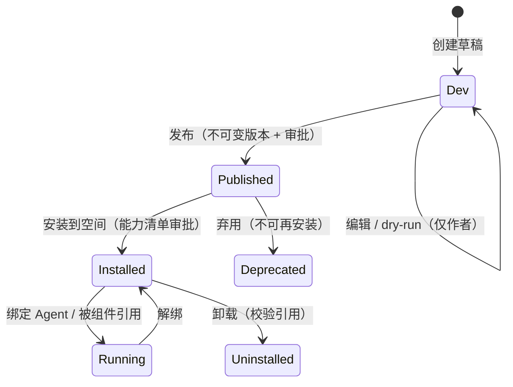

# 插件体系设计

> 状态：**设计稿 v0.2，未实现**。**不承担向下兼容**：旧目录一次性迁移，直接按目标形态实现。
> 评审通过后并入 `docs/技术方案.md` 第 16 章，并同步 `AGENTS.md`。
> 关联章节：§5.3 MCP Gateway、§5.6 Tool Management、§5.8 UI Components、§15.2 通用搜索。

---

## 0. 结论与五条原则

**一句话：插件 = 一份清单（manifest）+ 一个执行器（runtime）+ 一套能力声明（capabilities）。四类插件共用清单、生命周期、权限与审计，只有执行器不同。**

| # | 原则 | 反面（要避免的） |
|---|---|---|
| P1 | **能力统一到 `tool.Tool`**：模型只认识工具 | 给模型暴露「插件 / MCP / 组件」三个概念 |
| P2 | **单一定义点**：元数据只在 `plugin.json`，其余全是派生 | 同一字段在 manifest、frontmatter、DB、UI 各写一遍 |
| P3 | **风险由能力清单推导**，作者不能自称 | manifest 写 `risk: 1` 绕过审批 |
| P4 | **代码插件只能挂在 `Invoker` 之下** | 插件绕过策略引擎直接出网 |
| P5 | **发布即快照、安装即授权、卸装不删审计** | 热加载到生产；卸载即失去追责能力 |

---

## 1. 四类插件

| | `skill` | `tool` | `mcp` | `component` |
|---|---|---|---|---|
| 执行位置 | 无执行器（正文注入上下文） | 沙箱（Deno 进程） | 外部服务（HTTP） | 浏览器 |
| 产出 | 知识与流程 | 函数返回值 | 函数返回值 | 界面 + 事件 |
| 谁写 | 业务专家 / 模型 | 开发者 / 模型 | 集成方 | 设计 / Skill 生成 |
| 信任级别 | 纯数据，无副作用 | 不可信代码 | 半可信（有网络） | 不可信 UI |
| 失败影响 | 该轮回答质量 | 单次调用 | 单个工具 | 单个消息块 |

技能之所以也纳入插件，是为了让**「装了什么、谁授权的、哪个版本」只有一套答案**。现在技能是“文件在目录里就等于生效”，与工具的标准完全不一致。

---

## 2. 包结构与清单

### 2.1 目录形态

```text
spaces/{space_id}/files/plugins/{slug}/     # 草稿（Agent 可改）
  plugin.json          # 唯一清单
  SKILL.md             # kind=skill：正文（无 frontmatter）
  main.ts              # kind=tool：宿主 ABI 入口
  mcp.json             # kind=mcp：连接配置
  ui/bundle.js         # kind=component：前端产物
```

```text
{STORAGE_ROOT}/published/plugin/{plugin_id}/{version}/   # 发布件（不可变）
  plugin.json
  artifact/…
  .meta.json           # sha256、构建信息、审批人、发布时间
```

### 2.2 公共字段

```jsonc
{
  "protocol": "wa-plugin/1",
  "kind": "skill",                 // skill | tool | mcp | component
  "slug": "weekly_report",         // ^[a-z][a-z0-9_]{1,31}$，全局唯一
  "version": "1.0.0",              // 发布时由平台写入，草稿为空
  "name": "周报生成",
  "description": "写明「做什么 + 何时使用」，进检索与模型上下文",
  "capability": "skill.use",       // 见 §6.1
  "capabilities": [],              // 能力清单，见 §6.2
  "limits": {},
  "extensible": false              // 平台发布件专用：是否允许空间内覆盖
}
```

### 2.3 kind=skill

```jsonc
{
  "kind": "skill",
  "slug": "weekly_report",
  "capability": "skill.use",
  "skill": { "entry": "SKILL.md", "assets": ["templates/"] }
}
```

`SKILL.md` **只有正文**，没有 YAML frontmatter：`name` / `description` 一律取自 `plugin.json`，`SKILL.md` 内再写一遍即视为错误。

### 2.4 kind=tool

```jsonc
{
  "kind": "tool",
  "slug": "arxiv_search",
  "capability": "search.query",
  "input_schema": {
    "type": "object",
    "properties": { "query": { "type": "string" }, "limit": { "type": "integer", "default": 5 } },
    "required": ["query"]
  },
  "capabilities": [
    { "method": "http.request", "hosts": ["export.arxiv.org"], "verbs": ["GET"] }
  ],
  "runtime": { "entry": "main.ts", "timeout_ms": 8000, "max_rpc": 10 }
}
```

### 2.5 kind=mcp

```jsonc
{
  "kind": "mcp",
  "slug": "internal_crm",
  "capability": "http.request",
  "transport": { "type": "http", "url": "https://crm.internal/mcp" },
  "auth": { "in": "header", "name": "Authorization", "secret": "crm_token", "mode": "platform" },
  "tools": { "allow": ["lead.search", "lead.create"] },
  "runtime": { "timeout_ms": 15000, "sync_interval_s": 300 }
}
```

`tools.allow` 必填且非空：默认不信任 MCP Server 的全部工具。

### 2.6 kind=component

```jsonc
{
  "kind": "component",
  "slug": "sales_dashboard",
  "capability": "ui.render",
  "trust": "third-party",
  "ui": { "entry": "ui/bundle.js", "height": 420 },
  "data_sources": [
    { "id": "orders", "plugin": "mysql", "tool": "sql_query", "mode": "read" },
    { "id": "submit", "plugin": "crm", "tool": "lead_create", "mode": "action" }
  ],
  "events": [{ "name": "refresh", "on_event": "message" }]
}
```

`data_sources` 指向**同空间已安装**的插件工具，宿主代调；组件本身不写接口地址。

### 2.7 硬校验（加载即拒绝，不静默兜底）

| 规则 | 原因 |
|---|---|
| 未知字段报错（`DisallowUnknownFields`） | 拼错字段不能被当成默认值 |
| schema 仅 JSON Schema 子集，禁远程 `$ref`，≤ 4KB | 直接进模型上下文 |
| `slug` + 工具名 ≤ 64 字符，`^[a-z0-9_]+$` | 多数模型 API 的工具名限制 |
| `capabilities.hosts` 必须是域名（不含 scheme/端口/路径） | 白名单按域名边界匹配 |
| 不允许 `npm:` / `https:` 等远程导入 | 供应链不在 v1 范围 |
| `version` 只能在发布时写入 | 草稿带版本会诱导“手改版本号”，绕过不可变约束 |

---

## 3. 单一定义点

### 3.1 三层，职责不重叠

| 层 | 性质 | 可否人工编辑 |
|---|---|---|
| `plugin.json` | **定义** | ✅ 唯一入口 |
| 空间索引 `.meta.json` | 缓存 | ❌ 可随时删除重建 |
| DB `plugin_version` 行的 name/description | 发布时的**不可变快照** | ❌ 只写一次，之后只读 |
| `resource` 发布件的展示字段 | 从 manifest **派生** | ❌ 接口不接受这两个字段入参 |

**规则：定义只有一处；快照与缓存可以有很多，但都不可手改。** 任何 UI 都不提供「修改插件名称/描述」的第二个入口——要改就改 `plugin.json`，重新发布。

### 3.2 派生生链

```
plugin.json ──▶ 空间索引（可重建）──▶ 检索结果
            └─▶ 发布（快照 + sha256）──▶ plugin_version 行 ──▶ 资源管理展示
```

任一层都可以从上一层重建，不存在双向同步。

### 3.3 外部格式只在边界转换

- 导入标准 Agent Skills 目录：frontmatter → `plugin.json`，正文 → `SKILL.md`（一次性转换，之后以 `plugin.json` 为准）。
- 导出：反向生成带 frontmatter 的 `SKILL.md`，供其他工具消费。
- **平台内部永远不存在两份元数据。**

---

## 4. 资产来源与空间可见性

### 4.1 四类来源

| 来源 | 存放 | 生成方式 |
|---|---|---|
| **平台原语** | 代码（`internal/tool`） | 不是插件，不参与生命周期 |
| **平台预置插件** | 部署包 → 启动 reconcile 到 `published/` | 平台团队发布 |
| **空间自建插件** | 空间 `files/plugins/` | 用户 / Agent 生成 |
| **共享插件** | `published/`（用户发布） | 空间发布 |

### 4.2 可见性矩阵

| 来源 | 空间文件可见 | 资源管理可见 | 可改 | 需安装 |
|---|---|---|---|---|
| 平台原语（`file_read` 等 11 个） | ✗ | 只读展示 | ✗ | ✗（始终可用） |
| 平台预置 · `extensible: false` | **✗** | ✓ | ✗ | ✓ |
| 平台预置 · `extensible: true` | ✓ 系统空间 | ✓ | ✓（覆盖基线） | ✓ |
| 空间自建 · 已发布 | ✗（草稿除外） | ✓ | ✗（新版本才可改） | ✓ |
| 共享插件 | ✗ | ✓ | ✗ | ✓ |

### 4.3 系统空间 = 可编辑扩展区

系统空间**只放允许被扩展和修改的插件**，理由：空间文件区是用户会让 Agent 去修改的地方，把只读资产放进去只有副作用——Agent 改不动、又不知道为什么改不动。

因此：
- `extensible: false` 的内置插件**不落系统空间文件**，只存在发布件里，通过资源管理查看与安装；
- `extensible: true` 的内置插件在系统空间放一份**可编辑副本**，用户改动即覆盖基线，基线仍保留在发布件里可回滚。

### 4.4 资源管理板块

- 展示**全部已发布插件**（平台预置 + 共享），只读；
- 是「不可扩展内置件」的唯一入口；
- 提供安装、查看能力清单、查看版本历史；
- 不提供修改入口（要改回到空间草稿）。

### 4.5 平台原语不是插件

`time_now`、`file_*`、`resource_*`、`session_list`、`skill_create` 这些承载空间边界与审计不变量，**不参与插件生命周期**，也不进索引。它们的可配置项（结果额度、超时、是否对模型可见）走平台配置，不走插件机制。

---

## 5. 生命周期：开发 → 发布 → 安装 → 运行 → 卸载



### 5.1 五个阶段的定义

| 阶段 | 动作 | 产物 | 谁能做 |
|---|---|---|---|
| **开发** | 编辑器里改文件、`dry-run` 回放样例 | 草稿 + 试运行报告（RPC 轨迹、耗时、错误） | 空间 `write` |
| **发布** | 校验 → 生成不可变快照 → 审批 | `plugin_version` + `published/` 目录 | 空间 `manage`（L1/L2）/ 系统管理员（L3+） |
| **安装** | 选版本 → 审批能力清单 → 落安装记录 | `plugin_install` 行 | 空间 `manage` |
| **运行** | 绑定 Agent、被组件引用、审计、配额 | 运行时注册 + 审计记录 | Agent 作者 |
| **卸载** | 校验引用 → 摘除运行时 → 删内容 | 审计保留 | 空间 `manage` |

### 5.2 三条硬规则

1. **安装只接受已发布版本**。草稿不能装——否则“运行中的东西”没有不可变快照，出问题无法复现。
2. **绑定固定版本**，不跟 `latest`。升级是显式动作。
3. **卸载不删审计**（见 §11.1）。

### 5.3 安装语义（按 kind）

| kind | 安装后发生什么 |
|---|---|
| `skill` | 进入空间能力池，`resource_search` 可检索，Agent 可绑定；正文按需注入 |
| `tool` | 注册为 `tool.Tool`，出现在模型工具列表 |
| `mcp` | 建立连接、同步工具清单、按 `allow` 注册 |
| `component` | 可被消息 `ui-block` 引用渲染 |

卸载是逆操作：从注册表摘除、从检索池移除、关闭连接、清理缓存目录。

### 5.4 默认安装集（由部署者定义）

**部署者在运行时配置里决定装哪些内置插件**，新空间创建时按此安装：

```jsonc
// config.json
"plugins": {
  "default_install": ["weekly_report", "code_review", "internal_crm"],
  "allow_user_install": true
}
```

| 规则 | 说明 |
|---|---|
| 作用时机 | 空间创建时执行一次；已存在的空间不追溯 |
| 版本 | 装部署包内当前发布件版本；升级部署后**新空间**装新版，老空间需显式升级 |
| 缺失处理 | 配置里的 slug 不存在 → 启动告警并跳过，不阻断服务 |
| 用户可卸载 | 默认集成员与手动安装的插件在卸载上无差别 |
| 幂等 | 重复创建/重试不会产生多条安装记录 |

### 5.5 卸载与引用检查

卸载前检查三类引用，有引用则拒绝并返回清单：

1. Agent 绑定（`agent_tool` / 会话级技能）；
2. 组件的 `data_sources`；
3. 其他插件的 `capabilities`（如 tool 引用同空间 mcp 的凭证）。

### 5.6 升级与回滚

- 装新版 = 新增 `plugin_install` 的 `version`，旧记录保留；
- 回滚 = 把 `version` 指回旧值，无需重新下载；
- 已绑定的引用不自动跟随新版本。

---

## 6. 风险与权限

### 6.1 capability 取值

固定枚举（沿用 §5.6.1）：`skill.use`、`search.query`、`http.request`、`fs.read`、`fs.write`、`sql.query`、`shell.exec`、`ui.render`、`plugin.invoke`（兜底，按 L3）。**插件不能自定义 capability 名**，否则策略规则表会被绕过。

### 6.2 能力清单 → 风险

| capabilities | 风险 | 审批人 |
|---|---|---|
| 空 / 仅 `skill.use` | L1 | 免审 |
| `http` 仅 GET + 域名白名单 | L2 | 空间管理员 |
| 含非 GET / `fs.write` / 写类 MCP 工具 | L3 | 空间管理员（系统管理员可见） |
| `secret.use` + `write-external` | L4 | 系统管理员 |

`risk` 与 `side_effects` **由平台计算**，manifest 里不存在这两个字段。

### 6.3 审批对象是能力清单

管理员审的是 `hosts: ["crm.internal"]`、`tools.allow: [...]`，不是代码。审批结果记录到 `plugin_version` 与 `plugin_install`，安装即授权、卸载即回收，不做逐次审批。

### 6.4 密钥是句柄

```ts
await host.http({ url, headers: { Authorization: "secret:crm_token" } });
```

宿主执行时替换、发完即弃；插件进程内存里没有明文，`console.log(req)`、异常栈、stderr 都不可能泄漏。

---

## 7. 执行器（runtime）

### 7.1 tool：宿主 ABI

插件进程**无网络、无写文件权限**，一切 I/O 经宿主。NDJSON 双向流：

| 方向 | 帧 |
|---|---|
| 宿主 → 插件 | `{"op":"invoke","input":{…},"context":{space_id,user_id,locale,now,request_id}}` |
| 插件 → 宿主 | `{"op":"call","id":1,"method":"http.request","args":{…}}` |
| 宿主 → 插件 | `{"op":"result","id":1,"ok":true,"data":{…}}` |
| 插件 → 宿主 | `{"op":"return","data":{…}}` / `{"op":"error","message":"…"}` |

宿主 method 白名单：`http.request`（走 `Guard`）、`fs.read` / `fs.write` / `fs.list`（空间边界）、`secret.use`（只回替换结果）、`log`（进审计，不进上下文）。

插件侧 SDK 由平台以 `--preload` 注入 `globalThis.host`，避免每个插件重写协议。

**前置改造**：`sandbox.Runner` 目前是「一次性执行 + 收集输出」，需补

```go
func (r *runner) Start(ctx context.Context, spec Spec) (*Proc, error)
// Proc: Stdin io.WriteCloser / Stdout io.Reader；env 清理、私有 TMPDIR、
// 超时、进程组回收复用现有逻辑；Run = Start + 收集
```

### 7.2 mcp

复用 `mcp.Client` 的 `Initialize / ListTools / CallTool`；安装时同步工具清单落 `mcp.lock.json`，到期后台刷新，失败沿用上次快照；出网域名必须在 `capabilities` 中声明。

### 7.3 component：两种信任模式

| | `trust: platform` | `trust: third-party` |
|---|---|---|
| 谁写 | 平台 Skill 生成（§5.8.3） | 用户上传 / 模型生成 |
| 渲染 | 同源直挂（保留 §5.8.6 的零 iframe） | `<iframe sandbox="allow-scripts">`（无 `allow-same-origin`） |
| 网络 | 无直连，只能走 bridge | CSP `connect-src 'none'` |
| cookie | 拿不到 | 拿不到 |

共同底线：组件不直接发请求，`host.data()` → 宿主 → `Invoker` → 工具。写操作必须用户手势触发且 `risk ≥ L3` 时弹平台审批框。

### 7.4 skill

无执行器。安装后进入检索池；被 Agent 绑定时，正文注入当轮上下文（沿用 4000 tokens 预算）。

---

## 8. 与模型、前端的接口

### 8.1 模型侧

- 已安装的 `tool` / `mcp` 与内置工具**同构**：`Name = {slug}__{tool}`、`Parameters = input_schema`、`Risk` 来自推导、`Runtime = plugin`。
- 未安装的插件不进入工具列表，只能通过 `resource_search` 发现，模型需要征得用户同意后由用户安装。

### 8.2 `resource_search` 收窄

不再检索「内置工具清单」这类无意义条目（内置工具本来就在工具列表里）。检索范围只剩：未安装/已安装的 skill 正文、`extensible` 模板、共享插件。返回 `kind` + `scope`（`space` / `system` / `published`）。

### 8.3 组件渲染

助手消息中 ` ```ui-block {"slug":"sales_dashboard","version":"1.2.0","props":{…}} ```` → 前端加载 `/c/{slug}/{version}/bundle.js`（immutable，强缓存 1y）→ 挂载。版本固定，同一消息永远渲染同一版本。

---

## 9. 存储与数据模型

草稿只存在于文件，**发布才写 DB**（避免“草稿也要有行”带来的状态同步问题）：

```sql
plugin(id, slug unique, kind, name, description, visibility,
       status, latest_version, owner_space_id, created_at, updated_at)

plugin_version(id, plugin_id, version, manifest jsonb, artifact_path,
               sha256, capabilities jsonb, risk,
               approved_by, approved_at, published_at)
  unique(plugin_id, version)

plugin_install(id, space_id, plugin_id, version, status,
               installed_by, installed_at, approval_id)
  unique(space_id, plugin_id)
```

- `plugin.name / description` 是最近一次发布的快照，不可编辑；
- 平台预置插件在启动时 reconcile：`published/` 缺失或 hash 变化才写入；
- `mcp` 的连接健康与工具缓存放运行时态（内存 + 可选 DB），**内容不回写文件**。

---

## 10. 装配与运行

启动顺序（每步失败只影响对应插件）：

1. `sandbox.Detect()` → `sandbox.Ensure(cfg.SandboxRequire)`（已有）；
2. reconcile 平台预置发布件；
3. 读 `plugin_install` 中 `status=enabled` 的记录 → 校验清单 → 起 runtime；
4. 注册进 `tool.Registry`，与内置工具平级，**重名直接启动失败**；
5. 挂载组件静态路由；
6. 按 `plugins.default_install` 为缺失的新空间补装默认集。

运行期变更即时生效：install → 注册；disable → 摘除 + 拒绝；uninstall → 查引用后摘除。无需重启。

---

## 11. 治理

### 11.1 审计：永久保留

- 每次调用一条：`plugin_id / version / capability / decision / duration_ms / rpc_count / egress_hosts / truncated / error_code`。
- **无 TTL、无删除接口**；卸载插件只删内容与安装记录，审计保留 `slug / version / hash`，保证“谁在什么时候用它干了什么”事后可查。
- 归档到冷存储可以，但平台不主动删。

### 11.2 配额

单次：`timeout_ms`、`max_rpc`、输出 256KB；日配额：按空间统计 RPC 次数与出网字节。

### 11.3 灰度与停用

绑定指向版本，天然灰度（先绑测试空间）；`status=suspended` 立即拒绝调用，不改文件不回滚版本。

### 11.4 告警

连续失败率 > 50% 或 `p99 > 5s` 通知空间管理员；MCP 连接失败单独告警。

---

## 12. 一次性迁移（不做兼容）

| 旧 | 新 |
|---|---|
| `files/<name>/SKILL.md`（空间根） | `files/plugins/<slug>/SKILL.md` + `plugin.json`（frontmatter 转换后删除） |
| `files/skills/<name>/`（系统空间） | 仅 `extensible: true` 的保留为可编辑副本；其余移出，只留发布件 |
| `files/tools/*.json` | 删除（内容改由 `plugin.json` 承载；内置工具不再进文件） |
| `files/mcps/*.json` | 删除（镜像机制取消） |
| `mcp_server` 表 | 内容转 `mcp.json`；表改为 `plugin` + `plugin_install`，只存运行时态 |
| `space.Index` 扫三个目录 | 只扫 `plugins/` |

迁移脚本一次执行，不做双读、不做回退分支。

---

## 13. 分期与验收

| 阶段 | 内容 | 验收标准 |
|---|---|---|
| **P0** | `sandbox.Start` + NDJSON ABI + tool runtime | 白名单外域名被 `Guard` 拦住；超时整棵进程树被回收；stderr 进审计 |
| **P1** | 包模型（四类）+ 单一定义点 + 一次性迁移 | 存量技能全部转换；索引只扫 `plugins/`；无第二处元数据 |
| **P2** | 五段生命周期（开发/发布/安装/运行/卸载） | 草稿不能装；卸载有引用时拒绝并列出引用方；审计在卸载后仍可查 |
| **P3** | 默认安装集配置 | 新空间按 `plugins.default_install` 安装；slug 缺失只告警不阻断 |
| **P4** | mcp / component 插件 | `allow` 外工具不可见；第三方组件 iframe 内无法直连网络 |
| **P5** | 可见性矩阵落地 | `extensible: false` 的内置件不出现在系统空间文件里 |

---

## 14. 明确不做（v1 边界）

- ❌ 向下兼容（旧目录、旧格式一律迁移后删除）
- ❌ 除 Deno 外的运行时
- ❌ 插件 import npm / 远程模块
- ❌ 插件之间互相调用工具（防权限放大与递归）
- ❌ 插件直连数据库 / 内网
- ❌ 把 harness（`internal/agent`）做成插件
- ❌ 组件的服务端渲染与流式订阅

---

## 15. 风险与对策

| 风险 | 影响 | 对策 |
|---|---|---|
| 双工协议实现复杂（半包、崩溃、超时） | 插件随机失败 | 单写者 NDJSON、逐帧超时、进程退出即判失败并回收 |
| Deno 冷启动 ~100ms | 高频工具变慢 | 高频能力留在平台原语；插件面向“接一次用很久” |
| 一次性迁移出错 | 存量技能丢失 | 迁移前整目录备份，脚本幂等，逐空间校验条目数 |
| 组件 XSS | 会话内钓鱼 | 第三方强制 iframe 无同源 + CSP `connect-src 'none'` |
| 版本矩阵（插件 × 模型） | 排查困难 | 绑定固定版本 + 审计记录版本号 |
| 审批疲劳 | 管理员闭眼点 | 只审能力清单；L1/L2 免审或空间内自决 |
