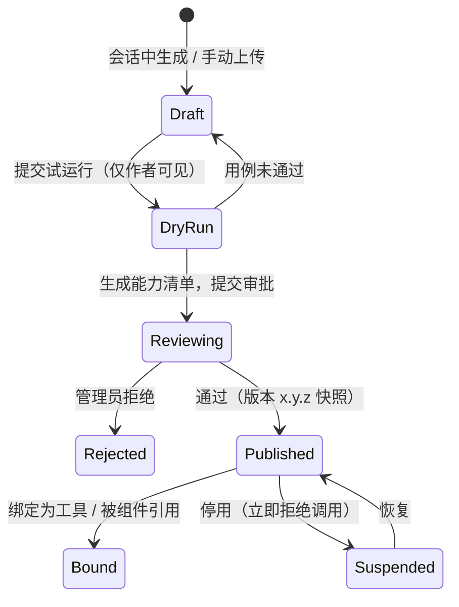

# 插件体系设计（tool / mcp / component）

> 状态：**设计稿 v0.1，未实现**。评审通过后并入 `docs/技术方案.md` 第 16 章，并同步 `AGENTS.md`。
> 关联章节：§5.3 MCP Gateway、§5.6 Tool Management、§5.8 UI Components、§15.2 通用搜索。

---

## 0. 结论与设计原则

**一句话：插件 = 一份清单（manifest）+ 一个执行器（runtime）+ 一套能力声明（capabilities）。三种插件共用清单、生命周期、权限与审计，只有执行器不同。**

四条原则，后文所有细节都从这里推导：

| # | 原则 | 反面（要避免的） |
|---|---|---|
| P1 | **能力统一到 `tool.Tool`**：插件最终都以工具形式出现，模型只认识工具 | 给模型暴露「插件」「MCP」「组件」三个概念 |
| P2 | **权限由能力清单推导，作者不能自称** | manifest 里写 `risk: 1` 就绕过审批 |
| P3 | **代码插件跑在 `Invoker` 之下**，组件跑在渲染沙箱之下 | 插件绕过策略引擎直接出网 |
| P4 | **发布即快照，绑定固定版本** | 热加载到生产，昨天能跑今天异常查不出来 |

---

## 1. 三种插件，同一件事

| | `tool` | `mcp` | `component` |
|---|---|---|---|
| 执行位置 | 平台沙箱（Deno 进程） | 外部服务（HTTP） | 浏览器（宿主页面） |
| 谁写 | 用户 / 模型生成 | 服务提供方 | 用户 / Skill 生成 |
| 信任级别 | 不可信代码 | 半可信（有网络） | 不可信代码 + 不可信 UI |
| 失败影响 | 单次调用 | 单个工具 | 单个消息块 |
| 产出 | 函数返回值 | 函数返回值 | 可交互的界面 + 事件 |

三者 **80% 的元数据相同**（名称、描述、版本、权限、输入输出 schema、审计、发布、绑定），差异只在「怎么执行」。分三套做会得到三套权限、三套发布、三套审计——这是本设计要避免的核心浪费。

> 关键统一：**组件的数据源也是工具**。组件不写接口地址，只声明 `data_sources` 指向已注册工具，宿主代它调用。于是「组件请求接口」和「Agent 调用工具」走同一条链路（策略 → 审批 → 审计 → 结果）。

---

## 2. 包结构与清单

### 2.1 目录形态

草稿在空间内可编辑，发布后进入 `published/`：

```text
spaces/{space_id}/files/plugins/{slug}/     # 草稿（可编辑）
  plugin.json
  main.ts                # kind=tool
  mcp.lock.json          # kind=mcp（同步后的工具快照）
  ui/                    # kind=component
    bundle.js
    style.css
```

```text
{STORAGE_ROOT}/published/plugin/{plugin_id}/{version}/
  plugin.json            # 清单副本
  artifact/…             # 与 kind 对应
  .meta.json             # sha256、构建信息、审批人、发布时间
```

### 2.2 公共字段

```jsonc
{
  "protocol": "wa-plugin/1",
  "kind": "tool",                  // tool | mcp | component
  "slug": "arxiv_search",          // ^[a-z][a-z0-9_]{1,31}$，空间内唯一
  "version": "0.1.0",              // x.y.z，发布时由平台写入
  "name": "arXiv 检索",
  "description": "按关键词检索论文，写明「什么场景用」",
  "capability": "search.query",    // 见 3.1，决定风险与策略
  "input_schema": { },             // JSON Schema 子集，进模型上下文
  "output_schema": { },
  "capabilities": [ ],             // 能力清单，见 3.2
  "limits": { }
}
```

### 2.3 kind=tool

```jsonc
{
  "kind": "tool",
  "slug": "arxiv_search",
  "capability": "search.query",
  "input_schema": {
    "type": "object",
    "properties": { "query": { "type": "string" }, "limit": { "type": "integer", "default": 5 } },
    "required": ["query"]
  },
  "capabilities": [
    { "method": "http.request", "hosts": ["export.arxiv.org"], "verbs": ["GET"] }
  ],
  "runtime": { "entry": "main.ts", "timeout_ms": 8000, "max_rpc": 10 }
}
```

### 2.4 kind=mcp

```jsonc
{
  "kind": "mcp",
  "slug": "internal_crm",
  "capability": "http.request",
  "transport": { "type": "http", "url": "https://crm.internal/mcp" },
  "auth": { "in": "header", "name": "Authorization", "secret": "crm_token", "mode": "platform" },
  "tools": { "allow": ["lead.search", "lead.create"], "deny": [] },
  "runtime": { "timeout_ms": 15000, "sync_interval_s": 300 }
}
```

- `auth.mode`：`platform` = 用平台凭证（上面这种）；`delegated` = 透传当前用户令牌（仅限已接入 SSO 的服务）。
- `tools.allow` 必填且非空：**默认不信任 MCP Server 的全部工具**，只暴露显式声明的那些。

### 2.5 kind=component

```jsonc
{
  "kind": "component",
  "slug": "sales_dashboard",
  "capability": "ui.render",
  "trust": "third-party",          // platform | third-party，见 5.3
  "ui": {
    "entry": "ui/bundle.js",
    "height": 420,
    "props_schema": { "type": "object", "properties": { "period": { "type": "string", "enum": ["week","month"] } } }
  },
  "data_sources": [
    { "id": "orders", "tool": "mysql__sql_query", "mode": "read",
      "params": { "sql": "SELECT ... WHERE dt >= {{period}}" } },
    { "id": "submit", "tool": "crm__lead_create", "mode": "action" }
  ],
  "events": [ { "name": "refresh", "on_event": "message" }, { "name": "hover", "on_event": "silent" } ]
}
```

### 2.6 硬校验（加载即拒绝，不静默忽略）

| 规则 | 原因 |
|---|---|
| 未知字段一律报错（`DisallowUnknownFields`） | 拼错字段名不能被当成默认值 |
| `input_schema` / `props_schema` 仅 JSON Schema 子集，禁远程 `$ref`、禁 `patternProperties`，总大小 ≤ 4KB | schema 直接进模型上下文，炸上下文比漏洞更快出事 |
| `slug` + 工具名拼接后 ≤ 64 字符，`^[a-z0-9_]+$` | 多数模型 API 的工具名限制 |
| `capabilities` 里的 `hosts` 必须是域名（不含 scheme/端口/路径） | 白名单按域名边界匹配 |
| `tools.allow` 为空视为非法 | 空清单等价于开放全部 |
| 不允许 `npm:`、`https:` 等远程导入 | 供应链不在 MVP 范围内 |

---

## 3. 风险与权限：由能力推导，不由作者声明

### 3.1 capability 取值

沿用 §5.6.1 的固定枚举：`search.query`、`http.request`、`fs.read`、`fs.write`、`sql.query`、`shell.exec`、`ui.render`。都不匹配时用 `plugin.invoke`（默认按 L3 处理）。**不允许插件自定义 capability 名**，否则策略引擎的规则表会被绕过。

### 3.2 能力清单 → 风险等级

| capabilities 内容 | 风险 | 审批 |
|---|---|---|
| 空（纯计算） | L1 | 无需 |
| `http.request` 且全部 `GET` + 域名白名单 | L2 | 空间管理员 |
| `http.request` 含非 GET / `fs.write` / `sql.execute` | L3 | 空间管理员 + 系统管理员可见 |
| 含 `secret.use` 且 `write-external` | L4 | 系统管理员，逐次审批可选 |

`risk` 与 `side_effects` **由平台根据上表计算**，manifest 里不出现这两个字段（`TestManifestRejectsSelfDeclaredRisk` 保护）。

### 3.3 密钥：句柄，不是明文

插件永远看不到密钥原文：

```ts
await host.http({ url, headers: { Authorization: "secret:crm_token" } });
```

宿主在 `http.request` 执行时替换，发完即弃。收益是结构性的：`console.log(req)`、异常栈、stderr 回传都不可能出现明文（现有的 `mask.go` 从「事后擦除」变成「结构上不可能」）。

审批粒度也随之变成「`hosts: ["export.arxiv.org"]`」——管理员看得懂域名，看不懂 TS。

---

## 4. 生命周期



- **试运行**：`POST /plugins/{slug}/dry-run`，输入样例 JSON，返回输出 + 宿主 RPC 轨迹（调了哪个 method、哪个域名、耗时、错误）。这是「模型生成的代码能不能上线」的唯一可信闸门。
- **发布**：不可变快照 + sha256 + 审批人，复用 §5.6.1 的发布约束（≤ 200 文件 / 5MB）。
- **绑定**：`tool_binding` 增加 `plugin_id` / `plugin_version` 两列，指向**具体版本**，不跟 `latest`。
- **停用**：状态位即拒绝，不改脚本、不回滚版本。

---

## 5. 执行器（runtime）

### 5.1 tool：宿主 ABI

插件进程**没有网络、没有文件系统写权限**，一切 I/O 经宿主。协议是 NDJSON 双向流：

| 方向 | 帧 | 说明 |
|---|---|---|
| 宿主 → 插件 | `{"op":"invoke","input":{…},"context":{…}}` | 首帧，`context` 含 `space_id`/`user_id`/`locale`/`now`/`request_id` |
| 插件 → 宿主 | `{"op":"call","id":1,"method":"http.request","args":{…}}` | 申请一次宿主能力 |
| 宿主 → 插件 | `{"op":"result","id":1,"ok":true,"data":{…}}` | 或 `ok:false` + `error` |
| 插件 → 宿主 | `{"op":"return","data":{…}}` | 正常结束，`data` 按 `output_schema` 校验 |
| 插件 → 宿主 | `{"op":"error","message":"…"}` | 业务错误（与崩溃区分） |

宿主 method 白名单（v1）：

| method | 策略来源 |
|---|---|
| `http.request` | `search.Guard`（https、域名白名单、拨号期 IP 校验、不跟 30x、4MB） |
| `fs.read` / `fs.write` / `fs.list` | 空间边界（`spaces/{id}/files/`），路径由宿主解析校验 |
| `secret.use` | 凭证存储，只返回句柄替换结果，不返回明文 |
| `log` | 结构化写入审计，不进模型上下文 |

插件侧 SDK 由平台以 `--preload` 注入，暴露 `globalThis.host`，避免每个插件重复写协议：

```ts
const r = await host.http({ url, method: "GET" });
return { results: r.json.items.map(…) };
```

**实现前提**：当前 `sandbox.Runner` 是「一次性执行 + 收集输出」，插件需要双向流。必须新增：

```go
func (r *runner) Start(ctx context.Context, spec Spec) (*Proc, error)
// Proc: Stdin io.WriteCloser / Stdout io.Reader；env 清理、私有 TMPDIR、
// 超时、进程组回收全部复用；Run 退化为 Start + 收集
```

这是整个体系唯一的底层改造，约 100 行。

### 5.2 mcp：连接配置 + 工具白名单

不复用 `mcp.Client` 的实现细节，只复用其能力：`Initialize` / `ListTools` / `CallTool`。

- 安装时 `Sync` 一次，工具清单落 `mcp.lock.json`（含每个工具的 `inputSchema` 摘要）；`sync_interval_s` 到期后台刷新，失败只告警，沿用上次快照。
- 暴露给模型的工具名：`{slug}__{tool}`；schema 来自 MCP `inputSchema`（同样做 4KB 截断与子集校验）。
- 调用链：`Invoker` → `plugin.Runtime.Call` → `mcp.Client.CallTool` → 结果按 4KB / 24KB 回填。
- 出网仍走 `Guard`：`url` 的域名必须在 `capabilities` 里声明，否则安装即拒。
- 与 §5.3 MCP Gateway 的关系：Gateway 是**面向外部客户端的出口**，本设计是**平台内部的插件化接入**，两者共用 `Guard` 与凭证体系，不合并实现。

### 5.3 component：两种信任模式

| | `trust: platform` | `trust: third-party` |
|---|---|---|
| 谁写 | 平台 Skill 生成（§5.8.3） | 用户上传 / 模型生成 |
| 渲染 | 同源直挂（保留 §5.8.6 的「零 iframe」） | `<iframe sandbox="allow-scripts">`（**不含 allow-same-origin**） |
| 网络 | 无直连，只能走 bridge | CSP `connect-src 'none'`，物理不可能直连 |
| 校验 | 构建期白名单 lint | 同左 + 运行时消息校验 |
| 能拿 cookie | 否（bridge 内不带） | 否（无同源） |

两种模式的共同点：**组件不直接发请求**。所有数据经 bridge：

```ts
// 组件内
const rows = await host.data("orders", { period: "month" });
host.emit("refresh", { tab: "detail" });
```

宿主侧：`host.data(id)` → 查 `data_sources` → **走 `Invoker` 调用对应工具** → 策略、审批、审计、脱敏全部自动生效。这是本设计最重要的一条：组件没有绕过平台治理的路径。

写操作（`mode: "action"`）：

- 必须由**用户手势**触发（点击），不接受组件挂载时自动调用；
- `risk ≥ L3` 时弹平台审批框（复用 `policy` + 审批流），不弹组件自己的确认框；
- 审批结果与调用记录进同一份审计。

渲染与事件：

- 助手消息里出现 ` ```ui-block {"slug":"sales_dashboard","version":"1.2.0","props":{…}} ```` 时，前端加载 `/c/{slug}/{version}/bundle.js` 并挂载；版本固定，本消息永远渲染同一版本。
- 高度由组件 `host.setHeight()` 上报，宿主夹在 `[120, 720]`。
- `events[].on_event = "message"` 的事件会作为一条用户消息追加进会话（可触发新一轮 run）；`silent` 只更新组件内部状态。**默认 silent**，避免组件把会话刷爆。

---

## 6. 与模型、前端的接口

### 6.1 模型侧

- 插件工具与内置工具**同构**：`tool.Tool` 的 `Name` = `{slug}__{tool}`，`Parameters` = `input_schema`，`Risk` / `SideEffects` 来自推导结果，`Runtime` = `plugin`。
- 不新增系统提示词规则：插件与内置工具在建言上无差别。
- 结果回填沿用现有预算：默认 4KB，读类可申请 24KB；超限截断并标注。

### 6.2 前端侧

| 能力 | 接口 |
|---|---|
| 拉取 bundle | `GET /c/{slug}/{version}/bundle.js`（immutable，强缓存 1y） |
| 组件桥 | `postMessage`，消息体 `{channel, kind: "data"\|"event"\|"height", …}`，宿主校验 `event.origin === "null"`（iframe）或同源 |
| 数据 | 宿主 → 后端 `/spaces/{id}/plugins/{slug}/data`（内部走 Invoker） |
| 事件 | 宿主 → 后端 `/spaces/{id}/sessions/{sid}/ui-events`（可选追加为用户消息） |

---

## 7. 存储与数据模型

新增 `0019_plugin.sql`（不复用 `resource_version`：resource 是**对外分发**语义，plugin 是**对内安装**语义；插件可另外发布成 resource，届时再写快照）：

```sql
plugin(id, space_id, slug, kind, name, description, status,
       latest_version, owner_id, created_at, updated_at)
  unique(space_id, slug)

plugin_version(id, plugin_id, version, manifest jsonb, artifact_path,
               sha256, capabilities jsonb, risk int,
               approval_by, approval_at, published_at)
  unique(plugin_id, version)
```

`tool_binding` 增列 `plugin_id` / `plugin_version`（空值表示内置工具或 MCP，与现状兼容）。

---

## 8. 装配与注册

`app.New` 中的顺序（每一步失败都不影响其余插件）：

1. `sandbox.Detect()` → `sandbox.Ensure(runner, cfg.SandboxRequire)`（已有）；
2. `plugin.Manager.Load(ctx)`：读 `status=enabled` 的插件 → 校验清单 → 起 runtime（tool 做 `deno check`，mcp 做 `Sync`，component 只做静态校验）；
3. 注册进 `tool.Registry`，与内置工具**平级**；命名冲突直接启动失败（不静默覆盖）；
4. 挂载组件静态路由；
5. 启动日志逐条打印 `kind / slug / version / risk / runtime`。

热加载：仅开发模式（`PLUGIN_DEV_WATCH=true`）监听**草稿目录**；生产发布即快照，不监听。

---

## 9. 治理

| 项 | 做法 |
|---|---|
| 审计 | 每次调用一条记录：`plugin_id / version / capability / decision / duration_ms / rpc_count / egress_hosts / truncated / error_code` |
| 配额 | 单次：`timeout_ms`、`max_rpc`、输出 256KB；日配额：按空间统计 RPC 次数与出网字节 |
| 灰度 | 绑定指向版本，天然灰度；新版本先绑到测试空间 |
| 停用 | `status=suspended`，调用直接返回「插件已停用」，不落到 runtime |
| 告警 | 连续失败率 > 50% 或 `p99 > 5s` 时报给空间管理员 |

---

## 10. 分期与验收

| 阶段 | 内容 | 验收标准 |
|---|---|---|
| **P0** | `sandbox.Start` + NDJSON ABI + tool runtime | 一个样例插件跑通：出网被 Guard 拦住非白名单域名；`host.http` 走白名单成功；超时被 kill；stderr 进入审计 |
| **P1** | `plugin.Manager` + 注册成 `tool.Tool` + 列表/启停接口 | 会话里出现新工具，策略与审批自动生效；停用后立即不可调用 |
| **P2** | mcp 插件（白名单 + 同步 + 配额） | 未在 `allow` 里的工具不可见；MCP 服务宕机不影响其他插件 |
| **P3** | component 插件（两种信任 + dataSources 代理 + `ui-block` 渲染） | 第三方组件在 iframe 内无法直连网络；数据经 Invoker 且有审计；写操作必须用户手势 + 审批 |
| **P4** | dry-run / 审批 / 发布 / 绑定 UI | 模型生成 → 试运行看轨迹 → 审批 → 绑定 → 可停用可回滚 |

---

## 11. 明确不做（v1 边界）

- ❌ 除 Deno 外的运行时（WASM / Python 留到 ABI 验证之后再评估）；
- ❌ 插件 import npm / 远程模块（供应链不在 MVP 范围）；
- ❌ 插件之间互相调用工具（防权限放大与递归）；
- ❌ 插件直连数据库或内网（一律经 `http.request` + 白名单）；
- ❌ 把 harness（`internal/agent`）做成插件（见讨论：控制面不开放）；
- ❌ 组件的服务端渲染与流式数据订阅（v1 只做请求/响应）。

---

## 12. 风险与对策

| 风险 | 影响 | 对策 |
|---|---|---|
| 双工协议的实现复杂（半包、崩溃、超时） | 插件随机失败 | 单写者 NDJSON、逐帧超时、进程退出即判失败并回收 |
| Deno 冷启动 ~100ms | 高频工具变慢 | 高频能力留在内置工具；插件面向「接一次用很久」的场景 |
| 组件 XSS / 点击劫持 | 用户在会话里被钓鱼 | 第三方强制 iframe 无同源、CSP `connect-src 'none'`、写操作必须审批 |
| 版本矩阵（插件 × 模型 × 工具） | 排查困难 | 绑定固定版本 + 审计记录版本号 + dry-run 回放 |
| 审批疲劳 | 管理员闭眼点 | 审批对象是**能力清单**（域名/权限），不是代码；L1/L2 免审 |
| 插件滥用平台资源 | 单空间拖垮全站 | 超时 + max_rpc + 日配额 + 并发上限 |
