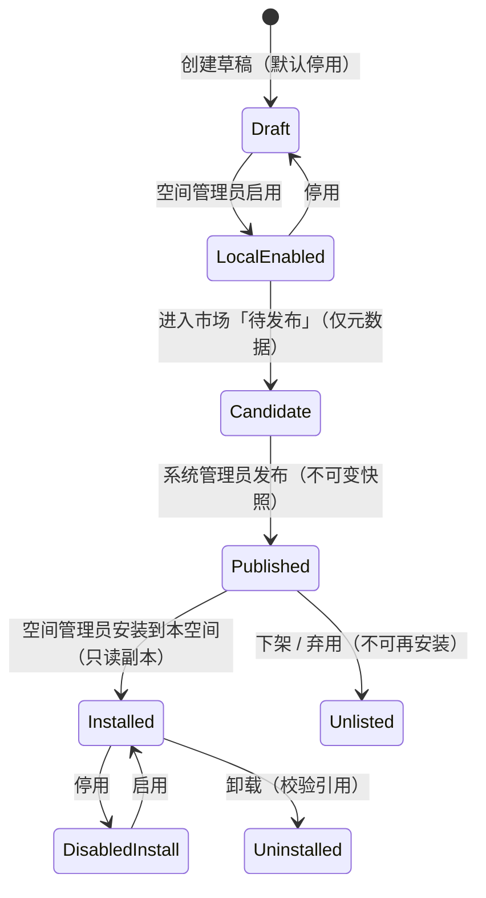

# 插件体系设计

> 状态：**v0.3 已实现**（组件为声明式 DSL）。**不承担向下兼容**：旧目录一次性迁移，直接按目标形态实现。
> 评审通过后并入 `docs/技术方案.md` 第 16 章，并同步 `AGENTS.md`。
> 关联章节：§5.3 MCP Gateway、§5.6 Tool Management、§5.8 UI Components、§15.2 通用搜索。

---

## 0. 结论与五条原则

**一句话：插件 = 一份清单（manifest）+ 一个执行器（runtime）+ 一套能力声明（capabilities）。六类插件共用清单、生命周期、权限与审计，只有执行器不同（`agent` 没有执行器，只有提示词与依赖；`source` 的执行器是宿主内的搜索适配器）。**

| # | 原则 | 反面（要避免的） |
|---|---|---|
| P1 | **能力统一到 `tool.Tool`**：模型只认识工具 | 给模型暴露「插件 / MCP / 组件」三个概念 |
| P2 | **单一定义点**：元数据只在 `plugin.json`，其余全是派生 | 同一字段在 manifest、frontmatter、DB、UI 各写一遍 |
| P3 | **风险由能力清单推导**，作者不能自称 | manifest 写 `risk: 1` 绕过审批 |
| P4 | **代码插件只能挂在 `Invoker` 之下** | 插件绕过策略引擎直接出网 |
| P5 | **发布即快照、安装即授权、卸装不删审计** | 热加载到生产；卸载即失去追责能力 |

---

## 1. 六类插件

| | `skill` | `tool` | `mcp` | `component` | `agent` |
|---|---|---|---|---|---|
| 执行位置 | 无执行器（正文注入上下文） | 沙箱（Deno 进程） | 外部服务（HTTP） | 宿主前端（DSL 解释） | 无执行器（提示词 + 依赖） |
| 产出 | 知识与流程 | 函数返回值 | 函数返回值 | 界面 + 交互动作 | 会话行为设定 |
| 谁写 | 业务专家 / 模型 | 开发者 / 模型 | 集成方 | 设计 / Skill 生成 | 业务专家 |
| 信任级别 | 纯数据，无副作用 | 不可信代码 | 半可信（有网络） | 纯数据，无可执行内容 | 纯数据，能力来自依赖 |
| 失败影响 | 该轮回答质量 | 单次调用 | 单个工具 | 单个消息块 | 该会话的风格与步骤 |

技能之所以也纳入插件，是为了让**「装了什么、谁授权的、哪个版本」只有一套答案**。现在技能是“文件在目录里就等于生效”，与工具的标准完全不一致。

---

## 2. 包结构与清单

### 2.1 目录形态

```text
spaces/{space_id}/files/plugins/{slug}/     # 草稿（Agent 可改）
  plugin.json          # 唯一清单
  SKILL.md             # kind=skill：正文（无 frontmatter）
  main.ts              # kind=tool：宿主 ABI 入口
  mcp.json             # kind=mcp：连接配置
  ui.json              # kind=component：声明式 UI（不是代码）
```

```text
{STORAGE_ROOT}/published/plugin/{plugin_id}/{version}/   # 发布件（不可变）
  plugin.json
  artifact/…
  .meta.json           # sha256、构建信息、审批人、发布时间
```

### 2.2 公共字段

```jsonc
{
  "protocol": "wa-plugin/1",
  "kind": "skill",                 // skill | tool | mcp | component
  "slug": "weekly_report",         // ^[a-z][a-z0-9_]{1,31}$，全局唯一
  "version": "1.0.0",              // 发布时由平台写入，草稿为空
  "name": "周报生成",
  "description": "写明「做什么 + 何时使用」，进检索与模型上下文",
  "capability": "skill.use",       // 见 §6.1
  "capabilities": [],              // 能力清单，见 §6.2
  "limits": {},
  "extensible": false,             // 平台发布件专用：是否允许空间内覆盖
  "derived_from": {                // 仅在系统空间副本（及其发布件）中出现，由平台写入
    "plugin_id": "plg_01H…",
    "version": "1.2.0",
    "sha256": "…"
  }
}
```

### 2.3 kind=skill

```jsonc
{
  "kind": "skill",
  "slug": "weekly_report",
  "capability": "skill.use",
  "skill": { "entry": "SKILL.md", "assets": ["templates/"] }
}
```

`SKILL.md` **只有正文**，没有 YAML frontmatter：`name` / `description` 一律取自 `plugin.json`，`SKILL.md` 内再写一遍即视为错误。

### 2.4 kind=tool

```jsonc
{
  "kind": "tool",
  "slug": "arxiv_search",
  "capability": "search.query",
  "input_schema": {
    "type": "object",
    "properties": { "query": { "type": "string" }, "limit": { "type": "integer", "default": 5 } },
    "required": ["query"]
  },
  "capabilities": [
    { "method": "http.request", "hosts": ["export.arxiv.org"], "verbs": ["GET"] }
  ],
  "runtime": { "entry": "main.ts" }
}
```

runtime 默认一次性：每次调用起一个新进程、跑完即退。需要跨调用保留连接/缓存时写 `"resident": true`
（代价是常驻内存与一个进程池名额）。常驻进程的约定与一次性不同，写清单前要知道三条：

- **安装/启用即启动，本地草稿同样如此**：三个入口——安装（安装即启用）、启用已安装件、
  启用本地草稿——都在那一刻把进程拉起来，不是等到第一次调用才冷启动。运行期让第一个业务请求承担初始化
  （建连接、加载字典、预热模型）会变成一次真实的业务失败，而不是「慢一点」。
  **是否常驻只看清单里的 `runtime.resident`，不看有没有发布**：草稿被启用之后就是本空间真正在用的插件，
  按发布状态分成两套执行形态，会让作者在发布前后看到完全不同的进程行为，调试结论全部失效。
  `plugin_try` 例外——试跑必须跑完即退，草稿代码不留在池里。
- **不按空闲回收**：常驻收益就是摊掉冷启动与保留进程内状态，空闲几分钟就杀等于退回一次性。
  只在停用/卸载/换版本/改配置/空间重载/服务退出时结束，池满时淘汰最久未用的空闲进程兜底。
- **崩溃自动重启，连续失败熔断**：异常退出按指数退避重启（300ms→5s），连续超过 5 次
  （`PLUGIN_PROC_MAX_RESTARTS`）停止重启，调用直接返回「插件不可用」；成功执行一次即清零。
  所以崩溃的那一次调用仍会失败（不自动重放，避免重复副作用），恢复的是后续调用。

`timeout_ms` / `max_rpc` 属于 `limits`，写进 runtime 会被拒绝。

`entry` 必须是 `.ts` / `.js`：执行器就是 `deno run`，平台没有 Python / Node 运行时，沙箱也不给 `--allow-run`。
写成 `.py` / `.sh` 时清单解析直接失败，不会拖到试运行才报「未知扩展名」。

### 2.5 kind=mcp

```jsonc
{
  "kind": "mcp",
  "slug": "internal_crm",
  "capability": "http.request",
  "transport": { "type": "http", "url": "https://crm.internal/mcp" },
  "auth": { "in": "header", "name": "Authorization", "secret": "crm_token", "mode": "platform" },
  "tools": { "allow": ["lead.search", "lead.create"] },
  "runtime": { "timeout_ms": 15000, "sync_interval_s": 300 }
}
```

`tools.allow` 必填且非空：默认不信任 MCP Server 的全部工具。

`tools.writes: true` 声明这些工具会改动远端状态（建单、改状态、删数据）。远端工具对平台是黑盒——除了 `input_schema` 没有别的语义，也看不到它实际发了什么请求——所以「是否写」不可能像脚本插件那样从出网动词推导，只能由作者显式声明。不声明按只读处理（远端鉴权、只读账号、限流与审计是第一道闸）；声明之后每次调用都要人工确认（与脚本插件的「出网非只读」同一个口径），风险等级抬到 L3，卡片上的 `L3` 让人一眼看出这一步会改远端。

`transport.url` 默认要求 https：MCP 是宿主自己发 HTTP 出去（`internal/mcp` 是裸 `http.Client`，不经 `search.Guard`），URL 校验是唯一的约束点。企业内网的 MCP Server 常常只有 http 一档，所以留了一个显式口子：`"allow_http": true`。写出来才放行，`Manifest.Permissions()` 会把这条线标成「明文 http」，安装确认时看得见；本机（`localhost` / `127.0.0.1` / `::1`）用 http 不必声明。它是「允许」不是「必须」——清单可以写 https 地址同时声明 `allow_http`，安装方才能在安装级配置里把地址覆盖成内网 http；反过来，发布方没声明时，改配置也绕不过 https。它**不改变风险等级**（仍是「只读有成本」）：内网 http 不扩大可达范围、也不增加副作用，代价只是链路不加密，所以用权限文案暴露而不是抬等级——抬成写风险会让内网 MCP 每次调用都要审批，把「明文」错当成「写操作」。这一点与 `source.allow_private` 不同，后者是真能穿过公网边界去看内网接口。

### 2.6 kind=component

```jsonc
{
  "kind": "component",
  "slug": "sales_dashboard",
  "capability": "ui.render",
  "ui": { "entry": "ui.json" },
  "data_sources": [
    { "id": "orders", "plugin": "mysql", "tool": "sql_query", "mode": "read", "params": { "limit": 20 } },
    { "id": "submit", "plugin": "crm", "tool": "lead_create", "mode": "action" }
  ]
}
```

`ui.entry` 默认 `ui.json`，必须是 DSL（`.json`），不能是脚本；`data_sources` 指向**同空间已安装**的插件工具，宿主代调；组件本身不写接口地址、不写工具名，也没有 `trust` / `events`——DSL 没有代码，不需要按信任级别分渲染通道。

### 2.7 硬校验（加载即拒绝，不静默兜底）

| 规则 | 原因 |
|---|---|
| 未知字段报错（`DisallowUnknownFields`） | 拼错字段不能被当成默认值 |
| schema 仅 JSON Schema 子集，禁远程 `$ref`，≤ 4KB | 直接进模型上下文 |
| `slug` + 工具名 ≤ 64 字符，`^[a-z0-9_]+$` | 多数模型 API 的工具名限制 |
| `capabilities.hosts` 必须是域名（不含 scheme/端口/路径） | 白名单按域名边界匹配 |
| 不允许 `npm:` / `https:` 等远程导入 | 供应链不在 v1 范围 |
| 组件 DSL：节点/字段白名单，≤ 300 节点、≤ 8 层、≤ 64KB | 解释器不猜语义，写错即拒绝 |
| 组件绑定只允许 `{{state.x}}` / `{{props.x}}` / `{{data.<id>.x}}` | 不做表达式求值，就没有注入面 |
| 组件 `data.*` / `action.*` 只能引用清单里的 `data_sources[].id` | 组件不能自己发明工具调用 |
| `version` 只能在发布时写入 | 草稿带版本会诱导“手改版本号”，绕过不可变约束 |

---

## 3. 单一定义点

### 3.1 三层，职责不重叠

| 层 | 性质 | 可否人工编辑 |
|---|---|---|
| `plugin.json` | **定义** | ✅ 唯一入口 |
| 空间索引 `.meta.json` | 缓存 | ❌ 可随时删除重建 |
| DB `plugin_version` 行的 name/description | 发布时的**不可变快照** | ❌ 只写一次，之后只读 |
| `resource` 发布件的展示字段 | 从 manifest **派生** | ❌ 接口不接受这两个字段入参 |

**规则：定义只有一处；快照与缓存可以有很多，但都不可手改。** 任何 UI 都不提供「修改插件名称/描述」的第二个入口——要改就改 `plugin.json`，重新发布。

### 3.2 派生生链

```
plugin.json ──▶ 空间索引（可重建）──▶ 检索结果
            └─▶ 发布（快照 + sha256）──▶ plugin_version 行 ──▶ 插件市场展示
```

任一层都可以从上一层重建，不存在双向同步。

### 3.3 外部格式只在边界转换

- 导入标准 Agent Skills 目录：frontmatter → `plugin.json`，正文 → `SKILL.md`（一次性转换，之后以 `plugin.json` 为准）。
- 导出：反向生成带 frontmatter 的 `SKILL.md`，供其他工具消费。
- **平台内部永远不存在两份元数据。**

---

## 4. 资产来源、市场与空间可见性

### 4.1 三条来源

| 来源 | 存放 | 生成方式 | 发布权 |
|---|---|---|---|
| **空间自建** | 空间 `files/plugins/` | 空间成员 / Agent 开发 | **系统管理员**（空间管理员只能启用，不能发布） |
| **平台内置** | 部署包 → 启动 reconcile 到 `published/` | 平台团队随产品发布 | 随产品发布 |
| **外部** | 外部提交（本轮不做） | 外部开发者 | 系统管理员决定是否允许内部可见 |

发布权和安装权必须分开：

- **系统管理员**决定插件能否进入组织目录（发布 / 下架 / 外部可见）；
- **空间管理员**决定插件是否装进自己的空间，以及启用 / 停用 / 卸载；
- 普通成员可以浏览市场、使用本空间已启用的插件，不能发布或安装。

### 4.2 市场分类

| 分类 | 含义 | 全员可见 | 可安装 | 操作者 |
|---|---|---|---|---|
| **组织内 · 待发布** | 空间已启用、尚未发布 | 是，但只展示元数据 | 否 | 系统管理员发布 |
| **组织内 · 已发布** | 已进入组织目录 | 是 | 是 | 空间管理员安装 |
| **平台内置** | 随产品发布的内置件 | 是（单独分组） | 是 | 空间管理员安装 |
| **外部 · 内部可见** | 系统管理员授权内部可见 | 是 | 是 | 空间管理员安装 |
| **外部 · 未授权** | 未授权 | 否 | 否 | — |

「待发布」对全员可见的是**元数据**：所在空间、作者、描述、版本、风险、能力清单；插件文件内容只有系统管理员能读。这样既能让作者之外的人知道组织里在做什么，也不会泄露未发布内容。

待发布不是可安装状态。系统管理员发布后，条目进入「组织内 · 已发布」，其他空间才可以安装。

### 4.3 空间内的两类插件

空间 `files/plugins/` 下同时承载两类插件，用平台写入的 `.install.json` 区分：

| 类型 | 目录 | 可编辑 | 默认状态 | 谁管理 |
|---|---|---|---|---|
| **空间本地插件** | `plugins/<slug>/` | 是 | 停用 | 空间成员编辑，空间管理员启用 |
| **已安装插件** | `plugins/<slug>/` | **否** | 启用 | 空间管理员启停 / 卸载 |

- 同一 `<slug>` 在空间内只能存在一种：本地开发目录与安装副本互斥；
- 安装时检查同 slug 的本地目录，存在则拒绝，要求先改名或归档；
- 启用本地插件时再查一次安装记录，同 slug 已安装则不可启用（防止历史副本或绕过 API 创建的目录）；
- 安装副本由平台写入 `.install.json`（来源插件、版本、hash、安装人、安装时间），`plugin.json` 也由平台生成；
- 文件树给安装目录打锁；文件编辑、重命名、删除、Agent `file_write` 一律拒绝；加载时校验 hash，发现被改拒绝加载并告警。

> `shell` 仍可能绕过服务层校验。MVP 至少限制 shell 对 `plugins/` 的写权限；后续把安装副本放到平台只读存储，`/plugins/<slug>` 只做逻辑视图。

### 4.4 市场与已装插件的位置

- 一级菜单只有 **插件市场**，全员可见，不再有「已装插件」二级页；
- 市场分类是**左侧二级菜单**（`/plugins/market/{category}`）：组织内已发布 / 组织内待发布 / 平台内置 / 外部（内部可见），右侧只保留类型筛选与列表；
- 已装插件属于空间，入口在空间页 / 空间树，不在市场；
- 市场卡片显示：来源分类、来源空间、作者、版本、风险、能力清单、当前空间是否已安装；
- 空间管理员在市场里选版本安装到当前空间，明确提示「只对当前空间生效」；平台内置件没有安装按钮（全空间默认可用）；
- **安装级配置**存 `plugin_install.config`（未发布的草稿存 `plugin_candidate.config`），按空间覆盖，发布快照不动；保存后整空间重载并记 `plugin.config` 审计（审计里带 `draft: true/false`，能区分改的是哪一层）。字段有两类来源，同一张表单按「平台内建 → 清单声明」排列：
  - **平台内建**：由 `kind` / `capability` 生成、被执行器直接消费的字段——MCP 的服务地址与鉴权 Header、凭证引用名；工具的**审批档位**（`approval_policy`：界面上只有 `declared`「需要用户审批」与 `off`「不需要用户审批」两档；`declared` 由清单声明判断哪些调用有风险，`always` 已从界面移除，只作为历史值兼容——旧配置继续按「每次都问」执行，界面显示成「需要用户审批」，保存时不回写；卡片上常驻显示，点「配置」或直接点徽标可改；不是风险等级的另一种写法，等级仍只用于展示）；`shell_exec` 的需确认命令名单。凭证只存引用名。
  - **清单声明**（`plugin.json` 的 `config` 段）：`key / label / type / required / default / placeholder / help / options / min / max / max_length / item / max_items`，类型限 `text / textarea / number / boolean / select / url / list / secret_ref / records`。键名须为小写字母开头的 `[a-z0-9_]` 且不能占用平台保留键（`url` / `auth_name` / `secret` / `approval_policy` / `approval_commands`）。`required` 与 `default` 互斥（有默认值就永远不为空）。**只有脚本工具能声明**：内置件的执行体在 Go 里、技能/组件/智能体没有执行器，声明了也没人读，`Validate` 直接拒绝。
  - 生效值 = 清单 `default` 打底 + 安装值覆盖；可选字段清空即回到默认、不落库；未知键一律拒绝（不明语义的值不存）。运行时脚本用 `await wa.config()` 取全量键值（宿主 RPC `config.get`，**不需要在 `capabilities` 里声明**——读的是安装方给自己的插件填的值）：标量字段是 `string`，`records` 字段是**对象数组**（`config.get` 直接返回嵌套值，不是序列化后的 JSON 字符串，作者不用自己 `JSON.parse`）；敏感信息用 `secret_ref` 引用凭证名，脚本再 `host.secret()` 取明文。保存配置会重建运行时（含常驻进程），不存在读到旧配置的窗口。
- 内置工具（`file_write`、`wiki_write`、`shell_exec` 等）同样支持档位：它们只有系统空间那一份安装记录，档位与 shell 的命令名单都在那里的卡片上配、对全部空间生效（读取侧是 `tool.builtinPolicy`，配置入口由 `configFields` 给出，两边都按 `KindTool` 判断，不会出现「有徽标没入口」的卡片）。
- 档位的界面只有**两档**：字段名「风险控制」，选项「需要用户审批 / 不需要用户审批」，每档说明「大模型调用该工具时，需要 / 不需要用户审批」。字段标题下一行是**能力清单**，按事实写全：「该工具需要访问 api.dingtalk.com、oapi.dingtalk.com 域名，写本空间的文件。」没有出网声明的按能力写「会写 / 会读本空间的文件」，shell 写「会在本机执行命令」，MCP 写「会调用远端服务」。不出现 `declared` / `always` / `off` 与「声明」「沙箱」「白名单」这类实现词。
- 「需要用户审批」直接落到 `declared`（按清单声明拦有风险的调用），它就是执行侧的缺省值，不存在第三个档位。独立的 `always` 档已从界面移除：三档并存时用户既要理解「什么算风险」，又要猜这一档到底拦不拦，最后没人能预期某次调用会不会被打断。旧配置里的 `always` 仍被识别并按「每次都问」执行，界面显示成「需要用户审批」，但**不回写**——保存是整表提交，把 `always` 改写成 `declared` 会让「只改了个 AppKey」的保存静默放宽确认范围。
- **配置页与审批卡是两套话术，不能互相复用**。配置页是管理员视角，回答「别人用这个插件时会不会被打断、这个档位松到什么程度」；审批卡是操作者视角，回答「这一步到底要做什么、做完能不能撤」。把「做完撤不回来」写进配置页，或在审批卡上写「保存后立即生效」，都是场景错位——同一个词在两个场景里指的不是一件事。

### 4.5 平台原语不是插件

`file_*`、`resource_*`、`session_list` 这些承载空间边界与审计不变量，**不参与插件生命周期**，也不进索引。它们的可配置项（结果额度、超时、是否对模型可见）走平台配置，不走插件机制。时间不属于这一类：它由 `session` 层把用户端上报的本地时间与时区直接写进系统提示词的 `## 当前时间` 段（取不到才回落服务器时间），既没有插件也没有工具——模型对「今天几号」有训练期先验，做成工具它会不查就答。

### 4.6 配置与凭证的录入权限

现状是一个死循环：凭证只有系统管理员能写（`/admin/secrets` 的 `requireAdmin`），而插件的配置项只有空间 `manage` 能改。结果是插件开发者在会话里写不出可运行的插件（缺凭证，`plugin_try` 直接失败），空间管理员装完插件也配不了自己的 AppSecret，只能挨个找管理员代录；每多一个机器人（一个智能体一套凭证）就多一次人工转交。

**凭证的 scope 改成实例级，权限按空间判定**：

| 角色 | 能写什么 | 依据 |
|---|---|---|
| 插件开发者 | 本空间**未发布草稿**可用的凭证名（`secret.use` 声明的 + `records` 子字段引用的） | 空间 `write`——改草稿就能试运行 |
| 空间管理员 | 本空间**已安装/已启用**插件的凭证名 | 空间 `manage`——安装时一次配完 |
| 系统空间管理员 | 系统空间那份安装记录（内置件的全局默认）的凭证名 | 系统空间成员固定 `manage`，即系统管理员 |
| 平台级 | `search` 凭证、MCP 应用密钥 | 系统管理员工号白名单 |

- **scope 由路径推导，前端不传**：`PUT /spaces/{id}/plugins/{slug}/secrets/{name}`，服务端算出 `plugin:<spaceID>|<slug>`。放开一个「scope 是自由字符串」的接口，等于允许写任意空间、任意插件的凭证；路径绑定是唯一能收口的做法。
- **判定不看有没有 `plugin_install` 行，看「这个 slug 在该空间是否可用」**：草稿存在（本地开发）或安装记录存在（已装）二者之一即可。开发期的草稿永远没有安装记录，而它恰恰最需要凭证——按「必须在 install 上配」实现，等于把 §4.6 开头那个死循环原样保留。
- **`{id}` 必须是这条实例的归属空间**：scope 跟着「配置归属」走，不跟着「调用方空间」走。`origin=system` 的内置件只有系统空间那一份安装记录，业务空间对它写凭证一律 403；同时运行时取凭证也必须用**安装记录的空间**（与 `tool.builtinPolicy` 读系统空间那份同源），否则内置件在业务空间调用时会去找一份没人填过的 `plugin:<业务空间>|<slug>`。
- **授权边界是 scope，不是名字白名单**：机器人数量由使用者决定（§4.7），凭证名 `bot_a_secret` / `bot_b_secret` 不可能在清单里预先枚举。`secret.use` 保留为「这个插件需要哪些凭证」的**安装页提示**，真正的越权防护是 scope 里带 slug——插件读不到别的插件、别的空间的凭证，名字格式仍受 `configNameRe` 限制。
- **明文只写不读**：`GET .../secrets` 只回 `name` / `configured` / `fingerprint` / `can_write`，与 `SecretSettingsDialog` 的口径一致。
- **同名回落**：`secret.get` 先查实例 scope，未命中回落旧的全局 `plugin` scope，存量凭证不用迁移（迁移要解密再加密，收益为零）；新写入一律落实例 scope。
- **平台级 scope 不开放**：`search` 与 MCP 应用密钥没有空间归属，放开等于任意外空间成员可写。
- **审计**：`plugin.secret.write` 记 `space / slug / name / actor`，不记值，与 `plugin.config` 同级。

### 4.7 结构化配置：`records`

有些插件的参数**数量由使用者决定**：一个渠道插件要接几台机器人、一个数据源插件要连几个库，平台不可能在清单里写死「robot_1 / robot_2 / …」。`list` 只能存逗号分隔的字符串，装不下「每项有 AppKey、RobotCode、各自的密钥、各自的智能体」这种结构。所以新增一种字段类型 `records`：**一个由使用者增删的对象数组，元素结构由作者在清单里声明**。

```jsonc
{
  "key": "bots", "label": "机器人", "type": "records",
  "help": "每个机器人一条；运行时用 wa.config().bots 读到数组",
  "max_items": 20,
  // 从没配过时的初始条目；保存过一次之后就以存储为准
  "default": [
    { "name": "默认机器人", "app_key": "", "app_secret": "", "robot_code": "", "agent": "base" }
  ],
  "item": {
    "label": "机器人",
    "title_key": "name",          // 折叠面板标题取这一列
    "fields": [
      { "key": "name",       "label": "名称",       "type": "text", "required": true },
      { "key": "app_key",    "label": "AppKey",     "type": "text", "required": true },
      { "key": "app_secret", "label": "AppSecret",  "type": "secret_ref", "required": true },
      { "key": "robot_code", "label": "RobotCode",  "type": "text" },
      // agent_ref：存智能体 slug，前端渲染成本空间智能体选择器
      { "key": "agent",      "label": "对应智能体",  "type": "agent_ref", "default": "base" }
    ]
  }
}
```

规则：

- **默认值分两层，解决两个不同的问题**：
  - `item.fields[].default` 是**新增一条时的预填值**（如 `agent` 预填 `base`）——点「添加」不该给一个空表单，让使用者猜每个字段该填什么。
  - `records` 自己的 `default` 是**一条都没有时的初始条目集**——安装页第一次打开就有一条可改的样例，而不是一片空白。
- **`records` 的 `default` 只在「从没配过」时生效**（`storedConfig` 里没有这个键），**不做逐条合并**：使用者删掉一条就真的没了，下一次加载不会从 `default` 里把它补回来。这与标量字段「清空即回默认」不同——`records` 保存空数组是**合法值**（等于「一台都不配」），因为默认条目只是样例，不是有效配置；真要求至少一条就标 `required: true`（此时不允许 `default: []`，与「有默认值就永远不为空」同一条规则）。
- **`default` 里的每一项必须是完整对象**：缺的子键按「未填」处理，不去套子字段自己的 `default`——两处都补值，作者改了子字段默认值会静默改掉存量条目的含义。
- **子字段只允许标量类型**（`text / textarea / number / boolean / select / url / secret_ref / agent_ref`），不允许再嵌 `records` / `list`：两层足够表达「一组配置」，再深一层就没人愿意在表单里点开三层折叠。
- **`agent_ref` 是「指向本空间智能体」的引用**：存的仍是 slug（与 `secret_ref` 只存名字同一路数），但语义比 `text` 强——前端渲染成本空间智能体选择器（`options_from: {source: "@agents"}`），保存时校验该 slug 在本空间可用，留空即平台默认 `base`。**它是平台唯一认识语义的配置项**，因为「这条配置服务于哪个智能体」直接决定消息投给谁；字段名仍由作者定（`agent` / `bot_agent` 都行），平台只认类型。
- **`agent_ref` 不建外键**：智能体被卸载后配置里的 slug 只是**失效**——读到时报「该智能体已不可用」，而不是让整份配置保存失败（保存失败会让用户连别的字段都改不了）。这与 `secret_ref` 指着名字、对应密钥可能没配是同一处理方式。
- **校验复用同一套**：`validateConfigValue` 按子字段类型逐项校验，`required` 逐项生效，未知子键拒绝；`max_items` 默认 20、硬上限 50（一节表单放不下更多，而且每项都可能带密钥）。
- **`secret_ref` 子字段只存名字**：保存时把凭证名写进配置，明文走 `PUT .../secrets/{name}`（§4.6）；名字同样受 `configNameRe` 限制。
- **整体大小上限 32KB**：`records` 是使用者填的数据，不能让它撑爆 `plugin_install.config`——jsonb 单行太大，每次加载都要整行解出来。
- **读取是结构化的**：`config.get` 把 `records` 字段解析成数组返回，`wa.config().bots` 的类型是 `Array<Record<string, string>>`。**不让作者自己 `JSON.parse`**——那等于把「平台已经知道结构」这个事实丢掉，让每个插件重新实现一遍解析与容错。
- **`ConfigItem.Default` 从 `string` 改 `json.RawMessage`**：标量字段的默认值仍是 JSON 字符串（`"default": "3"`，数字也写字符串，与 `min` / `max` 同一约定），`records` 是数组。`ConfigDefaults()` 随之返回 `map[string]any`，`config.get` 原样透传。**不要为 `records` 另加一个 `default_items` 字段**——那会让作者记两个名字，而「有默认值就永远不为空」这条规则要写两遍。
- **前端按 `item.fields` 渲染**：一组可增删的折叠面板，标题取 `title_key` 那一列；密钥是独立控件，值不回显（见 `docs/前端设计规范.md` §5.9）。
- **它不代替「需要哪些凭证」的提示**：`secret.use` 声明的是静态必填凭证（如搜索源的 `api_key`）；`records` 里的 `secret_ref` 是随条目动态产生的。两者一起汇总到安装页，但动态那部分只有使用者加了条目之后才可能出现——所以没配过的机器人显示「缺」，而不是在安装时就凭空列出 N 个名字。

---

## 5. 生命周期：开发 → 启用 → 发布 → 安装 → 运行 → 卸载



### 5.1 阶段定义

| 阶段 | 动作 | 产物 | 谁能做 |
|---|---|---|---|
| **开发** | 编辑空间 `plugins/<slug>/`，`dry-run` 回放样例 | 草稿 + 试运行报告 | 空间 `write` |
| **启用** | 校验清单、检查与安装记录是否重名 | 本地插件进入本空间运行池；市场出现「待发布」元数据 | 空间 `manage` |
| **发布** | 系统管理员审能力清单、生成不可变快照 | `plugin` + `plugin_version` + `published/` | 系统管理员 |
| **安装** | 选版本、确认风险、复制只读副本 | `plugin_install` + 空间 `plugins/<slug>/` | 空间 `manage` |
| **运行** | 绑定 Agent、组件引用、审计 | 运行时注册 + 审计 | 空间成员 |
| **卸载** | 校验引用、摘运行时、删副本 | 审计保留 | 空间 `manage` |

### 5.2 硬规则

1. **发布只由系统管理员执行**；空间管理员只能把本地插件启用为候选，不能直接进组织目录。
2. **本地插件未启用不得使用**：不进入检索、工具列表、MCP 连接、组件渲染。
3. **安装只接受已发布版本**（含平台内置、外部内部可见版本），草稿不能装。
4. **安装副本只读**：启用、停用、卸载、升级是仅有的操作。
5. **绑定/安装固定版本**，升级是显式动作；**卸载不删审计**。

### 5.3 本地插件启用

- 新建草稿默认停用；
- 空间管理员启用时校验 `plugin.json`、slug、与安装记录是否重名；
- 启用后进入本空间能力池，所有空间成员可用；
- 启用状态下仍可编辑，保存后热重载；校验失败自动回落到停用并提示；
- 启用不改变可见范围，也不产生发布快照。

**在插件目录下新建会话**：树里对插件目录点「新建会话」，会话的 `dir` 记录为 `plugins/<slug>`。
系统提示词据此注入「当前会话的目录」段落：插件名、类型、说明，并要求默认围绕该插件做事
（改清单与正文、解释行为、`plugin_try` 试跑），文件路径写相对空间根的完整路径。
清单还没写合规时按 slug 兜底，仍按插件目录处理，不会退化成普通目录。
已安装（只读）插件目录不提供该入口。

### 5.4 发布

- 系统管理员在「待发布」列表选择候选，查看空间、作者、描述、风险、能力清单；
- 发布前校验：候选仍处于启用、文件 hash 未变、slug 未被其他插件占用；
- 生成不可变快照，`origin=internal`，记录来源空间 / 作者 / 发布人；
- 发布后本地插件继续可编辑，hash 变化时市场显示「有新版本待发布」；
- 平台内置不走候选，启动时直接发布 `origin=system`，并安装到系统空间（全局安装）；
- 下架 / 弃用：不再允许新安装，已安装空间可继续使用旧版本；是否强制停用由系统管理员决定。

### 5.5 安装语义（按 kind）

| kind | 安装后发生什么 |
|---|---|
| `skill` | 进入空间能力池，`plugin_search` 可检索，Agent 可绑定 |
| `tool` | 注册为 `tool.Tool`，出现在模型工具列表 |
| `mcp` | 建立连接、同步工具清单、按 `allow` 注册 |
| `component` | 可被消息 `ui-block` 引用渲染 |
| `agent` | 出现在新建会话的智能体选择器；`requires` 的依赖同时装进同一空间 |
| `source` | 注册进 `search.Registry`，成为 `web_search` 的一个可用源 |

安装复制**全部产物**到空间 `plugins/<slug>/`，写入 `.install.json`，默认启用；高风险插件可默认停用。卸载是逆操作：摘注册表、移检索池、关连接、删副本。

### 5.6 平台内置与默认安装集

平台内置插件以 `origin=system` 发布后，由 seed 安装到**系统空间**：`系统空间/files/plugins/<slug>/` 是全局安装目录，`plugin_install` 也记在系统空间。其他空间在 `ensureLoaded` 时把系统空间的安装记录一并加载（标记 `Global`），因此内置技能与内置工具默认对所有空间可用，且不需要逐空间各装一遍。

- 市场「平台内置」分组展示版本、类型与风险，但没有安装按钮；普通空间对内置件 `install` / `uninstall` / `enable|disable` 一律拒绝（`ErrConflict` / `ErrForbidden`）。
- 系统空间尚未初始化（管理员从未登录）或全局安装记录缺失时，运行期退化为「按发布件全局可用」，下次启动补成正式安装——基础能力不能因初始化顺序缺失。
- 内置清单变化时版本号随之变化，重启即重新发布并升级全局安装；旧版本继续可用，便于回滚。
- `PLUGIN_DEFAULT_INSTALL` 只服务**非内置**的部署默认集：新空间创建时自动安装并启用，已存在的空间不追溯；内置件会跳过。

### 5.6.1 智能体插件（kind=agent）

智能体是「行为设定」，随其他插件一起发布、安装与选择：

~~~json
{ "kind": "agent", "agent": { "entry": "AGENT.md", "requires": ["crm_mcp"], "icon": "icon.png" } }
~~~

- 正文顺序：平台基础规则 → 自己，没有父链。`agent.extends` 已废弃（解析仍接受，运行时不跟随，`plugin_try` 会提示）：散文拼接会把「可以写文件」和「不要写文件」放进同一层互相抵消，且父件发版会无声改变使用方行为。要复用正文就复制，要复用能力写 `requires`。平台默认智能体是 slug `base` 的内置插件。
- `icon` 是头像文件（插件目录内的相对路径，`png/jpg/jpeg/webp`；禁 `..`、绝对路径与 `plugin.json`）。头像只是展示信息，不参与执行，也不进 `Permissions()`。空间管理员在插件卡片上点「头像」上传：前端先按 1:1 裁剪，服务端再裁一次并压成 256×256 PNG（`icon.png`），然后写回清单的 `agent.icon`。**只有草稿能改**——安装副本是只读的发布快照，写进去会在重装时被覆盖。读取走 `GET /spaces/{id}/plugins/{slug}/icon`，地址里带文件 mtime 做缓存失效。会话列表里的图标是**组合**的：智能体头像 + 右下角会话角标（头像回答「谁」，角标回答「这是一次会话」）；没设头像时头像位显示「首字 + 按 slug 固定的颜色」徽标，未绑定或 `base` 的会话保持原来的评论图标。
- 旧版系统空间 `agents/<id>/` 目录已废弃：启动时迁移成 `origin=system` 的智能体插件并全局安装，目录备份后删除。
- `requires` 是依赖插件（技能/工具/MCP），安装智能体时一并安装到同一空间；已全局可用的内置依赖自动跳过，依赖装不上则整个安装失败。
- 智能体没有执行器，清单里不允许 `capabilities`，也不允许 endpoint、密钥、命令；它不进 `plugin_search`，只在新建会话的选择器里出现。
- 安装在系统空间即全局可选；会话创建时把提示词快照固化在会话上，事后改智能体不影响已开会话。

### 5.6.2 搜索源插件（kind=source）

搜索源不是「模型可调用的工具」，而是 `web_search` 背后的实现。模型只见 `web_search(query, limit, scope)`；源由平台路由，换源不改工具契约。

~~~json
{ "kind": "source",
  "source": { "protocol": "spec", "scope": "internal", "entry": "search.json",
              "endpoint": "https://es.corp.local/wiki/_search", "secret": "intranet",
              "allow_private": true, "priority": 10, "timeout_seconds": 8 } }
~~~

- **两种协议，同一出口**：`spec` 用 `search.json` 描述请求与响应路径（复用 `internal/search.Spec`）；`script` 用 `main.ts` 输出 plan/map 两段（无网络权限，出网仍由宿主按 endpoint 完成）。两者都经 `search.Normalize` 归一化，换协议不改变模型看到的内容。
- **endpoint 在清单里**：Guard 的白名单由它推导，发布前即可静态审查；`allow_private` 放开 http 与私网（推导 L3，装到系统空间需系统管理员），但链路本地地址始终拒绝。清单不允许 `capabilities`。
- **装完即生效**：安装/启用后注册进 `search.Registry`，停用/卸载立刻摘除，无需重启；系统空间的那份注册为全局源，普通空间自己装的只对该空间生效。
- **路由**：`scope=auto` 先 internal 后 external，按 `priority` 排序、按 URL 去重；`scope=internal|external` 只查对应范围。单源失败不打断整体，全部失败才报错。
- **试跑**：`plugin_try` 真跑一次并回执 `top_keys` / `status` / `hit` / `dropped` / `samples`，让作者从「响应顶层键」直接定位 `items` 路径，而不是发布后才发现取不到字段。

### 5.7 卸载与引用检查

卸载前检查本空间引用，有引用则拒绝并返回清单：

1. 会话级技能 `session.skill_path`；
2. 同空间其他组件的 `data_sources`（按 slug 指向它）；
3. 其他插件声明的跨插件依赖（`requires`，后续落地）。

允许先停用；停用不删副本，不影响其他空间。

### 5.8 升级与回滚

- 一个空间一个 slug 只保留一个安装版本；
- 升级 = 下载新版本、校验、原子替换只读副本，保留启用状态；
- 升级失败不能破坏旧版本；
- 已安装空间显示「有新版本」，由空间管理员决定是否升级，不自动升级。

---

## 6. 风险与权限

### 6.1 capability 取值

固定枚举（沿用 §5.6.1）：`skill.use`、`search.query`、`http.request`、`fs.read`、`fs.write`、`sql.query`、`shell.exec`、`ui.render`、`plugin.invoke`（兜底，按 L3）。**插件不能自定义 capability 名**，否则策略规则表会被绕过。

### 6.2 能力清单 → 风险

| capabilities | 风险 | 审批人 |
|---|---|---|
| 空 / 仅 `skill.use` | L1 | 免审 |
| `http` 仅 GET + 域名白名单 | L2 | 空间管理员 |
| 含非 GET / `fs.write` / 写类 MCP 工具 | L3 | 空间管理员（系统管理员可见） |
| `secret.use` + `write-external` | L4 | 系统管理员 |

`risk` 与 `side_effects` **由平台计算**，manifest 里不存在这两个字段。

### 6.3 审批对象是能力清单

管理员审的是 `hosts: ["crm.internal"]`、`tools.allow: [...]`，不是代码。审批结果记录到 `plugin_version` 与 `plugin_install`，安装即授权、卸载即回收，不做逐次审批。

### 6.4 密钥是句柄

```ts
await host.http({ url, headers: { Authorization: "secret:crm_token" } });
```

宿主执行时替换、发完即弃；插件进程内存里没有明文，`console.log(req)`、异常栈、stderr 都不可能泄漏。

唯一的例外是 MCP 的 jwt 应用密钥：它是 HS256 对称密钥，Server 侧必须持有明文才能验签，做不成句柄。
这类密钥按**应用名归属**收口——第一次生成时绑定创建者，明文只在该创建者的浏览器里出现（会话里的
「MCP 应用密钥」卡片，由 `mcp_app_key` 工具触发），不进消息表、不进模型上下文；别人只能看到创建者姓名，
发布时也必须出示这把密钥确认归属。

句柄本身也要有归属：清单只声明**名字**（`secret.use`），不声明 scope——scope 由「空间 + 插件」推导（§4.6）。作者把 `app_secret` 写进清单，平台在哪个安装实例里执行就去哪个实例的 scope 取；作者既不需要、也不应该知道凭证存在哪。反过来，如果清单能声明 scope，作者就能写死 `plugin` 去读同名的平台级凭证。

---

## 7. 执行器（runtime）

### 7.1 tool：宿主 ABI

插件进程**无网络、无写文件权限**，一切 I/O 经宿主。NDJSON 双向流：

| 方向 | 帧 |
|---|---|
| 宿主 → 插件 | `{"op":"invoke","input":{…},"context":{space_id,user_id,locale,now,request_id}}` |
| 插件 → 宿主 | `{"op":"call","id":1,"method":"http.request","args":{…}}` |
| 宿主 → 插件 | `{"op":"result","id":1,"ok":true,"data":{…}}` |
| 插件 → 宿主 | `{"op":"return","data":{…}}` / `{"op":"error","message":"…"}` |

宿主 method 白名单：`http.request`（走 `Guard`）、`fs.read` / `fs.write` / `fs.list`（空间边界）、`secret.use`（只回替换结果）、`log`（进审计，不进上下文）。

插件侧 SDK 由平台注入：`bootstrap.ts` 先 `import "./host_sdk.ts"` 装配 `globalThis.host`，再动态 import 插件入口（实现上不用 `--preload`，效果一致且不依赖 deno 版本）。每次调用一个进程，并发由 Agent 的 `LLM_MAX_PARALLEL` 兜底。

**前置改造**：`sandbox.Runner` 目前是「一次性执行 + 收集输出」，需补

```go
func (r *runner) Start(ctx context.Context, spec Spec) (*Proc, error)
// Proc: Stdin io.WriteCloser / Stdout io.Reader；env 清理、私有 TMPDIR、
// 超时、进程组回收复用现有逻辑；Run = Start + 收集
```

### 7.2 mcp

复用 `mcp.Client` 的 `Initialize / ListTools / CallTool`；加载时同步工具清单，成功后写快照 `{STORAGE_ROOT}/plugin-runtime/mcp/<slug>.json`，`ListTools` 失败时沿用快照（调用仍会失败，但清单不会凭空消失）。后台定时刷新暂未实现，重装/重启即刷新。出网域名必须在 `capabilities` 中声明。

### 7.3 component：声明式 DSL（小程序式）

组件不是一段可执行前端代码，而是一份 UI 描述。`ui.json` 声明「用哪些平台组件、绑哪个数据源、按钮触发什么动作」，宿主前端的解释器按白名单渲染成自己的 React 组件。

```jsonc
{
  "dsl": "wa-ui/1",
  "height": 420,
  "state": { "period": "month" },
  "data": { "orders": { "params": { "period": "{{state.period}}" } } },
  "view": {
    "type": "Stack", "gap": "md",
    "children": [
      { "type": "Heading", "text": "销售看板" },
      { "type": "Table", "columns": [{ "key": "name", "label": "客户" }],
        "source": "{{data.orders.items}}" },
      { "type": "Button", "text": "提交", "action": {
        "type": "invoke", "source": "submit", "confirm": "确认提交？" } }
    ]
  }
}
```

| 维度 | 规则 |
|---|---|
| 节点 | 固定枚举：布局（Stack/Row/Grid/Card/Divider）、内容（Heading/Text/Badge/Alert/Stat/KeyValue/List/Table/Progress）、交互（Button/Input/Select/Tabs）；字段也按类型白名单 |
| 绑定 | 仅 `{{state.x}}`、`{{props.x}}`、`{{data.<id>.x}}`；整串为一个绑定时保留原始类型（数组/对象），否则按字符串插值 |
| 条件 | `when: {path, op: eq/ne/gt/lt/in/exists/truthy, value}`，不提供表达式 |
| 动作 | `reload`（重取只读源）、`invoke`（只能指向 `mode=action` 的源，必须用户手势，可配 `confirm`）、`message`（把文本填进输入框，不自动发送） |
| 样式 | 组件不写样式、不注入 CSS，全部由宿主按 Design Token 渲染，主题/密度自动跟随 |
| 隔离 | 无需 iframe / Shadow DOM：没有 JS、没有 HTML 注入点，文本走 React 转义 |
| 取数 | 组件不直接发请求：`host` 把 `data.<id>` 翻译成 `POST /spaces/{id}/plugins/{slug}/data`，后端用当前用户身份走 `Invoker`（策略、审批、审计同一处） |

**为什么不用 iframe / 同源脚本**：iframe 带来独立文档、独立样式、独立滚动与 postMessage 序列化，体验和首屏都差；同源执行 TSX 则要求「来源绝对可信 + 构建期禁 API」，一旦审核漏了就直通主应用。DSL 把能力收敛到「平台已有的节点」，安全与体验都不需要取舍。

**校验位置**：`plugin.json` 解析时校验数据源，`ui.json` 在**发布与试运行时**都校验（节点/字段/绑定/动作/体积/嵌套），运行时读取再校验一次——产物在存储里被改坏也能挡住。

### 7.4 skill

无执行器。安装后进入检索池；被 Agent 绑定时，正文注入当轮上下文（沿用 4000 tokens 预算）。

### 7.5 会话内配置与试运行

开发插件是一个「在会话里写代码 → 试运行 → 看报错」的循环，但配置项和密钥都在插件面板的弹窗里。`plugin_try` 因为缺配置直接失败，用户被迫切页面、回来再问一遍「好了，继续」——上下文断了，试运行也就失去了意义。

**入口是一个内置工具，不是一个新的页面**：

```jsonc
// plugin_config 的入参
{ "slug": "dingtalk_bot", "agent": "assistant", "fields": ["app_key"] }
```

回执给出「还差什么」，由前端渲染成不折叠的配置卡片：

| 字段 | 含义 |
|---|---|
| `state` | `missing` / `partial` / `ready`（与 `SecretRefs` 的判定同源） |
| `fields[]` | 复用 `ConfigField`（`text/textarea/number/boolean/select/url/list/secret_ref/records/agent_ref`），前端不写死字段名与 `kind` |
| `secrets[]` | `name` / `configured` / `fingerprint` / `can_write` |
| `component` | 渲染描述（`{ slug: "plugin_setup", props }`），**这是唯一的渲染判据** |

- **配置表单就是一份 DSL 文档**：`ConfigView{fields, values}` 由平台编译成 `wa-ui/1`——字段映射成 `Input / Select / Switch / Textarea / RecordList / SecretInput`，`values` 进 `state` 而**不拼进 `view`**（值里有 `{{` 也不会被当成绑定，这是编译而不是字符串模板的唯一理由）。插件面板的弹窗与会话内卡片共用这一份产物，`PluginConfigDialog` 里那套按 `field.type` 的特判（含 `approval_policy` 渲染成卡片组）退化成 DSL 里的一种节点，不再是第二套渲染器（§7.6）。
- **DSL 分两档，档位按来源判定**：作者写的 `ui.json` 只能用展示档（现有 18 个节点，动作仅 `reload` / `invoke` / `message`）；平台编译的配置表单用配置档（**多一个 `submit` 动作与一个 `SecretInput` 节点**）。校验按来源选白名单——**作者的文档里出现 `submit` 必须解析失败**，否则一个组件就能替使用者提交配置，这是权限放大的典型路径。
- **`submit` 不带目的地**：动作只有名字，目标由渲染上下文决定（弹窗提交 `PUT .../config`，会话内卡片同路径，密钥另走 `PUT .../secrets/{name}`）。DSL 里出现 URL 字段一律解析失败——让作者写地址，等于把「提交到哪」交给组件。
- **校验两次，错误贴字段**：`required` / `number` 范围 / `max_length` / `records` 子字段 / `agent_ref` 可用性，前端先判一次（省一次往返），服务端再判一次（唯一可信）。错误按字段键回填 `FieldError`，渲染在该字段下方，不用 Toast 汇总——用户不知道是哪一项没填对。
- **保存路径**：普通字段 `PUT /spaces/{id}/plugins/{slug}/config`；密钥 `PUT .../secrets/{name}`（§4.6）。`records` 字段在表单里以 JSON 字符串提交，服务端解析校验后按数组落库（§16.3）。两者都只回状态与指纹，明文不进工具参数、不进消息体、不进 `run_step`。
- **保存后做什么**：卡片给「继续」（`message` 动作，发一句「已配置完成」，不自动触发 run）与「试运行」两个动作。试运行调 `POST .../dry-run`，参数预填清单里第一个工具的最小入参，输出显示在卡片内——不用切页面就能看到报错。
- **边界**：`can_write=false` 时只给「转给空间管理员」，不给表单；凭证存储未启用（无 `SECRET_KEK`）时直接说明，不引导填写；开发中的草稿与已安装件用同一个接口，`plugin_config` 只认「本空间可用的 slug」。

### 7.6 配置表单与组件 DSL 是同一套

平台现在有两套「按结构渲染控件」的实现：`PluginConfigDialog` 按 `ConfigField.type` 写死的 TSX，与 `UiView` 按 `ui.json` 渲染的 DSL。两者本来就同构——`ConfigField{key,label,type,required,default,options,help,item,max_items}` 就是一张极简节点表——所以合并，不保留第二套。

**合并方式：配置表单由平台编译成 DSL，前端只留一个 `UiView`。**

```ts
// 纯函数：结构进 view，值进 state，绝不拼字符串
configToDsl(view: ConfigView): { dsl: 'wa-ui/1'; view: UiNode; state: Record<string, unknown> }
```

| `ConfigField.type` | 编译成 | 备注 |
|---|---|---|
| `text` / `url` | `Input` | `url` 不改控件，只在保存时校验 scheme |
| `textarea` / `list` | `Textarea` | `list` 仍是逗号 / 换行分隔的字符串，协议不动 |
| `number` | `Input` + `input_type: number` | `min` / `max` 转成节点属性，前端与后端各判一次 |
| `boolean` | `Switch` | 提交仍是 `"true"` / `"false"` |
| `select` | `Select` | `options` 编译成字面量；只有需要动态候选才用 `options_from` |
| `secret_ref` | `SecretInput` | 名字进 `state`，明文进独立的 `rt.secrets`，不参与绑定解析 |
| `agent_ref` | `Select` + `options_from: {source: "@agents"}` | `@` 前缀是平台内建数据源，见 §4.7 |
| `records` | `RecordList` | `item.fields` 递归编译成子节点，`title_key` 决定面板标题，增删在节点内完成 |
| 字段级错误 | `FieldError` | 按字段键挂在该字段下方 |

三条边界：

- **值绝不进 `view`**：`values` 只作为 `state` 初值传入，DSL 文本里只有结构。用字符串模板拼 JSON，用户填 `{{state.x}}` 就会被当成绑定求值——这是编译与模板的分水岭，不是实现偏好。
- **`submit` 只出现在平台编译产物里**：作者 `ui.json` 的校验白名单没有它。动作不带 URL，目标由渲染上下文给出（弹窗 → 插件配置接口，会话卡片 → 同一接口）。放开给作者，等于任何组件都能替使用者提交配置。
- **`SecretInput` 的值不进 `state`**：进了就会被 `invoke` 参数、`message` 插值、错误回显带出去。它单独存 `rt.secrets`，只在 `submit` 时按名字写到 `PUT .../secrets/{name}`，保存后当场清空。
- **`@agents` 是内建数据源，不走 `data_sources`**：DSL 现有校验要求 `options_from.source` 必须出现在清单的 `data_sources` 里，否则报「声明了但没人加载」。`@` 前缀走另一条分支：按内建源校验取值字段（`slug` / `name` / `kind`），数据由宿主直接给（当前空间可用智能体），不产生工具调用。否则配置表单编译出来的文档会在 dry-run 时整份失败。

**为什么不合并到后端编译**：后端产出 `values` 与 `fields` 是两份数据，编译成 DSL 必须把值嵌进文本，绕不开上面那条第 1 点；前端持有 `ConfigView` 全量，编译成 `{view, state}` 是纯函数，也方便会话内卡片与面板弹窗共用同一个组件。

**收益**：`PluginConfigDialog` 里按 `field.type` 的分支（含 `approval_policy` 渲染成卡片组那种特判）全部消失，新增配置类型只改 `configToDsl` 的一张映射表；样式、四态、可访问性只有一套；会话内配置卡片（§7.5）天然复用，不需要为它再造一个组件。

---

## 8. 与模型、前端的接口

### 8.1 模型侧

- 已安装的 `tool` / `mcp` 与内置工具**同构**：`Name = {slug}__{tool}`、`Parameters = input_schema`、`Risk` 来自推导、`Runtime = plugin`。
- 未安装的插件既不进工具列表，也不进检索池；模型只能看到已安装件与空间草稿，要用市场里的插件得先由用户在市场安装。

### 8.2 `plugin_search` 收窄

检索范围：

- 本空间**已安装且启用**的插件；
- 本空间**本地开发且启用**的插件；
- 已安装到本空间的平台内置插件。

以下不进检索池：

- 已安装但停用、本地开发但未启用；
- 市场里已发布但**未安装到本空间**的插件（只在市场浏览，不进系统提示词与工具列表）；
- 待发布候选只展示元数据，正文仅系统管理员可读。

返回 `kind` + `scope`（`space` / `system`）。未安装插件不在默认工具列表里，模型需要用户先去市场安装。

### 8.3 组件渲染

助手消息中 ` ```ui-block {"slug":"sales_dashboard","version":"1.2.0","props":{…}} ``` ` → 前端 `GET /spaces/{id}/plugins/{slug}/ui?version=1.2.0` → 拿到 `{manifest, dsl, height}` → 本地解释器渲染。版本固定，同一消息永远渲染同一版本。

- 只有**已安装到当前空间**的组件才能渲染：渲染意味着可以用当前身份取数，未安装却能渲染等于绕过安装审批。
- 运行以空间副本为准（改完 `ui.json` 不必先发布即可在会话里看到），非当前版本读发布件（不可变）。
- 组件不加载任何远程产物，`/c/...` 静态产物路由随之删除。

---

## 9. 存储与数据模型

草稿只存在于文件，**发布才写 DB**（避免“草稿也要有行”带来的状态同步问题）：

```sql
plugin(id, slug unique, kind, name, description, visibility,
       status, latest_version, owner_space_id, origin,
       created_at, updated_at)
  -- origin: internal / system / external；市场分类依赖它

plugin_version(id, plugin_id, version, manifest jsonb, artifact_path,
               sha256, capabilities jsonb, risk,
               approved_by, approved_at, published_at)
  unique(plugin_id, version)

plugin_install(id, space_id, plugin_id, version, status, config jsonb,
               installed_by, installed_at, approval_id)
  unique(space_id, plugin_id)

plugin_candidate(id, space_id, slug, kind, name, description,
                 author_id, author_name, manifest_hash, risk,
                 capabilities jsonb, status, plugin_id,
                 enabled_at, created_at, updated_at)
  unique(space_id, slug)
  -- status: enabled / disabled；plugin_id 非空表示已发布过
```

- `plugin.name / description` 是最近一次发布的快照，不可编辑；
- `plugin_candidate` 只记录「空间已启用、待发布」的元数据与 hash，内容仍以空间文件为准；
- 空间 `plugins/<slug>/` 是安装副本，平台写入 `.install.json`（来源、版本、hash），只读；
- 平台预置插件在启动时 reconcile：`published/` 缺失或 hash 变化才写入，`origin=system`；
- `mcp` 的连接健康与工具缓存放运行时态（内存 + 可选 DB），**内容不回写文件**。

---

## 10. 装配与运行

启动顺序（每步失败只影响对应插件）：

1. 执行面由 `internal/app.newShellRunner` 按 `WA_ROLE` 固定：`server` → 远端执行体，`client` → 本机 bwrap（`sandbox.Ensure` 只在真有隔离后端时通过）；
2. `plugin.New`：注入 Deno ABI 脚本（`runtimeDir/bootstrap.ts`、`host_sdk.ts`），挂载插件路由；
3. `Bootstrap`：发布内置技能（`builtin_plugin_dev` 等）→ 迁移存量技能 → 只为没有标记的空间打 bootstrap 标记；
4. 空间首次访问时按需加载：读 `plugin_install` 中 `status=enabled`，再叠加 `plugin_candidate` 中 `status=enabled` 的本地插件 → 校验清单 → 起 runtime → 注册进 `tool.Registry`；
5. 新空间创建回调里按 `PLUGIN_DEFAULT_INSTALL` 安装默认集（失败只告警）。

运行期变更即时生效：install → 复制只读副本并注册；本地 enable → 写候选并注册；disable → 摘除 + 拒绝；uninstall → 查引用后摘除。无需重启。

---

## 11. 治理

### 11.1 审计：永久保留

- 每次调用一条：`plugin_id / version / capability / decision / duration_ms / rpc_count / egress_hosts / truncated / error_code`。
- **无 TTL、无删除接口**；卸载插件只删内容与安装记录，审计保留 `slug / version / hash`，保证“谁在什么时候用它干了什么”事后可查。
- 归档到冷存储可以，但平台不主动删。

### 11.2 配额

单次：`timeout_ms`、`max_rpc`、输出 256KB；日配额：按空间统计 RPC 次数与出网字节。

### 11.3 灰度与停用

绑定指向版本，天然灰度（先绑测试空间）；`status=suspended` 立即拒绝调用，不改文件不回滚版本。

### 11.4 告警

连续失败率 > 50% 或 `p99 > 5s` 通知空间管理员；MCP 连接失败单独告警。

---

## 12. 一次性迁移（不做兼容）

| 旧 | 新 |
|---|---|
| `files/<name>/SKILL.md`（空间根） | `files/plugins/<slug>/SKILL.md` + `plugin.json`（frontmatter 转换后删除） |
| `files/skills/<name>/`（系统空间） | 仅 `extensible: true` 的保留为可编辑副本；其余移出，只留发布件 |
| `files/tools/*.json` | 删除（内容改由 `plugin.json` 承载；内置工具不再进文件） |
| `files/mcps/*.json` | 删除（镜像机制取消） |
| `mcp_server` 表 | 内容转 `mcp.json`；表改为 `plugin` + `plugin_install`，只存运行时态 |
| `space.Index` 扫三个目录 | 只扫 `plugins/` |

迁移脚本一次执行，不做双读、不做回退分支。

---

## 13. 分期与验收

| 阶段 | 内容 | 验收标准 |
|---|---|---|
| **P0** | `sandbox.Start` + NDJSON ABI + tool runtime | 白名单外域名被 `Guard` 拦住；超时整棵进程树被回收；stderr 进审计 |
| **P1** | 包模型（四类）+ 单一定义点 + 一次性迁移 | 存量技能全部转换；索引只扫 `plugins/`；无第二处元数据 |
| **P2** | 五段生命周期（开发/发布/安装/运行/卸载） | 草稿不能装；卸载有引用时拒绝并列出引用方；审计在卸载后仍可查 |
| **P3** | 默认安装集配置 | 新空间按 `PLUGIN_DEFAULT_INSTALL` 安装；slug 缺失只告警不阻断 |
| **P4** | mcp / component 插件 | `allow` 外工具不可见；组件 DSL 只能渲染白名单节点、只能引用已声明的数据源 |
| **P5** | 可见性矩阵 + 基线升级提示 | `extensible: false` 的内置件不出现在系统空间文件里；`extensible: true` 的副本带 `derived_from`，基线发新版后列表出现「可更新」badge，同步前自动备份 |
| **P6** | 配置与凭证录入权限（§4.6）+ 会话内配置与试运行（§7.5） | 开发者能给自己空间的插件录凭证并跑通 `plugin_try`；空间管理员装完即可配；路径外的 scope 一律 403；`ChatPanel` 没有任何按工具名的渲染分支 |
| **P7** | 结构化配置 `records`（§4.7）+ 多机器人（§16） | 插件声明一条 `records` 就能配 N 台机器人，`wa.config()` 直接读到数组；同一插件按配置里的智能体把消息投进不同会话；平台不定义「默认机器人」，也不限制数量 |

状态：P0–P5 已全部实现（`internal/plugin`、`0019_plugin.sql`、前端 `PluginPanel` / `PluginCatalogPanel` / `UiBlock` + `UiView`）。P6 / P7 为设计定稿、未实施，动工前回看 §4.6 / §7.5 / §16。仍未实现的边界见 §14 与下文标注（MCP 后台定时刷新、跨插件 `requires` 引用检查；`baseline-diff` 只给了状态与一键同步，没有逐行 diff）。

---

## 14. 明确不做（v1 边界）

- ❌ 向下兼容（旧目录、旧格式一律迁移后删除）
- ❌ 除 Deno 外的运行时
- ❌ 插件 import npm / 远程模块
- ❌ 插件之间互相调用工具（防权限放大与递归）
- ❌ 插件直连数据库 / 内网
- ❌ 把 harness（`internal/agent`）做成插件
- ❌ 组件的服务端渲染与流式订阅
- ❌ **一个机器人一个插件**（`dingtalk_bot_a` / `dingtalk_bot_b`）：工具列表里会出现 N 个同类工具，模型随机挑一个发消息。机器人是同一份插件**自己配置里的数组项**，不是新的插件（§4.7 / §16）
- ❌ **平台定义「默认机器人」或智能体级机器人绑定**：机器人是插件的业务概念，平台不知道它长什么样、有几个。平台只提供「配置一个数组」的能力与「这条消息进谁的会话」的入口

---

## 15. 风险与对策

| 风险 | 影响 | 对策 |
|---|---|---|
| 双工协议实现复杂（半包、崩溃、超时） | 插件随机失败 | 单写者 NDJSON、逐帧超时、进程退出即判失败并回收 |
| Deno 冷启动 ~100ms | 高频工具变慢 | 高频能力留在平台原语；插件面向“接一次用很久” |
| 一次性迁移出错 | 存量技能丢失 | 迁移前整目录备份，脚本幂等，逐空间校验条目数 |
| 组件 XSS | 会话内钓鱼 | DSL 无 JS/HTML/样式注入，文本走 React 转义；取数只经宿主与 Invoker |
| 版本矩阵（插件 × 模型） | 排查困难 | 绑定固定版本 + 审计记录版本号 |
| 审批疲劳 | 管理员闭眼点 | 只审能力清单；L1/L2 免审或空间内自决 |

---

## 16. 多机器人（渠道插件自管实例）

### 16.1 结论

多机器人**不是平台的领域概念**。钉钉 / 企微这类渠道插件由平台用户开发：一个空间接几台机器人、每台用哪套凭证、投给哪个智能体，都由插件作者在自己的配置里声明。平台只做三件事：

1. 让配置装得下一组结构化条目（`records`，§4.7）；
2. 让插件运行时读得到这组配置（`wa.config()`）；
3. 让插件投递消息时能说明「这条属于哪个智能体」，平台据此分流会话。

平台**不做**：默认机器人、智能体级机器人绑定、按机器人拆进程 / 令牌 / 出网代理。这些随 `(space, slug, agent)` 那一版设计一起取消——它们把插件作者的领域模型搬进了平台，而平台并不知道一个渠道插件内部有几台机器人、怎么命名。

### 16.2 插件侧怎么写

机器人 ↔ 智能体的关联**只有一条纽带：配置里的 `agent_ref` 子字段**。平台不建关联表，也不按关联拆进程——进程数等于「这个空间装了这个插件」，与机器人有几台无关。

| 方向 | 起点 | 怎么找到对方 | 平台做什么 |
|---|---|---|---|
| 入站 | 某台机器人的长连接 | `bot.agent`（留空 = `base`）随消息进 `POST /inbox` 的 body | 校验该智能体在本空间可用，投进对应会话 |
| 出站 | 模型调用工具 | `wa.context().agentId` → 在 `bots` 里 `find(b => (b.agent \|\| 'base') === agentId)` | 透传 `AgentID`，不参与匹配 |

两个方向用的是**同一个 slug 空间**（本空间），所以配置里写什么，入站出站就对得上；写错了的表现分别是「投递被拒 400」与「没有为该智能体配置机器人」，都不是静默串号。

```jsonc
// plugin.json：一条 records 装下所有机器人
"config": [{
  "key": "bots", "label": "机器人", "type": "records",
  "item": { "title_key": "name", "fields": [
    { "key": "name",       "label": "名称",      "type": "text", "required": true },
    { "key": "app_key",    "label": "AppKey",    "type": "text", "required": true },
    { "key": "app_secret", "label": "AppSecret", "type": "secret_ref", "required": true },
    { "key": "agent",      "label": "对应智能体", "type": "text" }
  ]}
}]
```

```ts
// 运行时：一个进程内起多条连接，每条对应一个配置项
const bots = await wa.config().bots as Array<Record<string, string>>
for (const bot of bots) {
  const secret = await wa.secret(bot.app_secret)      // 凭证名来自配置，不是清单常量
  await startStream(bot.app_key, secret, async (msg) => {
    await postInbox({ ...msg, agent: bot.agent })     // 这台机器人对应哪个智能体
  })
}
```

- **进程只有一个**：`(空间, 插件)` 一份配置、一个常驻进程（`mode: service`），插件内部自己维护 N 条长连接。平台不为机器人拆进程——拆了也管不了「作者想用 3 条还是 30 条」。
- **凭证名是配置数据**：`secret.use` 只用于安装页提示，授权边界是实例 scope（§4.6）。
- **改配置即重建进程**：沿用 `UpdateConfig` 的现有行为，插件重连时自然读到新的机器人列表。

#### 出站：这次调用属于哪个智能体

入站由连接自身决定（哪条 WS 收到就是哪台机器人），出站不一样——工具被模型调用时，插件只知道「有人在用我」，不知道「现在服务的是哪个智能体」。多机器人的插件必须能回答这个问题，否则只能拿第一台发消息，那就是串号。

平台把它放进**调用上下文**，与配置严格分开：

```ts
const ctx = await wa.context()
// { spaceId, agentId, userId, runId, sessionId }
const bots = await wa.config().bots as Array<Record<string, string>>
const bot = bots.find(b => (b.agent || "base") === ctx.agentId)
if (!bot) throw new Error(`没有为智能体 ${ctx.agentId} 配置机器人`)
```

**数据链路**（四跳，每跳都是一个已有或新增的字段，不引入新概念）：

| 跳 | 位置 | 内容 |
|---|---|---|
| 1 | `tool.Env.AgentID` | 会话固化的智能体 slug（未固化的历史会话落 `base`） |
| 2 | `Manager.Call/Try` 构造 `invokeInput` | 新增 `AgentID` 字段，原样带下去 |
| 3 | `hostCall(ctx, in, frame)` | `in.AgentID` 就是「打开这条 RPC 的那次调用」的智能体 |
| 4 | `invoke.context` 返回 | `{ space_id, agent_id, user_id, run_id, session_id }`，SDK 转成 camelCase |

- **帧级隔离，天然并发安全**：常驻进程同时挂着 N 条长连接、可能并发处理多个调用，但每条 `call` 帧都由**某一次** `invokeInput` 打开，宿主按帧 id 回 `result`，插件侧是 `await`。所以不要用全局变量存 `ctx`，每次发消息前现取——这不是防御性写法，是协议本来的形状。
- **不需要在 `capabilities` 里声明**：与 `config.get` 同理，读的是「自己这次调用的上下文」，不碰跨主体的东西。
- **不能塞进 `wa.config()`**：`config` 是「装的时候填的」，一个进程一份。插件常在模块顶层 `await wa.config()` 建连接，把每次调用都可能不同的 `agentId` 混进去，它会被缓存成第一次的值——表现就是 A 的机器人给 B 发消息。`context` 是「这次调用的」，每次现取。
- **预热期拿不到**：模块加载期（还没有 invoke 帧）调 `wa.context()` 直接报错，与「没有正在执行的调用」一致。**不要用 `pickHostCallInput` 的启动参数兜底**——那正是把上一次调用的 agent 缓存进来的路径。预热期只该建连接，不该决定用哪台机器人。
- **`agentId` 是 slug，不是 UUID，作用域是本空间**：同一个 slug 在空间 A 与空间 B 是两个不同的智能体，插件配置本来就按空间存，所以只用 slug 匹配是安全的；**跨空间借用的智能体**（子会话继承发起方空间）在运行空间里可能查不到，此时匹配不到机器人就按上一条报错，不要回落到「随便找一台」。
- **一个智能体配了多台机器人时取第一台**：`find` 的顺序就是优先级，文档里要写明「顺序即优先级」，而不是报错——配置里有重复是使用者的自由，为此拒绝发消息只会让问题更难排查。
- **投递路径用 `host_space_id` 与 `host_inbox_url`，不要用 `ctx.spaceId`**：`ctx.spaceId` 是**运行空间**（谁来跑这一轮），配置归属空间是**安装空间**（§16.4），跨空间借用时两者不同。投递到 `/spaces/{运行空间}/.../inbox` 等于把消息塞进借用方的空间，正好是被 §16.4 否掉的那条路。
- **`agent` 留空视为 `base`**：配置里不填就是平台默认智能体，与新建会话的兜底一致；入站时平台校验的也是同一个 slug 空间，两边闭环。

### 16.3 平台侧要改的地方

| 位置 | 现状 | 改成 | 不改的后果 |
|---|---|---|---|
| 配置类型 | 标量 + `list`（逗号分隔字符串） | 新增 `records`（对象数组）与 `agent_ref`（智能体 slug，§4.7）；`ConfigItem.Default` 改 `json.RawMessage` | 多机器人只能写死在清单默认值里；关联智能体只能手抄 slug |
| 配置提交 | `map[string]string` 整表提交 | `records` 字段传 JSON 字符串，服务端解析校验后按 jsonb 数组落库 | 前端没法表达增删条目 |
| `config.get` | 返回 `map[string]string` | 值类型放宽，`records` 直接返回数组 | 作者只能拿字符串自己 parse |
| 调用上下文 | `invokeInput` 只有 `UserID` / `SpaceID` | 加 `AgentID`（来源 `tool.Env.AgentID`），新增 `invoke.context` 宿主方法 | 出站不知道用哪台机器人发消息 |
| 入站 | `IMInboxItem` 无 agent | 请求体可选 `agent`，校验它在本空间可用 | 所有机器人的消息进同一条时间线 |
| 会话唯一键 | `(channel, created_by)` | `(channel, coalesce(agent_id,'base'), created_by)` | 两台机器人同一用户被并成一条 |
| 去重键 | `channel\|slug\|ref` | `channel\|slug\|agent\|ref` | 两台机器人相同消息 id 被误判重投 |

`agent` 的取值由插件从自己的配置里读出（`bot.agent`），平台只校验「这个智能体在本空间可用」（已安装且启用，或来自系统空间）。**不校验它是否出现在配置里**——字段名是插件自定义的，平台不知道哪一列表示智能体。不传 `agent` 时按平台默认智能体（`base`）走，与新建会话的兜底一致。

这与「插件不能指定空间或会话」不冲突：agent 只在**令牌绑定的那个空间内**选择时间线，改变不了数据边界（工具权限仍按用户算），审计里会记下 agent 与来源插件。

### 16.4 令牌与权限

- `host_token` 仍按 `(空间, slug)` 派生：插件是**一个**实例，令牌证明的是「我是这个空间里的这个插件」，与它内部有几台机器人无关。`host_inbox_url` 照旧注入，插件不要自己拼。
- 入站只能投本空间的会话（空间由令牌绑定），agent 只决定进哪条时间线。
- 配置与凭证按 §4.6：空间 `manage` 改已装插件，空间 `write` 改草稿；scope 是 `plugin:<归属空间>|<slug>`，内置件归系统空间。配置本来就存在安装记录上，装在哪归哪管——不需要为「默认机器人」单独设计一层，`plugin_install.config` 天然就是该空间自己那份。
- **渠道插件不要做成 `origin=system` 的单点内置件**：那份配置全局唯一，所有空间共用一个机器人列表。正确路径是在市场发布、各空间自行安装；系统空间要装，那也是它自己的机器人（平台通知之类）。

### 16.5 分期与验收

| 阶段 | 内容 | 验收 |
|---|---|---|
| **P7.1 `records`** | 清单 schema（`item` / `max_items`）、递归校验、`config.get` 返回数组、前端折叠面板 | 声明一条 `bots` 就能配 3 台；`wa.config().bots.length === 3`；某台缺密钥时卡片指出是哪一台 |
| **P7.2 入站分流** | `IMInboxItem.Agent` + 校验、会话唯一键与回填、去重键 | 机器人 1 的消息进智能体 A 的会话、机器人 2 进 B；同一 `ref` 重投不跑第二轮；不传 agent 落 `base` |

### 16.6 风险

| 风险 | 对策 |
|---|---|
| 一条连接挂掉拖垮整个插件 | 插件自己的容错；平台只看进程存活（看门狗 + 重启策略，§15.7.2），不为单条连接负责 |
| `agent` 填错（不存在或已停用） | 入站时校验并拒绝，错误回给插件，插件日志里能直接看到 |
| `records` 值过大 | 32KB 上限 + `max_items` 硬上限 50（§4.7） |
| 动态凭证名列不全 | `secret.use` 声明静态必填项；动态项在「缺」时由配置卡片逐条指出 |
| 会话唯一索引变更 + NULL 语义 | 先回填 `base` 再建表达式索引，迁移可重复执行 |
