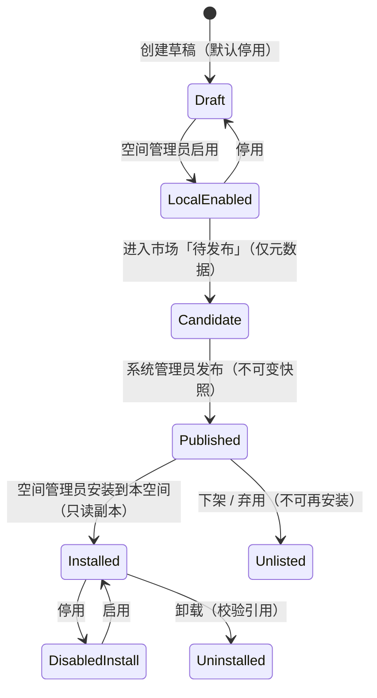

# 插件体系设计

> 状态：**v0.3 已实现**（组件为声明式 DSL）。**不承担向下兼容**：旧目录一次性迁移，直接按目标形态实现。
> 评审通过后并入 `docs/技术方案.md` 第 16 章，并同步 `AGENTS.md`。
> 关联章节：§5.3 MCP Gateway、§5.6 Tool Management、§5.8 UI Components、§15.2 通用搜索。

---

## 0. 结论与五条原则

**一句话：插件 = 一份清单（manifest）+ 一个执行器（runtime）+ 一套能力声明（capabilities）。六类插件共用清单、生命周期、权限与审计，只有执行器不同（`agent` 没有执行器，只有提示词与依赖；`source` 的执行器是宿主内的搜索适配器）。**

| # | 原则 | 反面（要避免的） |
|---|---|---|
| P1 | **能力统一到 `tool.Tool`**：模型只认识工具 | 给模型暴露「插件 / MCP / 组件」三个概念 |
| P2 | **单一定义点**：元数据只在 `plugin.json`，其余全是派生 | 同一字段在 manifest、frontmatter、DB、UI 各写一遍 |
| P3 | **风险由能力清单推导**，作者不能自称 | manifest 写 `risk: 1` 绕过审批 |
| P4 | **代码插件只能挂在 `Invoker` 之下** | 插件绕过策略引擎直接出网 |
| P5 | **发布即快照、安装即授权、卸装不删审计** | 热加载到生产；卸载即失去追责能力 |

---

## 1. 六类插件

| | `skill` | `tool` | `mcp` | `component` | `agent` |
|---|---|---|---|---|---|
| 执行位置 | 无执行器（正文注入上下文） | 沙箱（Deno 进程） | 外部服务（HTTP） | 宿主前端（DSL 解释） | 无执行器（提示词 + 依赖） |
| 产出 | 知识与流程 | 函数返回值 | 函数返回值 | 界面 + 交互动作 | 会话行为设定 |
| 谁写 | 业务专家 / 模型 | 开发者 / 模型 | 集成方 | 设计 / Skill 生成 | 业务专家 |
| 信任级别 | 纯数据，无副作用 | 不可信代码 | 半可信（有网络） | 纯数据，无可执行内容 | 纯数据，能力来自依赖 |
| 失败影响 | 该轮回答质量 | 单次调用 | 单个工具 | 单个消息块 | 该会话的风格与步骤 |

技能之所以也纳入插件，是为了让**「装了什么、谁授权的、哪个版本」只有一套答案**。现在技能是“文件在目录里就等于生效”，与工具的标准完全不一致。

---

## 2. 包结构与清单

### 2.1 目录形态

```text
spaces/{space_id}/files/plugins/{slug}/     # 草稿（Agent 可改）
  plugin.json          # 唯一清单
  SKILL.md             # kind=skill：正文（无 frontmatter）
  main.ts              # kind=tool：宿主 ABI 入口
  mcp.json             # kind=mcp：连接配置
  ui.json              # kind=component：声明式 UI（不是代码）
```

```text
{STORAGE_ROOT}/published/plugin/{plugin_id}/{version}/   # 发布件（不可变）
  plugin.json
  artifact/…
  .meta.json           # sha256、构建信息、审批人、发布时间
```

### 2.2 公共字段

```jsonc
{
  "protocol": "wa-plugin/1",
  "kind": "skill",                 // skill | tool | mcp | component
  "slug": "weekly_report",         // ^[a-z][a-z0-9_]{1,31}$，全局唯一
  "version": "1.0.0",              // 发布时由平台写入，草稿为空
  "name": "周报生成",
  "description": "写明「做什么 + 何时使用」，进检索与模型上下文",
  "capability": "skill.use",       // 见 §6.1
  "capabilities": [],              // 能力清单，见 §6.2
  "limits": {},
  "extensible": false,             // 平台发布件专用：是否允许空间内覆盖
  "derived_from": {                // 仅在系统空间副本（及其发布件）中出现，由平台写入
    "plugin_id": "plg_01H…",
    "version": "1.2.0",
    "sha256": "…"
  }
}
```

### 2.3 kind=skill

```jsonc
{
  "kind": "skill",
  "slug": "weekly_report",
  "capability": "skill.use",
  "skill": { "entry": "SKILL.md", "assets": ["templates/"] }
}
```

`SKILL.md` **只有正文**，没有 YAML frontmatter：`name` / `description` 一律取自 `plugin.json`，`SKILL.md` 内再写一遍即视为错误。

### 2.4 kind=tool

```jsonc
{
  "kind": "tool",
  "slug": "arxiv_search",
  "capability": "search.query",
  "input_schema": {
    "type": "object",
    "properties": { "query": { "type": "string" }, "limit": { "type": "integer", "default": 5 } },
    "required": ["query"]
  },
  "capabilities": [
    { "method": "http.request", "hosts": ["export.arxiv.org"], "verbs": ["GET"] }
  ],
  "runtime": { "entry": "main.ts" }
}
```

runtime 默认一次性；需要跨调用保留连接/缓存时写 `"resident": true`（代价是常驻内存与一个进程池名额）。
`timeout_ms` / `max_rpc` 属于 `limits`，写进 runtime 会被拒绝。

### 2.5 kind=mcp

```jsonc
{
  "kind": "mcp",
  "slug": "internal_crm",
  "capability": "http.request",
  "transport": { "type": "http", "url": "https://crm.internal/mcp" },
  "auth": { "in": "header", "name": "Authorization", "secret": "crm_token", "mode": "platform" },
  "tools": { "allow": ["lead.search", "lead.create"] },
  "runtime": { "timeout_ms": 15000, "sync_interval_s": 300 }
}
```

`tools.allow` 必填且非空：默认不信任 MCP Server 的全部工具。

`transport.url` 默认要求 https：MCP 是宿主自己发 HTTP 出去（`internal/mcp` 是裸 `http.Client`，不经 `search.Guard`），URL 校验是唯一的约束点。企业内网的 MCP Server 常常只有 http 一档，所以留了一个显式口子：`"allow_http": true`。写出来才放行，`Manifest.Permissions()` 会把这条线标成「明文 http」，安装确认时看得见；本机（`localhost` / `127.0.0.1` / `::1`）用 http 不必声明。它是「允许」不是「必须」——清单可以写 https 地址同时声明 `allow_http`，安装方才能在安装级配置里把地址覆盖成内网 http；反过来，发布方没声明时，改配置也绕不过 https。它**不改变风险等级**（仍是「只读有成本」）：内网 http 不扩大可达范围、也不增加副作用，代价只是链路不加密，所以用权限文案暴露而不是抬等级——抬成写风险会让内网 MCP 每次调用都要审批，把「明文」错当成「写操作」。这一点与 `source.allow_private` 不同，后者是真能穿过公网边界去看内网接口。

### 2.6 kind=component

```jsonc
{
  "kind": "component",
  "slug": "sales_dashboard",
  "capability": "ui.render",
  "ui": { "entry": "ui.json" },
  "data_sources": [
    { "id": "orders", "plugin": "mysql", "tool": "sql_query", "mode": "read", "params": { "limit": 20 } },
    { "id": "submit", "plugin": "crm", "tool": "lead_create", "mode": "action" }
  ]
}
```

`ui.entry` 默认 `ui.json`，必须是 DSL（`.json`），不能是脚本；`data_sources` 指向**同空间已安装**的插件工具，宿主代调；组件本身不写接口地址、不写工具名，也没有 `trust` / `events`——DSL 没有代码，不需要按信任级别分渲染通道。

### 2.7 硬校验（加载即拒绝，不静默兜底）

| 规则 | 原因 |
|---|---|
| 未知字段报错（`DisallowUnknownFields`） | 拼错字段不能被当成默认值 |
| schema 仅 JSON Schema 子集，禁远程 `$ref`，≤ 4KB | 直接进模型上下文 |
| `slug` + 工具名 ≤ 64 字符，`^[a-z0-9_]+$` | 多数模型 API 的工具名限制 |
| `capabilities.hosts` 必须是域名（不含 scheme/端口/路径） | 白名单按域名边界匹配 |
| 不允许 `npm:` / `https:` 等远程导入 | 供应链不在 v1 范围 |
| 组件 DSL：节点/字段白名单，≤ 300 节点、≤ 8 层、≤ 64KB | 解释器不猜语义，写错即拒绝 |
| 组件绑定只允许 `{{state.x}}` / `{{props.x}}` / `{{data.<id>.x}}` | 不做表达式求值，就没有注入面 |
| 组件 `data.*` / `action.*` 只能引用清单里的 `data_sources[].id` | 组件不能自己发明工具调用 |
| `version` 只能在发布时写入 | 草稿带版本会诱导“手改版本号”，绕过不可变约束 |

---

## 3. 单一定义点

### 3.1 三层，职责不重叠

| 层 | 性质 | 可否人工编辑 |
|---|---|---|
| `plugin.json` | **定义** | ✅ 唯一入口 |
| 空间索引 `.meta.json` | 缓存 | ❌ 可随时删除重建 |
| DB `plugin_version` 行的 name/description | 发布时的**不可变快照** | ❌ 只写一次，之后只读 |
| `resource` 发布件的展示字段 | 从 manifest **派生** | ❌ 接口不接受这两个字段入参 |

**规则：定义只有一处；快照与缓存可以有很多，但都不可手改。** 任何 UI 都不提供「修改插件名称/描述」的第二个入口——要改就改 `plugin.json`，重新发布。

### 3.2 派生生链

```
plugin.json ──▶ 空间索引（可重建）──▶ 检索结果
            └─▶ 发布（快照 + sha256）──▶ plugin_version 行 ──▶ 插件市场展示
```

任一层都可以从上一层重建，不存在双向同步。

### 3.3 外部格式只在边界转换

- 导入标准 Agent Skills 目录：frontmatter → `plugin.json`，正文 → `SKILL.md`（一次性转换，之后以 `plugin.json` 为准）。
- 导出：反向生成带 frontmatter 的 `SKILL.md`，供其他工具消费。
- **平台内部永远不存在两份元数据。**

---

## 4. 资产来源、市场与空间可见性

### 4.1 三条来源

| 来源 | 存放 | 生成方式 | 发布权 |
|---|---|---|---|
| **空间自建** | 空间 `files/plugins/` | 空间成员 / Agent 开发 | **系统管理员**（空间管理员只能启用，不能发布） |
| **平台内置** | 部署包 → 启动 reconcile 到 `published/` | 平台团队随产品发布 | 随产品发布 |
| **外部** | 外部提交（本轮不做） | 外部开发者 | 系统管理员决定是否允许内部可见 |

发布权和安装权必须分开：

- **系统管理员**决定插件能否进入组织目录（发布 / 下架 / 外部可见）；
- **空间管理员**决定插件是否装进自己的空间，以及启用 / 停用 / 卸载；
- 普通成员可以浏览市场、使用本空间已启用的插件，不能发布或安装。

### 4.2 市场分类

| 分类 | 含义 | 全员可见 | 可安装 | 操作者 |
|---|---|---|---|---|
| **组织内 · 待发布** | 空间已启用、尚未发布 | 是，但只展示元数据 | 否 | 系统管理员发布 |
| **组织内 · 已发布** | 已进入组织目录 | 是 | 是 | 空间管理员安装 |
| **平台内置** | 随产品发布的内置件 | 是（单独分组） | 是 | 空间管理员安装 |
| **外部 · 内部可见** | 系统管理员授权内部可见 | 是 | 是 | 空间管理员安装 |
| **外部 · 未授权** | 未授权 | 否 | 否 | — |

「待发布」对全员可见的是**元数据**：所在空间、作者、描述、版本、风险、能力清单；插件文件内容只有系统管理员能读。这样既能让作者之外的人知道组织里在做什么，也不会泄露未发布内容。

待发布不是可安装状态。系统管理员发布后，条目进入「组织内 · 已发布」，其他空间才可以安装。

### 4.3 空间内的两类插件

空间 `files/plugins/` 下同时承载两类插件，用平台写入的 `.install.json` 区分：

| 类型 | 目录 | 可编辑 | 默认状态 | 谁管理 |
|---|---|---|---|---|
| **空间本地插件** | `plugins/<slug>/` | 是 | 停用 | 空间成员编辑，空间管理员启用 |
| **已安装插件** | `plugins/<slug>/` | **否** | 启用 | 空间管理员启停 / 卸载 |

- 同一 `<slug>` 在空间内只能存在一种：本地开发目录与安装副本互斥；
- 安装时检查同 slug 的本地目录，存在则拒绝，要求先改名或归档；
- 启用本地插件时再查一次安装记录，同 slug 已安装则不可启用（防止历史副本或绕过 API 创建的目录）；
- 安装副本由平台写入 `.install.json`（来源插件、版本、hash、安装人、安装时间），`plugin.json` 也由平台生成；
- 文件树给安装目录打锁；文件编辑、重命名、删除、Agent `file_write` 一律拒绝；加载时校验 hash，发现被改拒绝加载并告警。

> `shell` 仍可能绕过服务层校验。MVP 至少限制 shell 对 `plugins/` 的写权限；后续把安装副本放到平台只读存储，`/plugins/<slug>` 只做逻辑视图。

### 4.4 市场与已装插件的位置

- 一级菜单只有 **插件市场**，全员可见，不再有「已装插件」二级页；
- 市场分类是**左侧二级菜单**（`/plugins/market/{category}`）：组织内已发布 / 组织内待发布 / 平台内置 / 外部（内部可见），右侧只保留类型筛选与列表；
- 已装插件属于空间，入口在空间页 / 空间树，不在市场；
- 市场卡片显示：来源分类、来源空间、作者、版本、风险、能力清单、当前空间是否已安装；
- 空间管理员在市场里选版本安装到当前空间，明确提示「只对当前空间生效」；平台内置件没有安装按钮（全空间默认可用）；
- **安装级配置**（MCP 地址、鉴权 Header、凭证名）仍存 `plugin_install.config`，按空间覆盖，发布快照不动；保存后整空间重载并记 `plugin.config` 审计。凭证只存引用名。

### 4.5 平台原语不是插件

`time_now`、`file_*`、`resource_*`、`session_list` 这些承载空间边界与审计不变量，**不参与插件生命周期**，也不进索引。它们的可配置项（结果额度、超时、是否对模型可见）走平台配置，不走插件机制。

---

## 5. 生命周期：开发 → 启用 → 发布 → 安装 → 运行 → 卸载



### 5.1 阶段定义

| 阶段 | 动作 | 产物 | 谁能做 |
|---|---|---|---|
| **开发** | 编辑空间 `plugins/<slug>/`，`dry-run` 回放样例 | 草稿 + 试运行报告 | 空间 `write` |
| **启用** | 校验清单、检查与安装记录是否重名 | 本地插件进入本空间运行池；市场出现「待发布」元数据 | 空间 `manage` |
| **发布** | 系统管理员审能力清单、生成不可变快照 | `plugin` + `plugin_version` + `published/` | 系统管理员 |
| **安装** | 选版本、确认风险、复制只读副本 | `plugin_install` + 空间 `plugins/<slug>/` | 空间 `manage` |
| **运行** | 绑定 Agent、组件引用、审计 | 运行时注册 + 审计 | 空间成员 |
| **卸载** | 校验引用、摘运行时、删副本 | 审计保留 | 空间 `manage` |

### 5.2 硬规则

1. **发布只由系统管理员执行**；空间管理员只能把本地插件启用为候选，不能直接进组织目录。
2. **本地插件未启用不得使用**：不进入检索、工具列表、MCP 连接、组件渲染。
3. **安装只接受已发布版本**（含平台内置、外部内部可见版本），草稿不能装。
4. **安装副本只读**：启用、停用、卸载、升级是仅有的操作。
5. **绑定/安装固定版本**，升级是显式动作；**卸载不删审计**。

### 5.3 本地插件启用

- 新建草稿默认停用；
- 空间管理员启用时校验 `plugin.json`、slug、与安装记录是否重名；
- 启用后进入本空间能力池，所有空间成员可用；
- 启用状态下仍可编辑，保存后热重载；校验失败自动回落到停用并提示；
- 启用不改变可见范围，也不产生发布快照。

**在插件目录下新建会话**：树里对插件目录点「新建会话」，会话的 `dir` 记录为 `plugins/<slug>`。
系统提示词据此注入「当前会话的目录」段落：插件名、类型、说明，并要求默认围绕该插件做事
（改清单与正文、解释行为、`plugin_try` 试跑），文件路径写相对空间根的完整路径。
清单还没写合规时按 slug 兜底，仍按插件目录处理，不会退化成普通目录。
已安装（只读）插件目录不提供该入口。

### 5.4 发布

- 系统管理员在「待发布」列表选择候选，查看空间、作者、描述、风险、能力清单；
- 发布前校验：候选仍处于启用、文件 hash 未变、slug 未被其他插件占用；
- 生成不可变快照，`origin=internal`，记录来源空间 / 作者 / 发布人；
- 发布后本地插件继续可编辑，hash 变化时市场显示「有新版本待发布」；
- 平台内置不走候选，启动时直接发布 `origin=system`，并安装到系统空间（全局安装）；
- 下架 / 弃用：不再允许新安装，已安装空间可继续使用旧版本；是否强制停用由系统管理员决定。

### 5.5 安装语义（按 kind）

| kind | 安装后发生什么 |
|---|---|
| `skill` | 进入空间能力池，`plugin_search` 可检索，Agent 可绑定 |
| `tool` | 注册为 `tool.Tool`，出现在模型工具列表 |
| `mcp` | 建立连接、同步工具清单、按 `allow` 注册 |
| `component` | 可被消息 `ui-block` 引用渲染 |
| `agent` | 出现在新建会话的智能体选择器；`requires` 的依赖同时装进同一空间 |
| `source` | 注册进 `search.Registry`，成为 `web_search` 的一个可用源 |

安装复制**全部产物**到空间 `plugins/<slug>/`，写入 `.install.json`，默认启用；高风险插件可默认停用。卸载是逆操作：摘注册表、移检索池、关连接、删副本。

### 5.6 平台内置与默认安装集

平台内置插件以 `origin=system` 发布后，由 seed 安装到**系统空间**：`系统空间/files/plugins/<slug>/` 是全局安装目录，`plugin_install` 也记在系统空间。其他空间在 `ensureLoaded` 时把系统空间的安装记录一并加载（标记 `Global`），因此内置技能与内置工具默认对所有空间可用，且不需要逐空间各装一遍。

- 市场「平台内置」分组展示版本、类型与风险，但没有安装按钮；普通空间对内置件 `install` / `uninstall` / `enable|disable` 一律拒绝（`ErrConflict` / `ErrForbidden`）。
- 系统空间尚未初始化（管理员从未登录）或全局安装记录缺失时，运行期退化为「按发布件全局可用」，下次启动补成正式安装——基础能力不能因初始化顺序缺失。
- 内置清单变化时版本号随之变化，重启即重新发布并升级全局安装；旧版本继续可用，便于回滚。
- `PLUGIN_DEFAULT_INSTALL` 只服务**非内置**的部署默认集：新空间创建时自动安装并启用，已存在的空间不追溯；内置件会跳过。

### 5.6.1 智能体插件（kind=agent）

智能体是「行为设定」，随其他插件一起发布、安装与选择：

~~~json
{ "kind": "agent", "agent": { "entry": "AGENT.md", "extends": "service_base", "requires": ["crm_mcp"] } }
~~~

- 正文顺序：平台基础规则 → 父智能体（可多层，最多 4 层、禁止成环）→ 自己；`extends` 为空表示只追加到基础规则。平台默认智能体是 slug `base` 的内置插件，`extends: "base"` 就是继承它。
- 旧版系统空间 `agents/<id>/` 目录已废弃：启动时迁移成 `origin=system` 的智能体插件并全局安装，目录备份后删除。
- `requires` 是依赖插件（技能/工具/MCP），安装智能体时一并安装到同一空间；已全局可用的内置依赖自动跳过，依赖装不上则整个安装失败。
- 智能体没有执行器，清单里不允许 `capabilities`，也不允许 endpoint、密钥、命令；它不进 `plugin_search`，只在新建会话的选择器里出现。
- 安装在系统空间即全局可选；会话创建时把提示词快照固化在会话上，事后改智能体不影响已开会话。

### 5.6.2 搜索源插件（kind=source）

搜索源不是「模型可调用的工具」，而是 `web_search` 背后的实现。模型只见 `web_search(query, limit, scope)`；源由平台路由，换源不改工具契约。

~~~json
{ "kind": "source",
  "source": { "protocol": "spec", "scope": "internal", "entry": "search.json",
              "endpoint": "https://es.corp.local/wiki/_search", "secret": "intranet",
              "allow_private": true, "priority": 10, "timeout_seconds": 8 } }
~~~

- **两种协议，同一出口**：`spec` 用 `search.json` 描述请求与响应路径（复用 `internal/search.Spec`）；`script` 用 `main.ts` 输出 plan/map 两段（无网络权限，出网仍由宿主按 endpoint 完成）。两者都经 `search.Normalize` 归一化，换协议不改变模型看到的内容。
- **endpoint 在清单里**：Guard 的白名单由它推导，发布前即可静态审查；`allow_private` 放开 http 与私网（推导 L3，装到系统空间需系统管理员），但链路本地地址始终拒绝。清单不允许 `capabilities`。
- **装完即生效**：安装/启用后注册进 `search.Registry`，停用/卸载立刻摘除，无需重启；系统空间的那份注册为全局源，普通空间自己装的只对该空间生效。
- **路由**：`scope=auto` 先 internal 后 external，按 `priority` 排序、按 URL 去重；`scope=internal|external` 只查对应范围。单源失败不打断整体，全部失败才报错。
- **试跑**：`plugin_try` 真跑一次并回执 `top_keys` / `status` / `hit` / `dropped` / `samples`，让作者从「响应顶层键」直接定位 `items` 路径，而不是发布后才发现取不到字段。

### 5.7 卸载与引用检查

卸载前检查本空间引用，有引用则拒绝并返回清单：

1. 会话级技能 `session.skill_path`；
2. 同空间其他组件的 `data_sources`（按 slug 指向它）；
3. 其他插件声明的跨插件依赖（`requires`，后续落地）。

允许先停用；停用不删副本，不影响其他空间。

### 5.8 升级与回滚

- 一个空间一个 slug 只保留一个安装版本；
- 升级 = 下载新版本、校验、原子替换只读副本，保留启用状态；
- 升级失败不能破坏旧版本；
- 已安装空间显示「有新版本」，由空间管理员决定是否升级，不自动升级。

---

## 6. 风险与权限

### 6.1 capability 取值

固定枚举（沿用 §5.6.1）：`skill.use`、`search.query`、`http.request`、`fs.read`、`fs.write`、`sql.query`、`shell.exec`、`ui.render`、`plugin.invoke`（兜底，按 L3）。**插件不能自定义 capability 名**，否则策略规则表会被绕过。

### 6.2 能力清单 → 风险

| capabilities | 风险 | 审批人 |
|---|---|---|
| 空 / 仅 `skill.use` | L1 | 免审 |
| `http` 仅 GET + 域名白名单 | L2 | 空间管理员 |
| 含非 GET / `fs.write` / 写类 MCP 工具 | L3 | 空间管理员（系统管理员可见） |
| `secret.use` + `write-external` | L4 | 系统管理员 |

`risk` 与 `side_effects` **由平台计算**，manifest 里不存在这两个字段。

### 6.3 审批对象是能力清单

管理员审的是 `hosts: ["crm.internal"]`、`tools.allow: [...]`，不是代码。审批结果记录到 `plugin_version` 与 `plugin_install`，安装即授权、卸载即回收，不做逐次审批。

### 6.4 密钥是句柄

```ts
await host.http({ url, headers: { Authorization: "secret:crm_token" } });
```

宿主执行时替换、发完即弃；插件进程内存里没有明文，`console.log(req)`、异常栈、stderr 都不可能泄漏。

---

## 7. 执行器（runtime）

### 7.1 tool：宿主 ABI

插件进程**无网络、无写文件权限**，一切 I/O 经宿主。NDJSON 双向流：

| 方向 | 帧 |
|---|---|
| 宿主 → 插件 | `{"op":"invoke","input":{…},"context":{space_id,user_id,locale,now,request_id}}` |
| 插件 → 宿主 | `{"op":"call","id":1,"method":"http.request","args":{…}}` |
| 宿主 → 插件 | `{"op":"result","id":1,"ok":true,"data":{…}}` |
| 插件 → 宿主 | `{"op":"return","data":{…}}` / `{"op":"error","message":"…"}` |

宿主 method 白名单：`http.request`（走 `Guard`）、`fs.read` / `fs.write` / `fs.list`（空间边界）、`secret.use`（只回替换结果）、`log`（进审计，不进上下文）。

插件侧 SDK 由平台注入：`bootstrap.ts` 先 `import "./host_sdk.ts"` 装配 `globalThis.host`，再动态 import 插件入口（实现上不用 `--preload`，效果一致且不依赖 deno 版本）。每次调用一个进程，并发由 Agent 的 `LLM_MAX_PARALLEL` 兜底。

**前置改造**：`sandbox.Runner` 目前是「一次性执行 + 收集输出」，需补

```go
func (r *runner) Start(ctx context.Context, spec Spec) (*Proc, error)
// Proc: Stdin io.WriteCloser / Stdout io.Reader；env 清理、私有 TMPDIR、
// 超时、进程组回收复用现有逻辑；Run = Start + 收集
```

### 7.2 mcp

复用 `mcp.Client` 的 `Initialize / ListTools / CallTool`；加载时同步工具清单，成功后写快照 `{STORAGE_ROOT}/plugin-runtime/mcp/<slug>.json`，`ListTools` 失败时沿用快照（调用仍会失败，但清单不会凭空消失）。后台定时刷新暂未实现，重装/重启即刷新。出网域名必须在 `capabilities` 中声明。

### 7.3 component：声明式 DSL（小程序式）

组件不是一段可执行前端代码，而是一份 UI 描述。`ui.json` 声明「用哪些平台组件、绑哪个数据源、按钮触发什么动作」，宿主前端的解释器按白名单渲染成自己的 React 组件。

```jsonc
{
  "dsl": "wa-ui/1",
  "height": 420,
  "state": { "period": "month" },
  "data": { "orders": { "params": { "period": "{{state.period}}" } } },
  "view": {
    "type": "Stack", "gap": "md",
    "children": [
      { "type": "Heading", "text": "销售看板" },
      { "type": "Table", "columns": [{ "key": "name", "label": "客户" }],
        "source": "{{data.orders.items}}" },
      { "type": "Button", "text": "提交", "action": {
        "type": "invoke", "source": "submit", "confirm": "确认提交？" } }
    ]
  }
}
```

| 维度 | 规则 |
|---|---|
| 节点 | 固定枚举：布局（Stack/Row/Grid/Card/Divider）、内容（Heading/Text/Badge/Alert/Stat/KeyValue/List/Table/Progress）、交互（Button/Input/Select/Tabs）；字段也按类型白名单 |
| 绑定 | 仅 `{{state.x}}`、`{{props.x}}`、`{{data.<id>.x}}`；整串为一个绑定时保留原始类型（数组/对象），否则按字符串插值 |
| 条件 | `when: {path, op: eq/ne/gt/lt/in/exists/truthy, value}`，不提供表达式 |
| 动作 | `reload`（重取只读源）、`invoke`（只能指向 `mode=action` 的源，必须用户手势，可配 `confirm`）、`message`（把文本填进输入框，不自动发送） |
| 样式 | 组件不写样式、不注入 CSS，全部由宿主按 Design Token 渲染，主题/密度自动跟随 |
| 隔离 | 无需 iframe / Shadow DOM：没有 JS、没有 HTML 注入点，文本走 React 转义 |
| 取数 | 组件不直接发请求：`host` 把 `data.<id>` 翻译成 `POST /spaces/{id}/plugins/{slug}/data`，后端用当前用户身份走 `Invoker`（策略、审批、审计同一处） |

**为什么不用 iframe / 同源脚本**：iframe 带来独立文档、独立样式、独立滚动与 postMessage 序列化，体验和首屏都差；同源执行 TSX 则要求「来源绝对可信 + 构建期禁 API」，一旦审核漏了就直通主应用。DSL 把能力收敛到「平台已有的节点」，安全与体验都不需要取舍。

**校验位置**：`plugin.json` 解析时校验数据源，`ui.json` 在**发布与试运行时**都校验（节点/字段/绑定/动作/体积/嵌套），运行时读取再校验一次——产物在存储里被改坏也能挡住。

### 7.4 skill

无执行器。安装后进入检索池；被 Agent 绑定时，正文注入当轮上下文（沿用 4000 tokens 预算）。

---

## 8. 与模型、前端的接口

### 8.1 模型侧

- 已安装的 `tool` / `mcp` 与内置工具**同构**：`Name = {slug}__{tool}`、`Parameters = input_schema`、`Risk` 来自推导、`Runtime = plugin`。
- 未安装的插件既不进工具列表，也不进检索池；模型只能看到已安装件与空间草稿，要用市场里的插件得先由用户在市场安装。

### 8.2 `plugin_search` 收窄

检索范围：

- 本空间**已安装且启用**的插件；
- 本空间**本地开发且启用**的插件；
- 已安装到本空间的平台内置插件。

以下不进检索池：

- 已安装但停用、本地开发但未启用；
- 市场里已发布但**未安装到本空间**的插件（只在市场浏览，不进系统提示词与工具列表）；
- 待发布候选只展示元数据，正文仅系统管理员可读。

返回 `kind` + `scope`（`space` / `system`）。未安装插件不在默认工具列表里，模型需要用户先去市场安装。

### 8.3 组件渲染

助手消息中 ` ```ui-block {"slug":"sales_dashboard","version":"1.2.0","props":{…}} ``` ` → 前端 `GET /spaces/{id}/plugins/{slug}/ui?version=1.2.0` → 拿到 `{manifest, dsl, height}` → 本地解释器渲染。版本固定，同一消息永远渲染同一版本。

- 只有**已安装到当前空间**的组件才能渲染：渲染意味着可以用当前身份取数，未安装却能渲染等于绕过安装审批。
- 运行以空间副本为准（改完 `ui.json` 不必先发布即可在会话里看到），非当前版本读发布件（不可变）。
- 组件不加载任何远程产物，`/c/...` 静态产物路由随之删除。

---

## 9. 存储与数据模型

草稿只存在于文件，**发布才写 DB**（避免“草稿也要有行”带来的状态同步问题）：

```sql
plugin(id, slug unique, kind, name, description, visibility,
       status, latest_version, owner_space_id, origin,
       created_at, updated_at)
  -- origin: internal / system / external；市场分类依赖它

plugin_version(id, plugin_id, version, manifest jsonb, artifact_path,
               sha256, capabilities jsonb, risk,
               approved_by, approved_at, published_at)
  unique(plugin_id, version)

plugin_install(id, space_id, plugin_id, version, status, config jsonb,
               installed_by, installed_at, approval_id)
  unique(space_id, plugin_id)

plugin_candidate(id, space_id, slug, kind, name, description,
                 author_id, author_name, manifest_hash, risk,
                 capabilities jsonb, status, plugin_id,
                 enabled_at, created_at, updated_at)
  unique(space_id, slug)
  -- status: enabled / disabled；plugin_id 非空表示已发布过
```

- `plugin.name / description` 是最近一次发布的快照，不可编辑；
- `plugin_candidate` 只记录「空间已启用、待发布」的元数据与 hash，内容仍以空间文件为准；
- 空间 `plugins/<slug>/` 是安装副本，平台写入 `.install.json`（来源、版本、hash），只读；
- 平台预置插件在启动时 reconcile：`published/` 缺失或 hash 变化才写入，`origin=system`；
- `mcp` 的连接健康与工具缓存放运行时态（内存 + 可选 DB），**内容不回写文件**。

---

## 10. 装配与运行

启动顺序（每步失败只影响对应插件）：

1. `sandbox.Detect()` → `sandbox.Ensure(cfg.SandboxRequire)`（已有）；
2. `plugin.New`：注入 Deno ABI 脚本（`runtimeDir/bootstrap.ts`、`host_sdk.ts`），挂载插件路由；
3. `Bootstrap`：发布内置技能（`builtin_plugin_dev` 等）→ 迁移存量技能 → 只为没有标记的空间打 bootstrap 标记；
4. 空间首次访问时按需加载：读 `plugin_install` 中 `status=enabled`，再叠加 `plugin_candidate` 中 `status=enabled` 的本地插件 → 校验清单 → 起 runtime → 注册进 `tool.Registry`；
5. 新空间创建回调里按 `PLUGIN_DEFAULT_INSTALL` 安装默认集（失败只告警）。

运行期变更即时生效：install → 复制只读副本并注册；本地 enable → 写候选并注册；disable → 摘除 + 拒绝；uninstall → 查引用后摘除。无需重启。

---

## 11. 治理

### 11.1 审计：永久保留

- 每次调用一条：`plugin_id / version / capability / decision / duration_ms / rpc_count / egress_hosts / truncated / error_code`。
- **无 TTL、无删除接口**；卸载插件只删内容与安装记录，审计保留 `slug / version / hash`，保证“谁在什么时候用它干了什么”事后可查。
- 归档到冷存储可以，但平台不主动删。

### 11.2 配额

单次：`timeout_ms`、`max_rpc`、输出 256KB；日配额：按空间统计 RPC 次数与出网字节。

### 11.3 灰度与停用

绑定指向版本，天然灰度（先绑测试空间）；`status=suspended` 立即拒绝调用，不改文件不回滚版本。

### 11.4 告警

连续失败率 > 50% 或 `p99 > 5s` 通知空间管理员；MCP 连接失败单独告警。

---

## 12. 一次性迁移（不做兼容）

| 旧 | 新 |
|---|---|
| `files/<name>/SKILL.md`（空间根） | `files/plugins/<slug>/SKILL.md` + `plugin.json`（frontmatter 转换后删除） |
| `files/skills/<name>/`（系统空间） | 仅 `extensible: true` 的保留为可编辑副本；其余移出，只留发布件 |
| `files/tools/*.json` | 删除（内容改由 `plugin.json` 承载；内置工具不再进文件） |
| `files/mcps/*.json` | 删除（镜像机制取消） |
| `mcp_server` 表 | 内容转 `mcp.json`；表改为 `plugin` + `plugin_install`，只存运行时态 |
| `space.Index` 扫三个目录 | 只扫 `plugins/` |

迁移脚本一次执行，不做双读、不做回退分支。

---

## 13. 分期与验收

| 阶段 | 内容 | 验收标准 |
|---|---|---|
| **P0** | `sandbox.Start` + NDJSON ABI + tool runtime | 白名单外域名被 `Guard` 拦住；超时整棵进程树被回收；stderr 进审计 |
| **P1** | 包模型（四类）+ 单一定义点 + 一次性迁移 | 存量技能全部转换；索引只扫 `plugins/`；无第二处元数据 |
| **P2** | 五段生命周期（开发/发布/安装/运行/卸载） | 草稿不能装；卸载有引用时拒绝并列出引用方；审计在卸载后仍可查 |
| **P3** | 默认安装集配置 | 新空间按 `PLUGIN_DEFAULT_INSTALL` 安装；slug 缺失只告警不阻断 |
| **P4** | mcp / component 插件 | `allow` 外工具不可见；组件 DSL 只能渲染白名单节点、只能引用已声明的数据源 |
| **P5** | 可见性矩阵 + 基线升级提示 | `extensible: false` 的内置件不出现在系统空间文件里；`extensible: true` 的副本带 `derived_from`，基线发新版后列表出现「可更新」badge，同步前自动备份 |

状态：P0–P5 已全部实现（`internal/plugin`、`0019_plugin.sql`、前端 `PluginPanel` / `PluginCatalogPanel` / `UiBlock` + `UiView`）。仍未实现的边界见 §14 与下文标注（MCP 后台定时刷新、跨插件 `requires` 引用检查；`baseline-diff` 只给了状态与一键同步，没有逐行 diff）。

---

## 14. 明确不做（v1 边界）

- ❌ 向下兼容（旧目录、旧格式一律迁移后删除）
- ❌ 除 Deno 外的运行时
- ❌ 插件 import npm / 远程模块
- ❌ 插件之间互相调用工具（防权限放大与递归）
- ❌ 插件直连数据库 / 内网
- ❌ 把 harness（`internal/agent`）做成插件
- ❌ 组件的服务端渲染与流式订阅

---

## 15. 风险与对策

| 风险 | 影响 | 对策 |
|---|---|---|
| 双工协议实现复杂（半包、崩溃、超时） | 插件随机失败 | 单写者 NDJSON、逐帧超时、进程退出即判失败并回收 |
| Deno 冷启动 ~100ms | 高频工具变慢 | 高频能力留在平台原语；插件面向“接一次用很久” |
| 一次性迁移出错 | 存量技能丢失 | 迁移前整目录备份，脚本幂等，逐空间校验条目数 |
| 组件 XSS | 会话内钓鱼 | DSL 无 JS/HTML/样式注入，文本走 React 转义；取数只经宿主与 Invoker |
| 版本矩阵（插件 × 模型） | 排查困难 | 绑定固定版本 + 审计记录版本号 |
| 审批疲劳 | 管理员闭眼点 | 只审能力清单；L1/L2 免审或空间内自决 |
