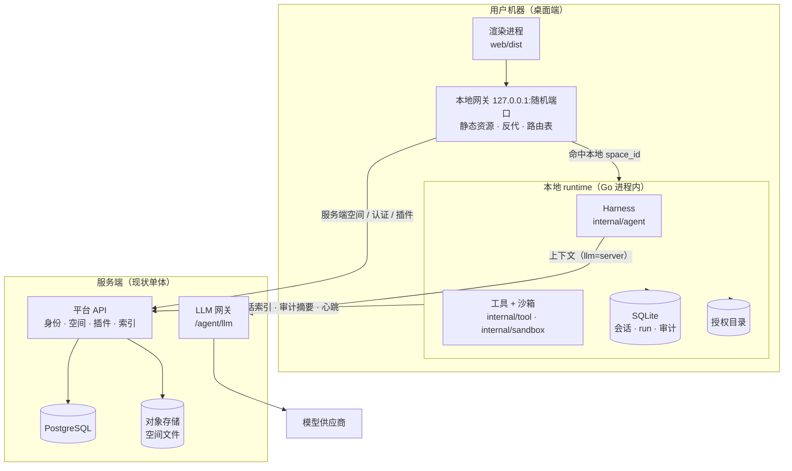

# 本地空间与双端架构

> 状态：**设计定稿，未实施**。本文只新增能力，不改《技术方案》的分层与接口风格；与《技术方案》冲突时以《技术方案》为准，落地前同步该文档对应章节。
>
> 前身：本地执行点方案（V1，已废弃）。本次按「空间」而非「设备」重建模型，V1 的 job 投递协议降级为暂缓项，见 §0。

---

## 0. 版本与方向修正（V1 → V2）

| 维度 | V1（原记录） | V2（本文） | 原因 |
| --- | --- | --- | --- |
| 一等公民 | 设备 / 执行点 | **空间**（`space.type=local`） | 现有 API、权限、`SpaceTree`、`hooks.ts` 全部以 `space_id` 为轴；新造一个「设备」维度等于让所有接口长第二套参数 |
| runtime | 只在服务端 | **本地空间带本地 runtime** | 否则「本地空间」只是把文件工具代理回服务端，断网即废，与 V1 的 `local_file_*` 没有区别 |
| 工具名 | `local_file_*` 与 `file_*` 并存 | **同名工具，一种根** | 一个空间只有一种根，模型与技能不用学两套名字 |
| 调用协议 | SSE 下发 job + 回执 | **进程内直接调用，无 RPC** | 本地 runtime 自己就是执行体，不存在「跨机投递」 |
| run 状态 | 新增 `waiting_local` | **不需要** | 没有「等远端设备回执」这回事 |
| 前端 | 单后端 | **单 origin + 本地网关按 id 路由** | `api/client.ts` 与 `hooks.ts` 零改动，路由决策收在一处 |
| 落地范围 | 设备配对 + job 投递 | 本地空间 MVP | 按「添加空间时新增添加本地空间」的需求 |

**不变的部分**：设备仍是必需概念（本地空间要归属某台机器、要能吊销），但降为空间的属性；`internal/agent` 的 Harness、`internal/tool`、`internal/sandbox` 全部复用，不写第二套。

---

## 1. 问题与结论

### 1.1 三种形态

| 形态 | 含义 | runtime 在哪 | 文件在哪 | 判断 |
| --- | --- | --- | --- | --- |
| **A 纯服务端** | 现状。浏览器只是界面，文件与命令都在服务端 | 服务端 | 服务端空间 | 保留，且是**默认** |
| **B 双空间** | 服务端空间照旧；另外可添加「本地空间」，其会话、文件、工具、插件都在本机 | 看空间类型 | 看空间类型 | **本次方案** |
| **C 完全离线** | 无服务端也能用，联网后同步资产与审计 | 本地 | 本地 | B 的子集，不单独做 |

**结论：B。** 默认空间不变——根个人空间（`type=personal` 且 `parent_id=''`）仍是新建会话的落点；本地空间只是「添加空间」里的第三个入口，不参与默认值。

### 1.2 为什么要有本地空间

- 用户的报表、代码、凭据在**自己机器**上，不该为了「让 Agent 看见」而全量上传。
- 本地 `localhost` 的服务、只对本机可达的内网库、自己 `npx` 起的 MCP，服务端的 VPC 进不去。
- 断网时仍要能用——这一条决定了 runtime 必须在本机，而不是「文件在本地、脑子在云端」。

### 1.3 明确不做的

| 不做 | 原因 |
| --- | --- |
| 服务端向本地**推送代码/脚本**执行 | 等于把服务端变成远程控制通道。本地只执行本机已有程序与用户自己安装的插件 |
| 服务端读写本地**绝对路径** | 服务端只存 `root_label`（展示名），路径映射只在本地 SQLite |
| 本地空间与空间文件**双向同步** | 冲突解决成本高于价值；两者是**两个根**，不是一份数据的副本 |
| 本地空间**共享、派发、被 IM/A2A/定时任务触发** | 数据不出机；无人值守的本地机器没有意义 |
| 服务端代用户点本地**高危确认** | 本地安全边界的唯一权威必须在本机 |
| 静默降级：本地空间不可用时自动改走服务端 | 路径语义不同（`~/a.xlsx` 与空间 `a.xlsx` 不是一个东西），降级会读写错对象 |

---

## 2. 设计原则

1. **空间是执行边界的载体**。执行点、文件根、会话存储、审批落点都由 `space.type` 决定，不再有会话级开关。
2. **控制面留在服务端**。身份、空间元数据、插件市场与签名、模型网关、会话索引仍在服务端；本地承接「必须在本机发生」的部分。
3. **一个空间一种根，工具名不变**。本地空间里 `file_read` 就是读本地根，`shell_exec` 就是在本地沙箱跑；技能与智能体不写绝对路径，因此可移植。
4. **本地空间不上行正文**。消息、文件、run 明细只在本地；上行只有索引与审计摘要。
5. **双实现、单语义**。Postgres 与 SQLite 两套 `store` 必须跑同一套 conformance 用例，行为漂移按缺陷处理。
6. **路由 fail-closed**。任何「这个 id 属于哪边」的判断不明确时，按服务端处理，绝不默认发往本地。

---

## 3. 总体架构



关键点：**本地空间不是一条新链路，而是「同一套 runtime 跑在另一个进程里，配另一套 store 与另一个文件根」。** `internal/agent` 的 Harness、`internal/tool` 的工具定义、`internal/sandbox` 的规格都不分叉，分叉只在 `store.Store` 的实现与文件根。

---

## 4. 空间类型与职责

### 4.1 四类空间

| type | runtime | 文件根 | 会话存储 | 可用范围 |
| --- | --- | --- | --- | --- |
| `personal` | 服务端 | 空间目录（`storage` + `spacefs`） | Postgres | 本人；根个人空间为默认 |
| `shared` | 服务端 | 同上 | Postgres | 空间成员 |
| `system` | 服务端 | 同上（内置目录只读） | Postgres | 系统管理员 |
| **`local`（新增）** | **本地 runtime** | **用户授权的本地目录** | **本地 SQLite** | 仅 owner + 绑定设备，桌面端 |

现有约束在 `0014_system_space.sql`：`check (type in ('personal','shared','system'))`。新增 `local` 必须同步改写 `internal/space` 里所有按 type 分支的地方：

- `spacePriority`（`internal/space/tree.go`）：建议 `personal 0 → system 1 → local 2 → shared 3`，本机空间排在团队共享之前。
- `isLocked`：`local` 不加锁（可改名、可删除，删除只删服务端元数据 + 本地映射）。
- `inBuiltinDir` / `isBuiltinDir`：仅对 `system` 生效，`local` 不适用。
- 权限：`local` 只有 owner，`SpacePerm` 对非 owner 一律空字符串。

### 4.2 职责矩阵

| 能力 | 服务端空间 | 本地空间 |
| --- | --- | --- |
| 空间元数据 | Postgres 权威 | Postgres 只有一条记录（`id / owner / name / type=local / device_id / root_label`） |
| 文件字节 | 对象存储 | 本地磁盘，服务端不可见 |
| 会话正文 / 消息 | Postgres | 本地 SQLite |
| run / run_step / tool_call | Postgres | 本地 SQLite |
| 会话索引 | 同一条记录 | `session` 表存元数据 + `storage='local'`，正文不落 |
| 审批 | 服务端 `approval` 表 | 本地原生弹窗，服务端无 `approval` 行 |
| 审计 | `audit_log` | 本地 SQLite + `audit.ndjson`；摘要可选上行 |
| 插件安装 | `plugin_install` | 本地目录 + 本地记录；市场只记「曾装过」（可选） |
| 模型调用 | 服务端直连供应商 | 经服务端 LLM 网关（默认）或本地 endpoint |

### 4.3 默认空间不变

- 新建会话时若未显式指定空间，落根个人空间（`type=personal`、`parent_id=''`），与现状一致。
- 本地空间不出现在「默认空间」候选里；`SpaceTree` 里单独分组，标题用「本机」。
- 没有可用设备时，「添加本地空间」入口置灰并说明原因（未安装桌面端 / 设备已吊销）。

---

## 5. 核心机制

### 5.1 创建本地空间

1. 桌面端登录走现有 SSO（内嵌 `BrowserWindow`，Cookie 落 Electron session）。
2. 登录后自动注册设备：`POST /devices/enroll`，上报 `name / os / arch / proto`，服务端返回 `device_id + device_secret`。CLI 场景保留配对码，语义相同。
3. 用户点「添加空间 → 本地空间」→ 原生目录选择器 → 本地校验：目录存在、可读、非符号链接逃逸、不是 `/`、`/Users`、系统目录、不允许是另一个本地空间的子目录。
4. 服务端生成 `space_id`（沿用 `platform.NewUUID()`，与现有 `CreateSpace` 一致）→ `POST /spaces {type:'local', device_id, root_label}`。**请求体不含绝对路径**，`root_label` 只是展示名（默认取目录名）。
5. 本地 SQLite 写 `space_root(space_id, abs_path, granted_at)`；本地网关在路由表登记 `space_id → local`。
6. 服务端把这条空间记进 `space` 表，前端 `GET /spaces` 即可看到；`device_online` 由心跳推导。

撤销：删空间只删服务端元数据 + 本地映射，**不删除、不移动用户目录**（删除用户文件必须由用户在文件管理器里做）。

### 5.2 本地 runtime 与工具

本地 runtime 是 `cmd/local` 一个 Go 二进制，进程内直接组装 Harness：

- `internal/agent`：Harness、工具循环、checkpoint、`ArgsHash` 回放逻辑原样复用。
- `internal/tool`：工具定义与 `Invoker` 的 策略 → 审批 → 执行 → 脱敏 → 截断 顺序不变；`file_*` 指向本地空间根，`shell_exec` 交给本地沙箱。
- `internal/sandbox`：`Spec{Mode, FS, Network, Timeout, MaxOutput}` 语义完全适用；默认 `ModeWorkspaceWrite`，可写范围 = 该本地空间的目录。
- 不新增 `local_*` 工具名。原 V1 的命名方案作废。

裁剪：本地 runtime 不注册依赖服务端的能力（`plugin_publish`、`task_*`、`wiki_*` 若依赖服务端索引则先不注册），工具列表以**实际可用**为准，不做「能调但报错」的空壳。

### 5.3 单 origin + 本地网关路由

桌面端只暴露出一个 origin（`http://127.0.0.1:<port>`），由本地网关提供三件事：

| 路径 | 去向 |
| --- | --- |
| `/` 与静态资源 | 内嵌 `web/dist` |
| 命中本地路由表的 id（`/spaces/{id}/…`、`/sessions/{id}/…`、`/runs/{id}/…`） | 本地 runtime |
| 其余 | 反代到服务端（含 `/auth`、`/plugins`、`/admin`、`/agent`） |

路由表来源：`GET /spaces` 返回的 `type=local` 列表（预登记）+ 本地创建会话的响应（登记 `session_id`）。表在内存，启动时从本地 SQLite 重建。

为什么这样切：现有前端所有请求都走 `api/client.ts` 的 `request()`（另有 4 处直连 `fetch`，路径都含 `/spaces/{spaceId}`），**前端不需要知道自己面对两个后端**。路由决策全部收在网关一处，`hooks.ts` 与 `client.ts` 可保持零改动。

fail-closed：

- 路由表未命中 → 一律转服务端，不猜。
- 服务端收到 `type=local` 空间的会话/文件明细请求 → 返回 `409` + `{code:'local_space_requires_device'}`，不返回空列表（空列表会被误读成「没有文件」）。
- 网关启动失败或路由表损坏 → 前端只能看到服务端空间，本地空间显示「未连接」，不阻塞主流程。

### 5.4 模型调用路径

| 模式 | 调用链 | key 在哪 | 上下文出机 | 配额 / 审计 |
| --- | --- | --- | --- | --- |
| `llm=server`（默认） | 本地 Harness → `POST /agent/llm` → 供应商 | 服务端 | 到公司服务端 + 供应商 | 服务端统一 |
| `llm=local` | 本地 Harness → OpenAI 兼容 endpoint（Ollama / LM Studio / 自配） | 本地 keychain | 不出机 | 仅本地 |

- `llm=server` 是**同一份** `llm` 接口实现，只是 `baseURL` 指向 `/agent/llm`、鉴权用设备凭据；不写两套客户端。
- `llm=local` 需管理员开关 `allow_local_llm`，否则用户可用它绕开成本与审计。
- 默认值落在空间上（`space.llm`），不落在会话上——避免同一空间里的会话行为不一致。
- 复用现有 `/agent` 前缀，不新增顶层路径，省一次反代配置。

### 5.5 会话、状态与断点

- 本地空间的 `session / message / run / run_step / tool_call / approval` 全部落本地 SQLite，服务端 `session` 表只存一行元数据（`storage='local'`、标题、消息数、时间），用于跨设备可见与搜索。
- `run.status` **不新增取值**。V1 的 `waiting_local` 取消：本地 run 在本地就是 `running`，没有「等远端」状态。
- 断点续跑复用现有 `run_resume` 与 `ArgsHash` 回放，只是 `store` 换成 sqlite 实现。
- 崩溃清扫：本地进程启动时把残留的 `running` 标记为 `failed`（错误码 `local_crash`），与现有 `PurgeStaleRuns` 同一口径；如果实现成本低，可续跑，但不作为 P0 要求。
- 服务端空间的 run 与本地 run 互不感知：前者查 Postgres，后者查 SQLite，没有任何共用的状态机。

### 5.6 数据边界与审计

| 对象 | 服务端空间 | 本地空间 |
| --- | --- | --- |
| 文件字节 | 对象存储 | 本地磁盘（服务端不可见） |
| 消息正文 | Postgres | 本地 SQLite（不上行） |
| 工具回执 | `tool_call` 表 | 本地 SQLite |
| 审批记录 | `approval` 表 | 本地（原生确认） |
| 审计 | `audit_log` | 本地 SQLite + `audit.ndjson` |

审计摘要上行（可关，默认开，满足企业合规）：

```json
{"space_id":"…","session_id":"…","tool":"shell_exec","at":"2026-11-19T10:00:00Z",
 "result_hash":"sha256:…","approved_by":"local_user","sandbox":"seatbelt","exit_code":0}
```

只上行元数据与结果哈希，**不上行参数与输出**。上行失败不阻塞会话，落本地待发队列。

### 5.7 本地沙箱

- 复用 `internal/sandbox`，在本地进程内实例化；根 = 该本地空间的目录。
- **客户端形态只认 bwrap**（`WA_ROLE=client`）：启动时直接 `sandbox.NewBwrap()`，探测不到就启动失败，不退回 `sandbox-exec`、也不允许连远端执行体。理由对称——服务端节点的内核与镜像不由我们决定，所以服务端（`WA_ROLE=server`）强制 `SANDBOX_BACKEND=remote`；而客户端装的是我们自己的包，可以把「Linux + 可用 user namespace」写成安装前提，换来的是一条不依赖宿主差异的隔离边界。
- `dev`（`WA_ROLE=dev`，`make run` 固定带）才允许自动探测 bwrap → sandbox-exec → local，用于本机调试与 CI；它不进入发布产物。
- 默认 `ModeWorkspaceWrite`；`ModeFull` 只在用户显式勾选「不受限」时使用，且每次确认。
- 路径校验先 `EvalSymlinks` 再比对，拒 `..` 与跨根逃逸，判据与插件 `fs` 校验同一套。
- 后续平台（macOS / Windows）补齐时按「有隔离才叫沙箱」处理：`Name()` 如实返回新后端名，`WA_ROLE=client` 的白名单同步加进去；在补齐之前这些平台不提供客户端形态，**不假装是沙箱**。`internal/sandbox` 目前是 `//go:build unix`。

### 5.8 暂缓：服务端空间引用本地文件

V1 设计过「在服务端空间里调用 `local_*` 工具，job 经 SSE 下发到设备」。它与本地空间功能重叠，且需要设备常驻 + 双向签名 + 幂等投递，成本高于收益，**P2 之前不做**。

若将来确有需求（例如用户在团队空间里想让 Agent 读一眼本机日志），按 V1 的思路重启：`Tool.Runtime=local` + `device_job` + 回执签名。届时需重新评估与本地空间的边界，避免两套「本地」并存。

---

## 6. 数据模型

迁移 `0032_local_space.sql`（0014 之后的下一编号）：

```sql
-- 1) 设备：本地空间的归属与吊销抓手
create table device (
  id         uuid primary key default gen_random_uuid(),
  user_id    uuid not null references app_user (id) on delete cascade,
  name       text not null,
  os         text not null,
  arch       text not null,
  proto      int  not null default 1,
  secret_enc bytea not null,             -- 设备凭据，信封加密
  status     text not null default 'active' check (status in ('active', 'revoked')),
  last_seen_at timestamptz,
  created_at timestamptz not null default now()
);
create index device_user_idx on device (user_id, status);

-- 2) 空间类型放开 local，并挂设备
alter table space drop constraint if exists space_type_check;
alter table space add constraint space_type_check
  check (type in ('personal', 'shared', 'system', 'local'));

alter table space add column device_id uuid references device (id) on delete set null;
alter table space add column root_label text;      -- 展示名，不是绝对路径
alter table space add column llm text not null default 'server'
  check (llm in ('server', 'local'));

-- 同一设备下空间名唯一；不同设备可同名
create unique index space_local_name_uniq
  on space (device_id, name)
  where type = 'local' and deleted_at is null;

-- 3) 会话标记存储位置；正文仍只在本地
alter table session add column storage text not null default 'server'
  check (storage in ('server', 'local'));
create index session_local_space_idx on session (space_id, updated_at desc)
  where storage = 'local';
```

要点：

- `space.device_id` 用 `on delete set null`，不级联删空间——设备吊销后空间变「离线只读」，由用户决定删除。
- `root_label` 只是名字；**绝对路径不落 Postgres**。这是「服务端读不到本地路径」的结构保证，不靠代码自觉。
- 不建 `local_session_index`：复用 `session` 表 + `storage` 字段，`GET /spaces/{id}/sessions` 零改动。
- 不建 `device_job`：进程内调用，没有投递队列。

本地 SQLite（`~/.workagent/spaces/<space_id>/local.db`）只建子集：

```sql
space_root(space_id, abs_path, granted_at)
session / message / run / run_step / tool_call / approval / audit_event
-- 不含 space / app_user / plugin_install / space_member
```

`space_root` 是唯一的路径权威，也是网关重建路由表的依据。

---

## 7. 安全设计

### 7.1 威胁模型

| 威胁 | 后果 | 对策 |
| --- | --- | --- |
| 服务端被攻破 | 变成对用户机器的远程控制 | 本地不接受代码下发；不下发绝对路径；高危动作只在本地确认 |
| 本地空间被误设成团队可见 | 数据外泄 | `local` 只有 owner；`SpacePerm` 对非 owner 返回空；`task_*` 与分享入口对 `local` 直接隐藏 |
| prompt injection 触发本地高危动作 | 删文件、外发数据 | 高危动作默认每次确认，`off` 档位不能作用于本地空间 |
| 设备凭据泄露 | 冒用设备领索引、刷 LLM 网关 | 单设备独立吊销；请求签名含 method/path/body；nonce 防重放 |
| 网关路由错误 | 本地请求打到服务端（数据出机） | fail-closed：未命中一律转服务端，绝不默认发本地；`local` 空间明细在服务端直接 409 |
| `llm=local` 被滥用 | 绕开配额与审计 | 管理员开关 `allow_local_llm`，默认关 |
| 本地日志被篡改 | 无法追责 | `audit.ndjson` 逐行追加 + 结果哈希上行 |

### 7.2 四条硬约束

1. **服务端不能读本地路径、不能下发代码**。`space` 表只有 `root_label`；任何 API 都不接受绝对路径参数。
2. **本地空间不共享、不派发、不被外部触发**。`task_*`、分享、A2A、IM 绑定、定时任务对 `type=local` 一律拒绝（UI 隐藏 + API 校验，两层）。
3. **高危确认只在本地**。覆盖写文件、非只读命令、出网调用，默认每次确认；服务端 `approval` 表对本地空间不产生记录。
4. **`llm=local` 需管理员开启**，且开关是空间创建时的校验条件，不是前端可改的字段。

### 7.3 审批落点

| 场景 | 审批在哪 | 记录 |
| --- | --- | --- |
| 服务端空间 | 服务端 `approval` 表（现状） | `approval` 行 + `tool_call` |
| 本地空间 | 本地原生弹窗 / 托盘 | 本地 `approval` 行 + `audit.ndjson` + 摘要上行 |
| 桌面端不在前台 | 系统通知 + 托盘角标，超时按拒绝 | 同 `approval` 过期口径 |

服务端的「本轮都同意」不覆盖本地确认；同理，本地的「本轮都同意」只在本地生效，不回写服务端。

---

## 8. 接口

服务端新增/修改：

| 方法 | 路径 | 调用方 | 说明 |
| --- | --- | --- | --- |
| `POST` | `/devices/enroll` | 桌面端 | 登录后注册；CLI 可用配对码换同一凭据 |
| `POST` | `/devices/{id}/heartbeat` | 桌面端 | 60s，维护 `last_seen_at` |
| `GET` | `/devices` | Web / 桌面 | 设备列表与在线态 |
| `DELETE` | `/devices/{id}` | Web / 桌面 | 吊销；关联本地空间转离线只读 |
| `POST` | `/spaces` | 桌面端 | 新增 `type=local` 分支（`device_id` + `root_label`） |
| `GET` | `/spaces` | Web / 桌面 | 返回 `type`、`device_online`、`llm` |
| `GET` | `/spaces/{id}/sessions` | Web / 桌面 | `local` 返回索引（`storage=local`），正文为空 |
| `POST` | `/agent/llm` | 桌面端 | LLM 网关，复用现有 `/agent` 前缀 |

本地 runtime（由网关转发，路径与现有服务端同形，前端无感）：

| 方法 | 路径 | 说明 |
| --- | --- | --- |
| `GET` / `POST` | `/spaces/{id}/sessions` | 会话列表与创建 |
| `GET` / `POST` | `/sessions/{id}/messages` | 消息 |
| `POST` | `/sessions/{id}/runs`、`GET /runs/{id}/stream` | 运行与流式 |
| `GET` / `POST` | `/spaces/{id}/files*` | 本地文件读写（根为该空间目录） |
| `POST` | `/sessions/{id}/approvals/{aid}` | 本地审批 |

不需要的：`/devices/{id}/jobs*`（V1 的投递协议）、`PUT /sessions/{id}/local`（会话级开关，已被空间类型取代）。

`/devices/*` 是新前缀，必须同步 `docs/技术方案.md` §10.2 的反代规则；漏配的表现是 SPA 回退成 `index.html`，客户端读到非 JSON 后表现为「设备一直离线」。

---

## 9. 客户端形态

| 形态 | 组成 | 阶段 |
| --- | --- | --- |
| 桌面端 | Electron 壳 + `web/dist` + 本地网关 + 内嵌本地 runtime；托盘显示空间与待确认数 | 0 |
| CLI | `cmd/local`：`wa login` / `wa space add` / `wa run` / `wa space status` | 0 |

### 9.1 UI 可直接搬（不改代码）

结论：**桌面端不做第二套 UI**，直接复用 `web/src`。能搬的前提是这套前端本来就适合被搬——`ChatPanel` / `SpaceTree` / `UiView` 全是受控组件（数据与回调由 props 注入，内部不取数），请求集中在 `api/client.ts` 的 `request()`，样式只用 Semi 语义 token 与 `--wa-*` 标尺，流式用的是 `fetch + ReadableStream` 而非 `EventSource`。

| 文件 | 规模 | 依据 |
| --- | --- | --- |
| `web/src/components/Markdown.tsx` | 351 行 | 只依赖 `highlight.js` 与剪贴板 |
| `web/src/components/UiView.tsx` + `UiBlock.tsx` | 827 行 | 声明式 DSL 解释器，无 iframe、无注入点 |
| `web/src/components/PluginCatalogPanel.tsx` | 332 行 | 数据全走 `api/hooks.ts` |
| `web/src/components/PluginPanel.tsx` + `PluginConfigDialog.tsx` | 708 行 | 表单按后端 `ConfigField` 渲染，前端不写死字段 |
| `web/src/components/SpaceTree.tsx` / `SpacePanel.tsx` | 690 行 | 全部 `on*` 回调由父组件注入，无路由跳转 |
| `web/src/components/SpaceDialog.tsx` / `NewSessionDialog.tsx` | 481 行 | 同上 |
| `web/src/components/SecretSettingsDialog.tsx` / `MCPAppsDialog.tsx` / `MCPAppKeyCard.tsx` / `AgentAvatarDialog.tsx` / `AgentAvatar.tsx` / `PluginVisual.tsx` | — | 无宿主依赖 |
| `web/src/components/TaskPanel.tsx` / `FilePanel.tsx` | 397 行 | 只读 `api/hooks.ts` 与 `downloadSpaceFile` |
| `web/src/pages/SharePage.tsx` | 92 行 | 公开只读页 |
| `web/src/styles.css` | 2838 行 | 只有 token 与 Semi 语义色，Electron 内是同一套 Chromium |
| `web/src/api/hooks.ts` / `types.ts` | 1392 行 | 纯 react-query 与类型定义 |

### 9.2 UI 需要改（很少）

| 位置 | 改动 |
| --- | --- |
| `web/src/components/SpaceDialog.tsx` | 加「本地空间」分支：目录选择（走 `pickDirectory()`）、设备选择、`root_label` 填写 |
| `web/src/components/SpaceTree.tsx` | 加「本机」分组与离线徽标；传 `device_online` 与 `type` |
| `web/src/pages/WorkspacePage.tsx` | 头部显示空间类型与设备在线态；本地空间下隐藏分享、派发、`TaskPanel` 入口 |
| `web/src/api/client.ts` | **不改**（网关路由），只需新增 `pickDirectory()` 的 Electron 桥接 |
| `web/src/api/stream.ts` | 已有手工 SSE 解析可直接用；补休眠唤醒与网络切换重连 |
| `web/src/main.tsx` | 去掉硬编码 `theme-mode=dark`，跟随系统 |

`ChatPanel` 不在改动清单里：会话内不需要标「本地执行」，因为整个空间就是本地的；也不需要「引用空间文件 / 读取本地文件」二选一，因为该空间只有一种根。这是 V2 相比 V1 省下的一块真实改动。

### 9.3 桌面端怎么加载这套 UI

| 方案 | 改动量 | 代价 |
| --- | --- | --- |
| 1. `loadURL('https://agent.example.com')` | 0 | 纯浏览器套壳，本地空间用不了 |
| **2. 内嵌 `web/dist` + 本地网关（单 origin）** | **近乎 0** | 维护一个网关进程；换来同源、Cookie、相对路径全部成立，且 `hooks.ts` 零改动 |
| 3. 抽 `packages/ui` 共享包 | 中 | 长期最干净，短期要动构建与目录 |

**采用方案 2。** 网关要点：

- 只监听 `127.0.0.1`，端口随机；页面 origin 即回环地址，相对路径天然命中网关，**不引入 `VITE_API_BASE` 之类的基址常量**（与 §10.2 的「零跨域逻辑」一致）。
- 反代前缀与 `docs/技术方案.md` §10.2 一致：`/auth`、`/spaces`、`/sessions`、`/runs`、`/tasks`、`/plugins`、`/admin`、`/healthz`、`/agent`，新增 `/devices` 时同步。
- `/runs/*` 必须**不缓冲**，否则流式会被攒着走。
- Cookie 由 Electron session 处理，渲染进程不拼；退出登录清 session，不只跳转。
- 证书固定与代理设置放主进程。

### 9.4 已知适配点

1. `api/client.ts` 的 `redirectToLogin()` 与 `LoginPage.tsx` 用 `window.location.href = '/login'`：`file://` 下失效。方案 2 规避；否则必须抽 `navigate()`。
2. 登录态是 `SameSite=Lax` 同站 Cookie：桌面端用内嵌 `BrowserWindow` 走完整跳转最稳；用系统浏览器必须配 `wa://` 深链回调。
3. `navigator.clipboard`（`MCPAppKeyCard.tsx`、`Markdown.tsx`）需要安全上下文：`http://127.0.0.1` 算 secure context，`file://` 不可靠。
4. 下载用 `URL.createObjectURL` + `a.click()`（`client.ts`）：桌面端会静默落到 Downloads，应换原生「保存到…」。
5. `UiBlock.tsx` 用 `window.dispatchEvent('wa-ui-message')` 回填输入框、`ChatPanel.tsx` 监听：单窗口没问题，多窗口会串台，需按窗口 id 分事件总线。
6. 目录/文件选择：`<input type="file">` 能拿 `File`，但拿不到路径；Electron 用 `dialog.showOpenDialog` + `webUtils.getPathForFile()`，且 `contextIsolation=true` 下必须经 preload 暴露。
7. 内嵌 `dist` 会失去 §10.2 的「前端 CDN 独立发布 / 回滚」节奏：要么客户端跟版发，要么做带签名的 HTML 热更（校验失败回退内置版本）。
8. 内嵌后 CSP 更严，Semi UI 依赖 inline style，需要放行 `style-src 'unsafe-inline'`；`nodeIntegration=false`、`contextIsolation=true` 不变。
9. 头像预览用 `URL.createObjectURL`（`AgentAvatarDialog.tsx`）可复用；`canvas` 裁剪在无 GPU 的远程桌面下要给出失败态。

### 9.5 两处不要照搬

- **本地空间要进空间树，但它的文件不要「像」空间文件**。空间树里是一个独立分组（「本机」），进去之后文件面板就是本地目录；不要做成「空间文件 + 本地文件」混合列表，否则用户会以为本地文件也同步到了服务端。
- **「安装到本地」不能复用「安装」按钮**。服务端安装只写 `plugin_install`，本地安装要在本机落盘并验签，交互上必须是两个动作、两句提示（P1 才涉及）。

### 9.6 打包与升级

- 本地 runtime 与网关用 Go 交叉编译三平台；Electron 只做进程管理、托盘与原生对话框。
- `proto` 版本协商：`enroll` 响应带 `min_runner`；服务端对不支持的 `proto` 返回 `426`。
- 审计摘要上行消息只加字段、不删字段，兼容 N-1。
- 复用度估算：按现有前端行数，约 **85%~90% 可直接复用**；新增集中在本地空间创建、空间树分组、托盘与授权管理。

---

## 10. 落地路线

| 阶段 | 范围 | 验收 |
| --- | --- | --- |
| **P0（3-4 周）** | `space.type=local`、设备注册与吊销、本地 runtime（复用 `internal/agent`）、SQLite store 子集、`/agent/llm` 网关、本地审批与审计、桌面壳（`dist` + 网关） | §11 的 1-5 条全过 |
| **P1** | 本地插件与本地 MCP（stdio）、`llm=local`、审计摘要上行、Windows 隔离后端、多本地空间 | §11 的 6-8 条全过 |
| **P2** | 离线资产缓存（签名快照）、跨设备会话索引浏览、服务端空间引用本地文件（V1 能力重启） | 断网 + `llm=local` 可完成一轮会话 |

P0 不做的事：本地插件、本地模型、多设备、离线缓存。先把「一个设备、一个目录、一个网关」跑通。

---

## 11. 验收

1. 默认空间仍是根个人空间；「添加空间」里出现「本地空间」，选中目录后空间树出现「本机」分组。
2. 本地空间里 `file_read` 读的是本地目录文件；同一路径在服务端空间不可见，`GET /spaces/{id}/files` 对 `local` 返回 409 而不是空列表。
3. 服务端删除设备后，本地空间变只读并提示重新绑定；已存在的本地会话仍可在本机打开。
4. 服务端空间与本地空间的 run 互不干扰：一边停止不影响另一边，状态机各自独立。
5. 本地空间不能共享、不能派发、不能被定时任务/IM 触发（UI 隐藏 + API 拒绝，两层都验）。
6. 高危命令弹本地确认；服务端无法代确认，`approval` 表无本地空间记录。
7. SQLite 与 Postgres 两套 `store` 跑同一套 conformance 用例全部通过。
8. `llm=local` 时断网可完成一轮本地空间会话；`llm=server` 时断网给出明确错误而不是空回复。

---

## 12. 风险与取舍

| 风险 | 影响 | 缓解 |
| --- | --- | --- |
| SQLite 与 Postgres 两套 store 行为漂移 | 同一功能两个 bug 面 | 同一套 conformance 用例跑两个实现；`store.Store` 只加不减方法 |
| `space.type` 从 3 种扩到 4 种 | 漏改分支导致权限漏洞 | 逐处审 `spacePriority`、`isLocked`、`inBuiltinDir`、`SpacePerm`、索引合并；`local` 的权限等价于「仅 owner」 |
| 上下文出机（`llm=server`） | 合规质疑 | 默认值明确写在空间创建页；`llm=local` 由管理员开关 |
| `llm=local` 失控 | 绕开成本与审计 | 默认关；开启后仍要求设备凭据有效 |
| 网关路由表状态丢失 | 本地空间打不开 | 从本地 SQLite 重建；未命中转服务端，不误发本地 |
| 前端产物内嵌 | 与 Web 发布节奏脱钩 | 客户端跟版为主，热更为辅（带签名，失败回退） |
| Windows 隔离弱于 unix | 隔离承诺不一致 | `Name()` 如实上报，界面显示 `windows-restricted`，不标「沙箱」 |

---

## 13. 代码落点

| 改动 | 位置 |
| --- | --- |
| `space.type` 扩 `local` 与权限 | `internal/space/service.go`、`internal/space/tree.go`（`spacePriority`）、`internal/store/postgres/space_crud.go` |
| 迁移 | `internal/store/postgres/migrations/0032_local_space.sql` |
| 本地 runtime | 新增 `cmd/local`，复用 `internal/agent`（Harness）、`internal/tool`、`internal/sandbox` |
| SQLite store | 新增 `internal/store/sqlite`，实现 `store.Store` 的会话子集（无 space / user / plugin_install） |
| LLM 网关 | `internal/platform/http.go` 的 `/agent/*` 分支，复用现有 `llm` 接口 |
| 设备注册与吊销 | 新增 `internal/device/`（enroll / heartbeat / revoke / 签名校验） |
| 本地网关与路由表 | 新增 `cmd/local` 的 `gateway` 子命令（静态资源 + 反代 + 按 id 路由） |
| 空间树与创建入口 | `web/src/components/SpaceTree.tsx`（本机分组）、`SpaceDialog.tsx`（本地空间分支）、`WorkspacePage.tsx`（类型与在线态） |
| 插件本地安装（P1） | `internal/plugin/manifest.go`、本地验签与安装目录 |

---

## 14. 待确认

| # | 决策点 | 建议 |
| --- | --- | --- |
| 1 | 一个设备允许多个本地空间吗 | 允许，`unique (device_id, name)`；UI 上一个设备的空间归到同一分组 |
| 2 | 会话正文允许上行为备份吗 | 不允许。只上行索引；换设备看不到历史，换取「数据不出机」 |
| 3 | `llm=local` 默认关还是开 | 默认关，管理员按用户/空间开 |
| 4 | 审计摘要上行默认开还是关 | 默认开（只上行元数据与结果哈希），企业可按部署关 |
| 5 | SQLite store 用子集实现还是先抽共享抽象 | 先子集 + conformance 用例；抽抽象等第二个消费方出现再做 |
